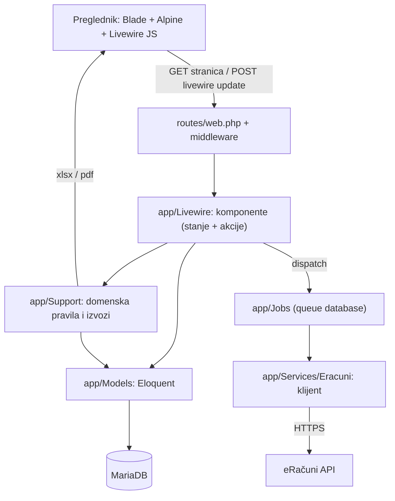
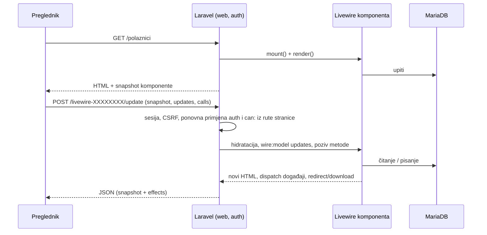

# Arhitektura

**Izvor istine:** `bootstrap/app.php`, `routes/web.php`, `routes/console.php`, `config/features.php`, `config/livewire.php`, `app/Providers/AppServiceProvider.php`, `composer.json`, `package.json`, `resources/js/app.js`
**Stanje:** `feature/clanarine` @ 87307b0, 2026-10-20

## Stog

| Sloj | Tehnologija | Napomena |
|---|---|---|
| Jezik / okvir | PHP ^8.3 (`ext-intl` obavezan), Laravel ^13.17 | `composer.json` |
| UI | Livewire ^4.4 (class komponente), Blade, Alpine (dolazi s Livewireom), Tailwind v4, Vite 8 | `package.json` |
| Baza | MariaDB (produkcija), SQLite `:memory:` (testovi) | vidi [02-baza-podataka.md](02-baza-podataka.md) |
| Izvozi | DomPDF ^3.1 (PDF izvještaj djeteta), OpenSpout ^5.3 (xlsx) | `app/Support/*Export.php`, `ChildReport.php` |
| Red poslova | driver `database` | `config/queue.php`, vidi [06-eracuni.md](06-eracuni.md) |
| Hosting | cPanel dijeljeni hosting bez terminala | vidi [10-deploy-i-operacije.md](10-deploy-i-operacije.md) |

Nema API-ja za treće strane ni SPA-a: sve je renderirano na poslužitelju, a interaktivnost ide kroz Livewire zahtjeve (vidi [03-http-i-livewire.md](03-http-i-livewire.md)).

## Slojevi

- **Livewire komponente** drže stanje ekrana i sve akcije (gumbi). Nema zasebnog sloja kontrolera osim `DeclarationController` (preuzimanje izjave) i `logout` rute u `routes/web.php`.
- **`app/Support`** su čiste domenske klase bez stanja (uzrast, liječnički, sezona, novac, alokacija uplata, izvozi). Detalji u [05-domena-i-servisi.md](05-domena-i-servisi.md).
- **`app/Services/Eracuni`** je jedini kod koji priča s vanjskim sustavom.
- **Modeli** nose relacije i *izvedene* atribute (npr. `Student::training_slots`). Mnoge vrijednosti se računaju, ne spremaju (ADR [0003](../decisions/0003-izracunato-ne-spremljeno.md)).

## Životni ciklus zahtjeva

Točni oblik zahtjeva i odgovora, URL endpointa i tablica događaja nalaze se u [03-http-i-livewire.md](03-http-i-livewire.md).

## Feature flag „Članarine"

`config/features.php` čita `FEATURE_PAYMENTS` (zadano `false`). Kad je isključen:

- rute `/clanarine/*` se ne registriraju (`routes/web.php`),
- navigacija i ekrani Članarina se ne prikazuju,
- aplikacija se ponaša kao prije modula.

Tablice Članarina **postoje u bazi i kad je flag isključen** (migracije se uvijek izvode). Odluka: ADR [0005](../decisions/0005-feature-flag-clanarine.md).

## Mapa direktorija

| Putanja | Sadržaj |
|---|---|
| `app/Livewire` | 15 komponenti (jedna po ekranu/dijelu ekrana), `Auth/Login` |
| `app/Models` | 20 Eloquent modela |
| `app/Enums` | `Belt`, `ChargeStatus`, `Discipline`, `FeePlanType`, `Medal`, `NextGradeStatus`, `Role` |
| `app/Support` | domenska logika, izvozi, audit |
| `app/Services/Eracuni` | klijent (sučelje, HTTP, mock), logger, matcher partnera |
| `app/Jobs` | `FetchEracuniPartnersJob`, `CreateEracuniPartnerJob` |
| `app/Console/Commands` | `GenerateChargesCommand` (`clanarine:zaduzi`) |
| `app/Rules` | `Oib` |
| `app/Providers` | `AppServiceProvider` (gateovi `manage-payments`, `manage-fee-plans`, `assign-fee-plan`) |
| `config` | uz standardne: `features.php`, `optimist.php`, `eracuni.php` |
| `database/migrations`, `database/seeders` | shema i početni podaci |
| `resources/views/livewire` | Blade po komponenti; `components/`, `partials/pwa.blade.php`, `pdf/child-report.blade.php` |
| `resources/css`, `resources/js` | Tailwind tokeni i Alpine/PWA kod; build ide u `public/build` |
| `public` | `index.php`, `manifest.json`, `sw.js`, `offline.html`, `icons`, `build` |
| `tests` | `Feature`, `Unit`, `Fakes/FakeEracuniClient.php` |
| `docs` | `tehnicka` (ovo), `decisions` (ADR), `upute` (za trenere), `sql` (skripte za phpMyAdmin), `deploy-*` |

## Raspored (scheduler)

`routes/console.php` registrira `clanarine:zaduzi` svakog 1. u mjesecu u 06:00. **Na produkciji nema cron zadatka koji bi pokretao `schedule:run`**, pa se to ne izvršava samo od sebe; vidi [11-poznata-ogranicenja.md](11-poznata-ogranicenja.md) i [10-deploy-i-operacije.md](10-deploy-i-operacije.md).

## Od pokretanja do odgovora

1. Poslužitelj poziva `public/index.php` (na produkciji kopija s prilagođenim `$base`).
2. `bootstrap/app.php` registrira rute (`web`, `console`, zdravlje `/up`). Nema prilagođenih globalnih middlewarea.
3. `AppServiceProvider` definira gateove.
4. Ruta (`routes/web.php`) → `guest`/`auth` grupa → Livewire komponenta kao puna stranica.
