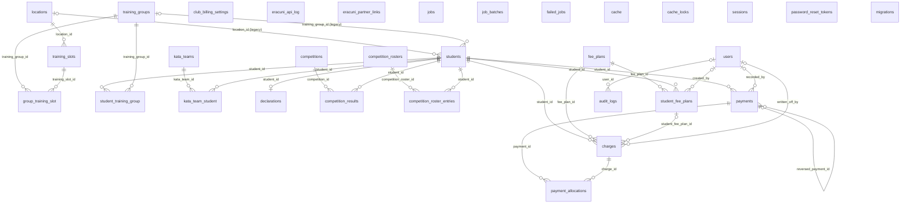
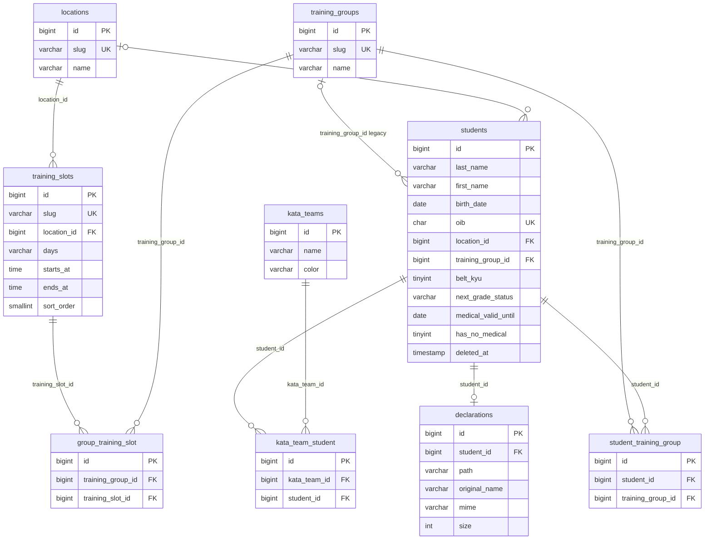
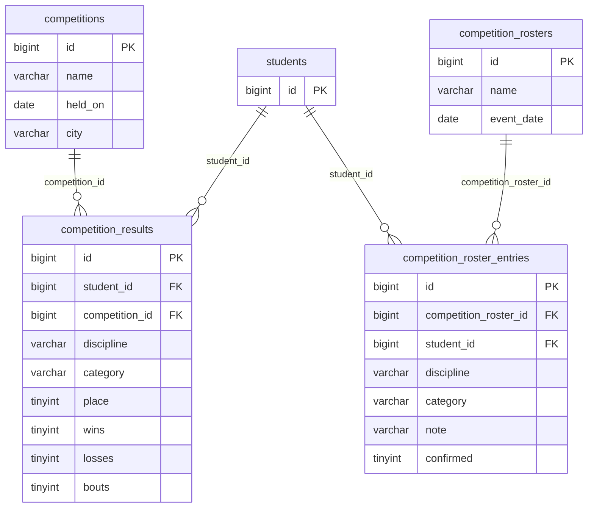
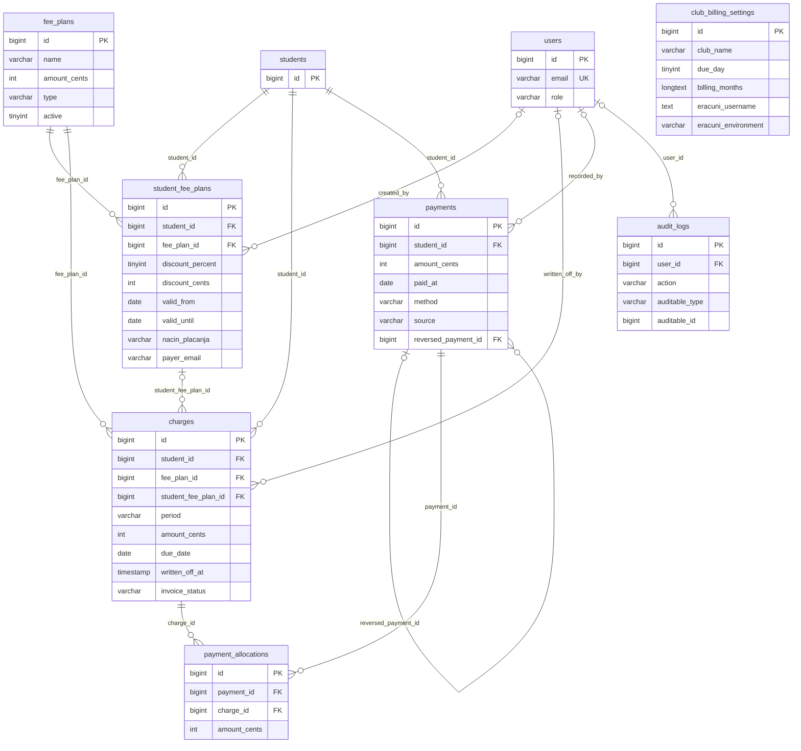

# Baza podataka

**Izvor istine:** `database/migrations/*.php` (29 migracija), `app/Models/*.php`, `app/Enums/*.php`, `database/seeders/*.php`, `docs/sql/*.sql`, `config/database.php`, `phpunit.xml`; živa lokalna baza `optimist` (samo metapodaci: `SHOW CREATE TABLE`, `information_schema`).
**Stanje:** feature/clanarine @ 87307b0, 2026-10-20

Ovaj dokument je referenca i objašnjenje sheme: dijagrami odnosa, rječnik podataka za svih 31 tablicu, pravila koja vrijede u bazi i ona koja vrijede samo u aplikaciji, seederi, ručne SQL skripte i razlike između lokalnog i produkcijskog okruženja. Za kod koji piše u ove tablice vidi [05-domena-i-servisi.md](05-domena-i-servisi.md) i [06-eracuni.md](06-eracuni.md); za konfiguraciju spajanja vidi [08-konfiguracija.md](08-konfiguracija.md).

## Pregled i načela

- **Mehanizam:** MariaDB, charset `utf8mb4`, collation `utf8mb4_unicode_ci`, engine InnoDB (`config/database.php`, spojnica `mariadb`; zadane vrijednosti `DB_CHARSET`/`DB_COLLATION` su iste). Testovi rade na SQLite u memoriji (`phpunit.xml`: `DB_CONNECTION=sqlite`, `DB_DATABASE=:memory:`), pa migracije moraju raditi na oba mehanizma.
- **Prenosive migracije:** koriste samo Laravelov Schema builder, a jedini sirovi SQL su upiti koji rade i na SQLite-u i na MariaDB-u (korelirani podupit u `2026_10_18_100002_add_invoicing_to_charges_table.php`, `insert … select` u `2026_10_20_100001_create_student_training_group_table.php`). Razlike u ponašanju ipak postoje (npr. `json` stupac je na MariaDB-u `longtext` s `json_valid` CHECK-om, na SQLite-u običan tekst).
- **Pravilo „samo dodavanje” (add-only):** stupci i tablice se dodaju, ništa se ne uklanja iz postojećih tablica. Primjer: `students.training_group_id` ostaje iako ga zamjenjuje pivot `student_training_group` (komentar u migraciji `2026_10_20_100001`). Ručne SQL skripte u `docs/sql` isto naglašavaju „samo dodavanje”.
- **Novac** je uvijek cijeli broj centi (`*_cents`, tip `int`), nikad `float`/`decimal`; formatira i parsira ga `App\Support\Money` ([05-domena-i-servisi.md](05-domena-i-servisi.md)). Valuta je EUR (`club_billing_settings.currency`).
- **Soft delete** postoji samo na `students` (`deleted_at`, trait `SoftDeletes` u `app/Models/Student.php:31`). Svi ostali podaci se brišu stvarno ili se uopće ne brišu (zaduženja, uplate, audit).
- **Vremenske oznake:** `timestamp NULL` (Laravel `timestamps()`); `audit_logs` i `eracuni_api_log` imaju samo `created_at` (append-only).
- **Polimorfno bez FK-a:** samo `audit_logs.auditable_type/auditable_id`.

## ER dijagrami

### Pregled svih tablica

Dijagram prikazuje sve veze stranih ključeva iz žive baze (31 tablica). Tablice bez veza na ostale navedene su na dnu. Stupci su izostavljeni; vidi dijagrame po modulima i rječnik podataka.

Bez veza stranih ključeva (ostaju samostalne): `club_billing_settings`, `eracuni_api_log`, `eracuni_partner_links`, `jobs`, `job_batches`, `failed_jobs`, `cache`, `cache_locks`, `sessions` (stupac `user_id` nije FK), `password_reset_tokens`, `migrations`. Veza `eracuni_partner_links.payer_email` ↔ `student_fee_plans.payer_email` postoji samo logički (po e-mailu), ne u bazi.

### Jezgra polaznika

### Natjecanja

`competition_rosters` / `competition_roster_entries` (popisi za natjecanje) su odvojeni od `competitions` / `competition_results` (održana natjecanja i rezultati); među njima nema veze u bazi.

### Članarine

`club_billing_settings` nema stranih ključeva (jedan redak postavki kluba).

### eRačuni i infrastruktura

```mermaid
erDiagram
    eracuni_api_log {
        bigint id PK
        varchar method
        tinyint ok
        smallint http_status
        longtext request
        text response
        text error
        int duration_ms
    }
    eracuni_partner_links {
        bigint id PK
        varchar payer_email UK
        varchar eracuni_partner_id
        timestamp confirmed_at
    }
    jobs {
        bigint id PK
        varchar queue
        longtext payload
        smallint attempts
        int available_at
    }
    job_batches {
        varchar id PK
        varchar name
    }
    failed_jobs {
        bigint id PK
        varchar uuid UK
        longtext exception
    }
    cache {
        varchar key PK
        mediumtext value
        bigint expiration
    }
    cache_locks {
        varchar key PK
        varchar owner
        bigint expiration
    }
    sessions {
        varchar id PK
        bigint user_id
        longtext payload
    }
    password_reset_tokens {
        varchar email PK
        varchar token
    }
    migrations {
        int id PK
        varchar migration
        int batch
    }
```

Nijedna od ovih tablica nema FK prema drugima. `sessions.user_id` je samo indeksiran stupac.

## Rječnik podataka

Tablice su poredane abecedno; stupci su u redoslijedu iz baze. Tip i „Null” preuzeti su iz `information_schema` lokalne baze, a „Zadano” iz `column_default`. Stupac „Napomena” razlikuje pravilo u bazi od pravila koje provodi samo aplikacija. Redci podataka nisu korišteni.

### `audit_logs`

Dopisni (append-only) revizijski trag: tko je, kada i s koje IP adrese napravio novčanu operaciju ili promjenu referentnih podataka u modulu Članarine. Piše ga isključivo `App\Support\Auditer::log()` (`app/Support/Auditer.php:22`); model `AuditLog` nema `updated_at` (`app/Models/AuditLog.php:17`). Aplikacija nikad ne mijenja niti briše retke.

| Stupac | Tip | Null | Zadano | Napomena |
| --- | --- | --- | --- | --- |
| `id` | bigint(20) unsigned | ne | auto_increment | PK |
| `user_id` | bigint(20) unsigned | da | NULL | `Auth::id()`; NULL kad piše konzolna naredba (`clanarine:zaduzi`) |
| `action` | varchar(255) | ne | — | npr. `payment.recorded`, `payment.reversed`, `charge.written_off`, `fee_plan.created`, `eracuni.partner_linked` |
| `auditable_type` | varchar(255) | da | NULL | puno ime klase modela (npr. `App\Models\Payment`); polimorfno bez FK-a |
| `auditable_id` | bigint(20) unsigned | da | NULL | id retka; bez FK-a (polimorfno) |
| `old_values` | longtext | da | NULL | JSON (`longtext` s `json_valid` CHECK-om u MariaDB-u) |
| `new_values` | longtext | da | NULL | JSON; za postavke naplate bez vjerodajnica |
| `ip` | varchar(45) | da | NULL | `Request::ip()`; NULL kad se piše iz konzole |
| `created_at` | timestamp | da | NULL | — |

**Indeksi i unique ključevi**

- PRIMARY KEY (`id`)
- KEY `audit_logs_auditable_type_auditable_id_index` (`auditable_type,auditable_id`)
- KEY `audit_logs_user_id_index` (`user_id`)
- KEY `audit_logs_created_at_index` (`created_at`)

**Strani ključevi**

- `user_id` → `users.id`, ON DELETE SET NULL (`audit_logs_user_id_foreign`)

**Pravila (baza vs aplikacija)**

- **Baza:** FK `user_id` je `SET NULL` pa audit preživljava brisanje korisnika. Nema FK-a na `auditable_*`.
- **Aplikacija:** samo `Auditer::log` piše redove; nema `update`/`delete` koda nad `AuditLog`. Append-only nije zaštićen na razini baze (nema trigger-a).

### `cache`

Spremnik za `CACHE_STORE=database` (zadano u `config/cache.php:18`). Aplikacija ga koristi samo za snapshot popisa partnera iz eRačuna (ključ `eracuni.partners`, vidi [06-eracuni.md](06-eracuni.md)). U testovima je `CACHE_STORE=array`.

| Stupac | Tip | Null | Zadano | Napomena |
| --- | --- | --- | --- | --- |
| `key` | varchar(255) | ne | — | PK; ključ s prefiksom `CACHE_PREFIX` |
| `value` | mediumtext | ne | — | — |
| `expiration` | bigint(20) | ne | — | UNIX vrijeme isteka |

**Indeksi i unique ključevi**

- PRIMARY KEY (`key`)
- KEY `cache_expiration_index` (`expiration`)

**Strani ključevi**

- nema

**Pravila (baza vs aplikacija)**

- **Baza:** PK `key`. **Aplikacija:** jedini ključ koji kod postavlja je `eracuni.partners` (TTL 1 dan).

### `cache_locks`

Zaključavanja za database cache driver. `WithoutOverlapping('eracuni')` u poslovima za eRačune koristi ovu tablicu za ključ preklapanja.

| Stupac | Tip | Null | Zadano | Napomena |
| --- | --- | --- | --- | --- |
| `key` | varchar(255) | ne | — | — |
| `owner` | varchar(255) | ne | — | — |
| `expiration` | bigint(20) | ne | — | — |

**Indeksi i unique ključevi**

- PRIMARY KEY (`key`)
- KEY `cache_locks_expiration_index` (`expiration`)

**Strani ključevi**

- nema

**Pravila (baza vs aplikacija)**

- **Baza:** PK `key`. Piše ga framework, ne aplikacijski kod.

### `charges`

Zaduženje (obveza plaćanja) za dijete u jednom mjesecu `YYYY-MM` po tarifi. Iznos je snimka već umanjena za popust. Zaduženja se ne brišu; otpis je zapisan u `written_off_*`. Status zaduženja (plaćeno/kasni/…) nije stupac, računa se u `Charge::status()` iz alokacija i roka.

| Stupac | Tip | Null | Zadano | Napomena |
| --- | --- | --- | --- | --- |
| `id` | bigint(20) unsigned | ne | auto_increment | PK |
| `student_id` | bigint(20) unsigned | ne | — | bez ON DELETE CASCADE: djeca se soft-brišu, a zapis ostaje |
| `fee_plan_id` | bigint(20) unsigned | ne | — | — |
| `student_fee_plan_id` | bigint(20) unsigned | da | NULL | NULL = ručno dodano zaduženje (`StudentCharges::addCharge`) |
| `nacin_placanja` | varchar(12) | da | NULL | kopija s dodjele u trenutku zaduživanja (`ChargeGenerator`); ručna zaduženja ga ne postavljaju |
| `period` | varchar(7) | ne | — | `YYYY-MM`; format provjerava samo aplikacija (regex) |
| `amount_cents` | int(11) | ne | — | već umanjeno za popust (snimka) |
| `due_date` | date | da | NULL | NULL kad `club_billing_settings.due_day` nije postavljen |
| `reference` | varchar(40) | da | NULL | interna oznaka `{student_id}-{YYYYMM}` (`BillingReference::for(..., null)`), ne poziv na broj s kontrolnom znamenkom |
| `written_off_at` | timestamp | da | NULL | otpis; ako nije NULL status je `WrittenOff` |
| `written_off_by` | bigint(20) unsigned | da | NULL | — |
| `written_off_reason` | varchar(255) | da | NULL | — |
| `eracuni_invoice_id` | varchar(255) | da | NULL | rezervirano za integraciju; nijedan kod ga ne piše |
| `eracuni_invoice_number` | varchar(255) | da | NULL | rezervirano; nijedan kod ga ne piše |
| `invoice_status` | varchar(10) | ne | `'none'` | komentar migracije: `none|queued|issued|failed`; NIJEDAN kod u `app/` ga ne piše, uvijek ostaje `none` |
| `last_sent_at` | timestamp | da | NULL | rezervirano; nijedan kod ga ne piše |
| `created_at` | timestamp | da | NULL | — |
| `updated_at` | timestamp | da | NULL | — |

**Indeksi i unique ključevi**

- PRIMARY KEY (`id`)
- UNIQUE `charges_student_id_fee_plan_id_period_unique` (`student_id,fee_plan_id,period`)
- KEY `charges_fee_plan_id_foreign` (`fee_plan_id`)
- KEY `charges_student_fee_plan_id_foreign` (`student_fee_plan_id`)
- KEY `charges_written_off_by_foreign` (`written_off_by`)
- KEY `charges_period_index` (`period`)

**Strani ključevi**

- `fee_plan_id` → `fee_plans.id`, ON DELETE RESTRICT (zadano, bez ON DELETE) (`charges_fee_plan_id_foreign`)
- `student_fee_plan_id` → `student_fee_plans.id`, ON DELETE SET NULL (`charges_student_fee_plan_id_foreign`)
- `student_id` → `students.id`, ON DELETE RESTRICT (zadano, bez ON DELETE) (`charges_student_id_foreign`)
- `written_off_by` → `users.id`, ON DELETE SET NULL (`charges_written_off_by_foreign`)

**Pravila (baza vs aplikacija)**

- **Baza:** UNIQUE (`student_id`, `fee_plan_id`, `period`) sprječava duplo zaduženje iste tarife za isti mjesec; sve FK-ove ne brišu kaskadno (`student_id`, `fee_plan_id` su RESTRICT).
- **Aplikacija:** status se računa (`Charge::status`), ne sprema; zaduženje se ne briše; `invoice_status` je u bazi `NOT NULL DEFAULT 'none'` i nitko ga ne mijenja; `period` i `amount_cents` u ručnom zaduženju validiraju se regexom.

### `club_billing_settings`

Postavke naplate kluba: podaci primatelja, rok plaćanja, mjeseci naplate i pristupni podaci za eRačune. Predviđen je točno jedan redak (`ClubBillingSettings::current()` vraća prvi redak, `app/Models/ClubBillingSettings.php:36`). Pristupni podaci su šifrirani cast-om `encrypted` (AES preko `APP_KEY`).

| Stupac | Tip | Null | Zadano | Napomena |
| --- | --- | --- | --- | --- |
| `id` | bigint(20) unsigned | ne | auto_increment | PK |
| `club_name` | varchar(255) | da | NULL | naziv primatelja (klub) |
| `address` | varchar(255) | da | NULL | — |
| `iban` | varchar(34) | da | NULL | HUB-3 polje; dio „HUB (nekorišteno)” u obrascu jer je uplatnica otkazana |
| `model` | varchar(7) | da | NULL | model poziva na broj (npr. HR00); nekorišteno u generiranju |
| `reference_rule` | varchar(100) | da | NULL | HUB-3 polje, nekorišteno |
| `purpose_code` | varchar(4) | da | NULL | HUB-3 polje, nekorišteno |
| `due_day` | tinyint(3) unsigned | da | NULL | dan u mjesecu (1–31 u aplikaciji); `ChargeGenerator` ga ograničava na broj dana u mjesecu |
| `billing_months` | longtext | da | NULL | JSON niz mjeseci (1–12), npr. `[9,10,…,6]`; NULL/prazno = naplaćuje se svaki mjesec |
| `currency` | char(3) | ne | `'EUR'` | zadano `EUR`; aplikacija ga ne mijenja |
| `note` | varchar(255) | da | NULL | — |
| `created_at` | timestamp | da | NULL | — |
| `updated_at` | timestamp | da | NULL | — |
| `invoice_line_template` | text | da | NULL | predložak stavke računa; spremljen, ali nikad korišten u kodu |
| `reminder_days_after_due` | smallint(5) unsigned | da | NULL | dana nakon roka (0–365 u aplikaciji); spremljen, ali nikad korišten (podsjetnici nisu implementirani) |
| `eracuni_username` | text | da | NULL | šifrirano (`encrypted`), pa je stupac `text`; tajna |
| `eracuni_secret_key` | text | da | NULL | šifrirano (`encrypted`); tajna |
| `eracuni_token` | text | da | NULL | šifrirano (`encrypted`); tajna |
| `eracuni_endpoint` | text | da | NULL | šifrirano (`encrypted`); `HttpEracuniClient` traži `https://` |
| `eracuni_environment` | varchar(12) | da | NULL | `test` ili `production`; samo aplikacijsko pravilo (`Rule::in`); `isProduction()` se ne koristi za odluke |

**Indeksi i unique ključevi**

- PRIMARY KEY (`id`)

**Strani ključevi**

- nema

**Pravila (baza vs aplikacija)**

- **Baza:** samo PK; broj redaka nije ograničen (jedan redak je konvencija).
- **Aplikacija:** `ClubBillingSettingsSeeder` radi `firstOrCreate([], …)`; `ClubBillingSettingsForm::save` ažurira prvi redak ili stvara novi; prazno polje vjerodajnice znači „bez promjene”; audit ne sadrži vjerodajnice.

### `competition_results`

Rezultat jednog djeteta na jednom natjecanju u jednoj disciplini (plasman, borbe). Medalja se ne sprema, računa se iz `place` (`Medal::fromPlace`).

| Stupac | Tip | Null | Zadano | Napomena |
| --- | --- | --- | --- | --- |
| `id` | bigint(20) unsigned | ne | auto_increment | PK |
| `student_id` | bigint(20) unsigned | ne | — | — |
| `competition_id` | bigint(20) unsigned | ne | — | — |
| `discipline` | varchar(10) | ne | — | `Discipline`: `kate`, `kumite`, `kata_team`; bez CHECK-a u bazi |
| `category` | varchar(60) | da | NULL | slobodan tekst, npr. „U12 -40kg” |
| `place` | tinyint(4) | da | NULL | plasman; aplikacija dopušta 1–99; medalja se računa (1 zlato, 2 srebro, 3 bronca) |
| `wins` | tinyint(4) | da | NULL | aplikacija dopušta 0–127 (granica `tinyint`) |
| `losses` | tinyint(4) | da | NULL | aplikacija dopušta 0–127 |
| `bouts` | tinyint(4) | da | NULL | ako je NULL, `ChildReport` računa `wins + losses` |
| `note` | varchar(255) | da | NULL | — |
| `created_at` | timestamp | da | NULL | — |
| `updated_at` | timestamp | da | NULL | — |

**Indeksi i unique ključevi**

- PRIMARY KEY (`id`)
- KEY `competition_results_student_id_index` (`student_id`)
- KEY `competition_results_competition_id_index` (`competition_id`)

**Strani ključevi**

- `competition_id` → `competitions.id`, ON DELETE CASCADE (`competition_results_competition_id_foreign`)
- `student_id` → `students.id`, ON DELETE CASCADE (`competition_results_student_id_foreign`)

**Pravila (baza vs aplikacija)**

- **Baza:** FK-ovi `CASCADE` na `students` i `competitions`; indeksi na `student_id` i `competition_id`.
- **Aplikacija:** `discipline` mora biti `Discipline` (`Rule::enum`); `place` 1–99, `wins`/`losses`/`bouts` 0–127.

### `competition_roster_entries`

Prijava jednog djeteta (i discipline) na popis za natjecanje (`competition_rosters`). Jedno dijete može imati više redaka na istom popisu, po jedan po disciplini.

| Stupac | Tip | Null | Zadano | Napomena |
| --- | --- | --- | --- | --- |
| `id` | bigint(20) unsigned | ne | auto_increment | PK |
| `competition_roster_id` | bigint(20) unsigned | ne | — | indeks `roster_entries_roster_student_index` je namjerno običan (ne unique), vidi pravila |
| `student_id` | bigint(20) unsigned | ne | — | — |
| `discipline` | varchar(10) | da | NULL | `Discipline` ili NULL (još nije odabrano) |
| `category` | varchar(60) | da | NULL | — |
| `note` | varchar(255) | da | NULL | — |
| `confirmed` | tinyint(1) | ne | `0` | izvoz s kvačicom „Samo potvrđeni” uzima samo `confirmed = 1` |
| `created_at` | timestamp | da | NULL | — |
| `updated_at` | timestamp | da | NULL | — |

**Indeksi i unique ključevi**

- PRIMARY KEY (`id`)
- KEY `competition_roster_entries_student_id_foreign` (`student_id`)
- KEY `roster_entries_roster_student_index` (`competition_roster_id,student_id`)

**Strani ključevi**

- `competition_roster_id` → `competition_rosters.id`, ON DELETE CASCADE (`competition_roster_entries_competition_roster_id_foreign`)
- `student_id` → `students.id`, ON DELETE CASCADE (`competition_roster_entries_student_id_foreign`)

**Pravila (baza vs aplikacija)**

- **Baza:** FK-ovi `CASCADE` na `competition_rosters` i `students`; složeni indeks (`competition_roster_id`, `student_id`) NIJE unique namjerno (komentar u migraciji: NULL discipline su u MariaDB-u/sqlite-u međusobno različiti).
- **Aplikacija:** jedinstvenost (popis, dijete, disciplina) provjerava `CompetitionRosterShow` upitom `exists()` (`app/Livewire/CompetitionRosterShow.php:139`, `:221`). Soft-obrisano dijete: `student()` vraća null i pozivatelji moraju filtrirati (`CompetitionRosterEntry.php:28`).

### `competition_rosters`

Slobodni popis za natjecanje („Open Zadar 2026”) s neobaveznim datumom događaja. Odvojen je od `competitions`/`competition_results` (model `CompetitionRoster` u `app/Models/CompetitionRoster.php:11`).

| Stupac | Tip | Null | Zadano | Napomena |
| --- | --- | --- | --- | --- |
| `id` | bigint(20) unsigned | ne | auto_increment | PK |
| `name` | varchar(120) | ne | — | — |
| `event_date` | date | da | NULL | neobavezno; ako postoji, uzrasna kategorija u izvozu računa se na taj dan (`CompetitionRosterShow::asOf`) |
| `created_at` | timestamp | da | NULL | — |
| `updated_at` | timestamp | da | NULL | — |

**Indeksi i unique ključevi**

- PRIMARY KEY (`id`)

**Strani ključevi**

- nema

**Pravila (baza vs aplikacija)**

- **Baza:** samo PK. **Aplikacija:** `name` obavezno, max 120; `event_date` neobavezan.

### `competitions`

Natjecanje koje je održano (naziv, datum, grad). Na njega se vežu rezultati djece u `competition_results`.

| Stupac | Tip | Null | Zadano | Napomena |
| --- | --- | --- | --- | --- |
| `id` | bigint(20) unsigned | ne | auto_increment | PK |
| `name` | varchar(255) | ne | — | — |
| `held_on` | date | ne | — | cast `immutable_date`; određuje u koju sezonu rezultat pada (`Season::contains`) |
| `city` | varchar(100) | da | NULL | — |
| `created_at` | timestamp | da | NULL | — |
| `updated_at` | timestamp | da | NULL | — |

**Indeksi i unique ključevi**

- PRIMARY KEY (`id`)
- KEY `competitions_held_on_index` (`held_on`)

**Strani ključevi**

- nema

**Pravila (baza vs aplikacija)**

- **Baza:** indeks na `held_on`. **Aplikacija:** `name` max 255, `held_on` obavezno, `city` max 100.

### `declarations`

Metapodaci o potpisanoj izjavi roditelja (jedna po djetetu). Sama datoteka nije u bazi: pohranjena je šifrirana na privatnom disku `storage/app/private/izjave/<uuid>` (`app/Support/DeclarationStorage.php:17`).

| Stupac | Tip | Null | Zadano | Napomena |
| --- | --- | --- | --- | --- |
| `id` | bigint(20) unsigned | ne | auto_increment | PK |
| `student_id` | bigint(20) unsigned | ne | — | unique: najviše jedna izjava po djetetu |
| `path` | varchar(255) | ne | — | relativna putanja `izjave/<uuid>` na disku `local` (`storage/app/private`); sadržaj je šifriran `Crypt::encryptString` |
| `original_name` | varchar(255) | ne | — | — |
| `mime` | varchar(100) | ne | — | iz `UploadedFile::getMimeType()`; aplikacija prima samo pdf/jpg/jpeg/png do 10 MB |
| `size` | int(10) unsigned | ne | — | bajtovi izvorne datoteke (prije šifriranja) |
| `created_at` | timestamp | da | NULL | — |
| `updated_at` | timestamp | da | NULL | — |

**Indeksi i unique ključevi**

- PRIMARY KEY (`id`)
- UNIQUE `declarations_student_id_unique` (`student_id`)

**Strani ključevi**

- `student_id` → `students.id`, ON DELETE CASCADE (`declarations_student_id_foreign`)

**Pravila (baza vs aplikacija)**

- **Baza:** UNIQUE `student_id` i FK `CASCADE`. Soft delete djeteta NE okida kaskadu (redak ostaje).
- **Aplikacija:** zamjena izjave briše staru šifriranu datoteku (`StudentDeclaration.php:56`); čitanje samo preko autentificirane rute `/izjava/{student}` (`DeclarationController`).

### `eracuni_api_log`

Append-only zapisnik svih poziva prema eRačunima (pravih i mock), bez pristupnih podataka. Piše ga `App\Services\Eracuni\EracuniApiLogger`. Model `EracuniApiLog` mapira ime tablice `eracuni_api_log` (jednina) eksplicitno (`app/Models/EracuniApiLog.php:17`).

| Stupac | Tip | Null | Zadano | Napomena |
| --- | --- | --- | --- | --- |
| `id` | bigint(20) unsigned | ne | auto_increment | PK |
| `method` | varchar(60) | ne | — | naziv API metode, npr. `PartnerList` |
| `ok` | tinyint(1) | ne | `0` | 1 = poziv uspio |
| `http_status` | smallint(5) unsigned | da | NULL | NIKAD se ne piše: `EracuniApiLogger::write` ga ne prima |
| `request` | longtext | da | NULL | JSON omotača bez `username`, `secretKey`, `secret_key`, `token`, `md5pass`, `password` (samo gornja razina) |
| `response` | text | da | NULL | JSON odgovora skraćen na 2000 znakova |
| `error` | text | da | NULL | poruka iznimke kad je `ok = 0` |
| `duration_ms` | int(10) unsigned | da | NULL | trajanje poziva u ms |
| `created_at` | timestamp | da | NULL | — |

**Indeksi i unique ključevi**

- PRIMARY KEY (`id`)
- KEY `eracuni_api_log_method_index` (`method`)
- KEY `eracuni_api_log_created_at_index` (`created_at`)

**Strani ključevi**

- nema

**Pravila (baza vs aplikacija)**

- **Baza:** indeksi na `method` i `created_at`; JSON CHECK na `request`.
- **Aplikacija:** append-only (`UPDATED_AT = null`); redakcija samo gornje razine ključeva; `http_status` se ne postavlja.

### `eracuni_partner_links`

Veza platitelja (roditelja, prepoznatog po e-mailu) s partnerom u eRačunima. Jedna veza po e-mailu. Veza nastaje samo nakon potvrde administratora ili uspjelog posla `CreateEracuniPartnerJob`.

| Stupac | Tip | Null | Zadano | Napomena |
| --- | --- | --- | --- | --- |
| `id` | bigint(20) unsigned | ne | auto_increment | PK |
| `payer_email` | varchar(255) | ne | — | unique: jedna veza po e-mailu |
| `payer_name` | varchar(255) | da | NULL | — |
| `oib` | varchar(20) | da | NULL | OIB roditelja se zasad ne puni (komentar u migraciji) |
| `eracuni_partner_id` | varchar(255) | ne | — | id partnera u eRačunima (string) |
| `eracuni_partner_name` | varchar(255) | da | NULL | — |
| `linked_by` | varchar(255) | da | NULL | ime korisnika koji je potvrdio vezu (ne FK) |
| `confirmed_at` | timestamp | da | NULL | trenutak potvrde ili uspjeha posla |
| `created_at` | timestamp | da | NULL | — |
| `updated_at` | timestamp | da | NULL | — |

**Indeksi i unique ključevi**

- PRIMARY KEY (`id`)
- UNIQUE `eracuni_partner_links_payer_email_unique` (`payer_email`)

**Strani ključevi**

- nema

**Pravila (baza vs aplikacija)**

- **Baza:** UNIQUE `payer_email`.
- **Aplikacija:** `updateOrCreate` po `payer_email` u `EracuniPartnerLinks::link` i u `CreateEracuniPartnerJob`; `unlink` stvarno briše redak (uz audit).

### `failed_jobs`

Poslovi iz reda koji su iscrpili sve pokušaje (`QUEUE_FAILED_DRIVER=database-uuids`, `config/queue.php:124`). Standardna Laravel tablica.

| Stupac | Tip | Null | Zadano | Napomena |
| --- | --- | --- | --- | --- |
| `id` | bigint(20) unsigned | ne | auto_increment | PK |
| `uuid` | varchar(255) | ne | — | unique |
| `connection` | varchar(255) | ne | — | — |
| `queue` | varchar(255) | ne | — | — |
| `payload` | longtext | ne | — | — |
| `exception` | longtext | ne | — | — |
| `failed_at` | timestamp | ne | `current_timestamp()` | zadano `current_timestamp()` |

**Indeksi i unique ključevi**

- PRIMARY KEY (`id`)
- UNIQUE `failed_jobs_uuid_unique` (`uuid`)
- KEY `failed_jobs_connection_queue_failed_at_index` (`connection,queue,failed_at`)

**Strani ključevi**

- nema

**Pravila (baza vs aplikacija)**

- **Baza:** UNIQUE `uuid`. Piše ga framework nakon posljednjeg neuspjelog pokušaja.

### `fee_plans`

Tarife članarine (naziv, iznos u centima, tip monthly/yearly/one_time, aktivna). Referentni podaci kojima upravlja samo administrator.

| Stupac | Tip | Null | Zadano | Napomena |
| --- | --- | --- | --- | --- |
| `id` | bigint(20) unsigned | ne | auto_increment | PK |
| `name` | varchar(255) | ne | — | — |
| `amount_cents` | int(11) | ne | — | iznos u centima (cijeli broj) |
| `type` | varchar(10) | ne | — | `FeePlanType`: `monthly`, `yearly`, `one_time`; bez CHECK-a u bazi |
| `active` | tinyint(1) | ne | `1` | deaktivacija umjesto brisanja |
| `created_at` | timestamp | da | NULL | — |
| `updated_at` | timestamp | da | NULL | — |

**Indeksi i unique ključevi**

- PRIMARY KEY (`id`)

**Strani ključevi**

- nema

**Pravila (baza vs aplikacija)**

- **Baza:** nema unique na `name`; FK-ovi iz `student_fee_plans` i `charges` su RESTRICT.
- **Aplikacija:** brisanje tarife blokira samo broj dodjela (`student_fee_plans_count > 0`, `FeePlansList.php:148`); zaduženja se NE broje, pa tarifa bez dodjela a sa zaduženjima uspije proći provjeru aplikacije, a padne na FK `charges_fee_plan_id_foreign` (SQL greška). `FeePlansSeeder` je idempotentan po `name`.

### `group_training_slot`

Pivot: koje grupe treniraju u kojem terminu. Termini djeteta izvode se iz njegovih grupa preko ove veze.

| Stupac | Tip | Null | Zadano | Napomena |
| --- | --- | --- | --- | --- |
| `id` | bigint(20) unsigned | ne | auto_increment | PK |
| `training_group_id` | bigint(20) unsigned | ne | — | — |
| `training_slot_id` | bigint(20) unsigned | ne | — | — |

**Indeksi i unique ključevi**

- PRIMARY KEY (`id`)
- UNIQUE `group_training_slot_training_group_id_training_slot_id_unique` (`training_group_id,training_slot_id`)
- KEY `group_training_slot_training_slot_id_foreign` (`training_slot_id`)

**Strani ključevi**

- `training_group_id` → `training_groups.id`, ON DELETE CASCADE (`group_training_slot_training_group_id_foreign`)
- `training_slot_id` → `training_slots.id`, ON DELETE CASCADE (`group_training_slot_training_slot_id_foreign`)

**Pravila (baza vs aplikacija)**

- **Baza:** UNIQUE (`training_group_id`, `training_slot_id`); oba FK-a `CASCADE`. **Aplikacija:** puni ga `ReferenceSeeder` preko `sync`.

### `job_batches`

Standardna Laravel tablica za serije poslova (batching). Aplikacija ne koristi `Bus::batch`, tablica je prisutna iz zadanog skeleta migracije `0001_01_01_000002`.

| Stupac | Tip | Null | Zadano | Napomena |
| --- | --- | --- | --- | --- |
| `id` | varchar(255) | ne | — | — |
| `name` | varchar(255) | ne | — | — |
| `total_jobs` | int(11) | ne | — | — |
| `pending_jobs` | int(11) | ne | — | — |
| `failed_jobs` | int(11) | ne | — | — |
| `failed_job_ids` | longtext | ne | — | — |
| `options` | mediumtext | da | NULL | — |
| `cancelled_at` | int(11) | da | NULL | — |
| `created_at` | int(11) | ne | — | — |
| `finished_at` | int(11) | da | NULL | — |

**Indeksi i unique ključevi**

- PRIMARY KEY (`id`)

**Strani ključevi**

- nema

**Pravila (baza vs aplikacija)**

- Aplikacija ne piše u tablicu.

### `jobs`

Red čekanja za `QUEUE_CONNECTION=database`. Trenutno ga pune `FetchEracuniPartnersJob` i `CreateEracuniPartnerJob`. Za obradu je potreban `queue:work` (vidi [06-eracuni.md](06-eracuni.md), odlomak o redu poslova).

| Stupac | Tip | Null | Zadano | Napomena |
| --- | --- | --- | --- | --- |
| `id` | bigint(20) unsigned | ne | auto_increment | PK |
| `queue` | varchar(255) | ne | — | naziv reda (`default`) |
| `payload` | longtext | ne | — | serijalizirani posao |
| `attempts` | smallint(5) unsigned | ne | — | — |
| `reserved_at` | int(10) unsigned | da | NULL | UNIX vrijeme rezervacije |
| `available_at` | int(10) unsigned | ne | — | UNIX vrijeme kad posao postaje dostupan |
| `created_at` | int(10) unsigned | ne | — | — |

**Indeksi i unique ključevi**

- PRIMARY KEY (`id`)
- KEY `jobs_queue_index` (`queue`)

**Strani ključevi**

- nema

**Pravila (baza vs aplikacija)**

- **Baza:** indeks `queue`. Pišu je `dispatch()` pozivi; briše je worker nakon uspjeha.

### `kata_team_student`

Pivot: članovi kata tima. Isti obrazac se koristi za `student_training_group`.

| Stupac | Tip | Null | Zadano | Napomena |
| --- | --- | --- | --- | --- |
| `id` | bigint(20) unsigned | ne | auto_increment | PK |
| `kata_team_id` | bigint(20) unsigned | ne | — | — |
| `student_id` | bigint(20) unsigned | ne | — | — |

**Indeksi i unique ključevi**

- PRIMARY KEY (`id`)
- UNIQUE `kata_team_student_kata_team_id_student_id_unique` (`kata_team_id,student_id`)
- KEY `kata_team_student_student_id_foreign` (`student_id`)

**Strani ključevi**

- `kata_team_id` → `kata_teams.id`, ON DELETE CASCADE (`kata_team_student_kata_team_id_foreign`)
- `student_id` → `students.id`, ON DELETE CASCADE (`kata_team_student_student_id_foreign`)

**Pravila (baza vs aplikacija)**

- **Baza:** UNIQUE (`kata_team_id`, `student_id`); oba FK-a `CASCADE`.
- **Aplikacija:** `StudentForm::save` radi `kataTeams()->sync()` (`app/Livewire/StudentForm.php:211`). Imena ključeva razlikuju se između migracije i `docs/sql/2026-10-11-kata-timovi.sql` (vidi razlike lokalno/produkcija).

### `kata_teams`

Kata tim (naziv, boja oznake `#RRGGBB`). Za izvoz je potrebno barem 3 člana (`KataTeamExport::MIN_MEMBERS`).

| Stupac | Tip | Null | Zadano | Napomena |
| --- | --- | --- | --- | --- |
| `id` | bigint(20) unsigned | ne | auto_increment | PK |
| `name` | varchar(60) | ne | — | max 60 samo u aplikaciji |
| `color` | varchar(7) | ne | `'#2D3E7B'` | `#RRGGBB`; format provjerava samo aplikacija (`regex:/^#[0-9A-Fa-f]{6}$/`) |
| `created_at` | timestamp | da | NULL | — |
| `updated_at` | timestamp | da | NULL | — |

**Indeksi i unique ključevi**

- PRIMARY KEY (`id`)

**Strani ključevi**

- nema

**Pravila (baza vs aplikacija)**

- **Baza:** samo PK. **Aplikacija:** `name` max 60, `color` regex `#RRGGBB`; brisanje tima kaskadira pivot, djeca ostaju.

### `locations`

Lokacije treninga (referentni podaci; piše ih `ReferenceSeeder`, nema ekrana za uređivanje).

| Stupac | Tip | Null | Zadano | Napomena |
| --- | --- | --- | --- | --- |
| `id` | bigint(20) unsigned | ne | auto_increment | PK |
| `slug` | varchar(255) | ne | — | unique; ključ za `updateOrCreate` u `ReferenceSeeder` |
| `name` | varchar(255) | ne | — | — |
| `created_at` | timestamp | da | NULL | — |
| `updated_at` | timestamp | da | NULL | — |

**Indeksi i unique ključevi**

- PRIMARY KEY (`id`)
- UNIQUE `locations_slug_unique` (`slug`)

**Strani ključevi**

- nema

**Pravila (baza vs aplikacija)**

- **Baza:** UNIQUE `slug`. **Aplikacija:** `ReferenceSeeder` briše lokacije koje nisu na popisu; `students.location_id` tada postaje NULL (`SET NULL`), a `training_slots` lokacije se brišu kaskadno.

### `migrations`

Laravelova evidencija pokrenutih migracija (naziv + batch). Stanje te tablice na produkciji nije poznato iz repozitorija jer se shema ondje mijenja ručno iz `docs/sql` (vidi odlomak o razlikama lokalno/produkcija).

| Stupac | Tip | Null | Zadano | Napomena |
| --- | --- | --- | --- | --- |
| `id` | int(10) unsigned | ne | auto_increment | PK |
| `migration` | varchar(255) | ne | — | — |
| `batch` | int(11) | ne | — | lokalno 1–7; vidi odlomak o migracijama |

**Indeksi i unique ključevi**

- PRIMARY KEY (`id`)

**Strani ključevi**

- nema

**Pravila (baza vs aplikacija)**

- Piše samo `artisan migrate`.

### `password_reset_tokens`

Standardna Laravel tablica za resetiranje lozinke. U kodu nema toka za reset lozinke (pretraga `Password::` i `password.reset` u `app/`, `routes/` i `resources/views/` nema pogodaka); tablica stoji iz zadane migracije `0001_01_01_000000`.

| Stupac | Tip | Null | Zadano | Napomena |
| --- | --- | --- | --- | --- |
| `email` | varchar(255) | ne | — | — |
| `token` | varchar(255) | ne | — | — |
| `created_at` | timestamp | da | NULL | — |

**Indeksi i unique ključevi**

- PRIMARY KEY (`email`)

**Strani ključevi**

- nema

**Pravila (baza vs aplikacija)**

- Aplikacija ne piše u tablicu.

### `payment_allocations`

Raspodjela uplate na zaduženja. Iznos je s predznakom: negativan za alokacije storno-uplate. Neto alociran iznos zaduženja = zbroj `amount_cents` po `charge_id`.

| Stupac | Tip | Null | Zadano | Napomena |
| --- | --- | --- | --- | --- |
| `id` | bigint(20) unsigned | ne | auto_increment | PK |
| `payment_id` | bigint(20) unsigned | ne | — | — |
| `charge_id` | bigint(20) unsigned | ne | — | — |
| `amount_cents` | int(11) | ne | — | s predznakom; storno stvara zrcalne negativne retke |
| `created_at` | timestamp | da | NULL | — |
| `updated_at` | timestamp | da | NULL | — |

**Indeksi i unique ključevi**

- PRIMARY KEY (`id`)
- KEY `payment_allocations_charge_id_index` (`charge_id`)
- KEY `payment_allocations_payment_id_index` (`payment_id`)

**Strani ključevi**

- `charge_id` → `charges.id`, ON DELETE RESTRICT (zadano, bez ON DELETE) (`payment_allocations_charge_id_foreign`)
- `payment_id` → `payments.id`, ON DELETE CASCADE (`payment_allocations_payment_id_foreign`)

**Pravila (baza vs aplikacija)**

- **Baza:** FK `payment_id` `CASCADE`, FK `charge_id` RESTRICT; indeksi na obje strane.
- **Aplikacija:** zbroj alokacija ne smije premašiti uplatu niti iznos zaduženja (`PaymentRecorder::record`); to se ne provjerava u bazi.

### `payments`

Uplata članarine. Iznos je s predznakom (negativan za storno). Uplate se ne brišu; ispravak je nova uplata koja pokazuje na staru preko `reversed_payment_id`.

| Stupac | Tip | Null | Zadano | Napomena |
| --- | --- | --- | --- | --- |
| `id` | bigint(20) unsigned | ne | auto_increment | PK |
| `student_id` | bigint(20) unsigned | ne | — | — |
| `amount_cents` | int(11) | ne | — | s predznakom: negativno za storno |
| `paid_at` | date | ne | — | datum uplate (`date`) |
| `method` | varchar(10) | ne | — | `bank`, `cash`, `other`; samo `Rule::in` u `StudentCharges::recordPayment` |
| `source` | varchar(12) | ne | `'manual'` | komentar migracije: `manual|bank_import|eracuni`; u praksi uvijek `manual` (hardkodirano u `StudentCharges.php:166`), storno kopira izvornik |
| `bank_reference` | varchar(255) | da | NULL | slobodan tekst; storno ga kopira |
| `note` | varchar(255) | da | NULL | — |
| `recorded_by` | bigint(20) unsigned | da | NULL | korisnik koji je unio uplatu |
| `received_by` | varchar(255) | da | NULL | tko je primio gotovinu; aplikacija ga traži kad je `method = cash` |
| `reversed_payment_id` | bigint(20) unsigned | da | NULL | NULL za običnu uplatu; kod storna pokazuje na stornirani redak |
| `created_at` | timestamp | da | NULL | — |
| `updated_at` | timestamp | da | NULL | — |

**Indeksi i unique ključevi**

- PRIMARY KEY (`id`)
- KEY `payments_recorded_by_foreign` (`recorded_by`)
- KEY `payments_reversed_payment_id_foreign` (`reversed_payment_id`)
- KEY `payments_student_id_index` (`student_id`)

**Strani ključevi**

- `recorded_by` → `users.id`, ON DELETE SET NULL (`payments_recorded_by_foreign`)
- `reversed_payment_id` → `payments.id`, ON DELETE SET NULL (`payments_reversed_payment_id_foreign`)
- `student_id` → `students.id`, ON DELETE RESTRICT (zadano, bez ON DELETE) (`payments_student_id_foreign`)

**Pravila (baza vs aplikacija)**

- **Baza:** FK `student_id` RESTRICT; `recorded_by` i `reversed_payment_id` `SET NULL`; indeks na `student_id`.
- **Aplikacija:** uplate se ne brišu; `reverse()` odbija storno stornog retka i dvostruki storno (`PaymentRecorder.php:108`, `:112`); `method` i `source` nisu ograničeni u bazi.

### `sessions`

Sesije (`SESSION_DRIVER=database`, `config/session.php:21`). Standardna Laravel tablica; u testovima je driver `array`.

| Stupac | Tip | Null | Zadano | Napomena |
| --- | --- | --- | --- | --- |
| `id` | varchar(255) | ne | — | — |
| `user_id` | bigint(20) unsigned | da | NULL | bez FK-a |
| `ip_address` | varchar(45) | da | NULL | — |
| `user_agent` | text | da | NULL | — |
| `payload` | longtext | ne | — | — |
| `last_activity` | int(11) | ne | — | — |

**Indeksi i unique ključevi**

- PRIMARY KEY (`id`)
- KEY `sessions_user_id_index` (`user_id`)
- KEY `sessions_last_activity_index` (`last_activity`)

**Strani ključevi**

- nema

**Pravila (baza vs aplikacija)**

- **Baza:** PK `id`, indeksi `user_id`, `last_activity`. Bez FK-a na `users`.

### `student_fee_plans`

Dodjela tarife djetetu u razdoblju `valid_from`–`valid_until` uz popust (postotak ILI fiksni iznos), platitelja i način plaćanja.

| Stupac | Tip | Null | Zadano | Napomena |
| --- | --- | --- | --- | --- |
| `id` | bigint(20) unsigned | ne | auto_increment | PK |
| `student_id` | bigint(20) unsigned | ne | — | — |
| `fee_plan_id` | bigint(20) unsigned | ne | — | — |
| `discount_percent` | tinyint(3) unsigned | da | NULL | 0–100; popust u postotku ILI `discount_cents`, nikad oba (samo aplikacija) |
| `discount_cents` | int(11) | da | NULL | fiksni popust u centima; umanjuje se do osnovice (`min`) |
| `valid_from` | date | ne | — | početak važenja (uključivo) |
| `valid_until` | date | da | NULL | NULL = aktivno bez završetka |
| `payer_name` | varchar(150) | da | NULL | ako je prazno, aplikacija upisuje ime roditelja (`defaultPayer`) |
| `nacin_placanja` | varchar(12) | da | NULL | `racun_email` ili `gotovina`; NULL = nije postavljeno; samo aplikacijsko pravilo |
| `payer_email` | varchar(255) | da | NULL | obavezan samo u aplikaciji kad je `nacin_placanja = racun_email` |
| `created_by` | bigint(20) unsigned | da | NULL | korisnik koji je dodijelio tarifu |
| `created_at` | timestamp | da | NULL | — |
| `updated_at` | timestamp | da | NULL | — |

**Indeksi i unique ključevi**

- PRIMARY KEY (`id`)
- KEY `student_fee_plans_fee_plan_id_foreign` (`fee_plan_id`)
- KEY `student_fee_plans_created_by_foreign` (`created_by`)
- KEY `student_fee_plans_student_id_valid_from_index` (`student_id,valid_from`)

**Strani ključevi**

- `created_by` → `users.id`, ON DELETE SET NULL (`student_fee_plans_created_by_foreign`)
- `fee_plan_id` → `fee_plans.id`, ON DELETE RESTRICT (zadano, bez ON DELETE) (`student_fee_plans_fee_plan_id_foreign`)
- `student_id` → `students.id`, ON DELETE CASCADE (`student_fee_plans_student_id_foreign`)

**Pravila (baza vs aplikacija)**

- **Baza:** FK `student_id` `CASCADE`; `fee_plan_id` RESTRICT; `created_by` `SET NULL`; indeks (`student_id`, `valid_from`).
- **Aplikacija:** najviše jedna mjesečna tarifa u preklapajućem razdoblju (`StudentFeePlan::monthlyOverlapExists`, `app/Models/StudentFeePlan.php:56`); popust postotak ILI iznos; `valid_until >= valid_from`.

### `student_training_group`

Pivot: dijete može biti u više grupa (zamjenjuje jedan `students.training_group_id`).

| Stupac | Tip | Null | Zadano | Napomena |
| --- | --- | --- | --- | --- |
| `id` | bigint(20) unsigned | ne | auto_increment | PK |
| `student_id` | bigint(20) unsigned | ne | — | — |
| `training_group_id` | bigint(20) unsigned | ne | — | — |

**Indeksi i unique ključevi**

- PRIMARY KEY (`id`)
- UNIQUE `student_training_group_student_id_training_group_id_unique` (`student_id,training_group_id`)
- KEY `student_training_group_training_group_id_foreign` (`training_group_id`)

**Strani ključevi**

- `student_id` → `students.id`, ON DELETE CASCADE (`student_training_group_student_id_foreign`)
- `training_group_id` → `training_groups.id`, ON DELETE CASCADE (`student_training_group_training_group_id_foreign`)

**Pravila (baza vs aplikacija)**

- **Baza:** UNIQUE (`student_id`, `training_group_id`); oba FK-a `CASCADE`.
- **Aplikacija:** `StudentForm::save` radi `trainingGroups()->sync()` (`StudentForm.php:212`). Migracija je jednokratno prenijela postojeće `students.training_group_id`; `StudentSeeder` NE puni pivot.

### `students`

Polaznik (dijete). Jedina tablica sa soft deleteom (`deleted_at`). Sadrži osobne podatke maloljetnika (OIB, datum rođenja, kontakt roditelja): ne izlistavati retke u dokumentaciji ni logovima.

| Stupac | Tip | Null | Zadano | Napomena |
| --- | --- | --- | --- | --- |
| `id` | bigint(20) unsigned | ne | auto_increment | PK |
| `last_name` | varchar(100) | ne | — | obavezno i max 100 samo u aplikaciji (`StudentForm`) |
| `first_name` | varchar(100) | ne | — | obavezno i max 100 samo u aplikaciji |
| `birth_date` | date | da | NULL | cast `immutable_date`; izvor za `AgeCategory`; NULL = bez uzrasne kategorije |
| `oib` | char(11) | da | NULL | unique; kontrolnu znamenku (ISO 7064 MOD 11,10) provjerava samo aplikacija (`App\Rules\Oib`); više NULL vrijednosti je dopušteno |
| `location_id` | bigint(20) unsigned | da | NULL | LEGACY (add-only): i dalje u `$fillable`, ali `StudentForm` ga ne piše; služi samo kao rezervni prikaz (`Student::hasLegacyLocationOnly()`) |
| `training_group_id` | bigint(20) unsigned | da | NULL | LEGACY (add-only): i dalje u `$fillable`; piše ga još samo `StudentSeeder`; stvarna veza je `student_training_group` |
| `belt_kyu` | tinyint(4) | da | NULL | cast `Belt`: NULL = nije uneseno, 0 = bez pojasa, 1–9 = kyu; aplikacija dopušta '0'–'9' |
| `next_grade_status` | varchar(20) | ne | `'none'` | `NextGradeStatus`: `none`, `to_register`, `registered`; bez CHECK-a u bazi |
| `next_grade_kyu` | tinyint(4) | da | NULL | aplikacija ga traži (1–9) samo kad je status `registered` |
| `medical_valid_until` | date | da | NULL | cast `immutable_date`; kad je `has_no_medical` = 1 aplikacija zabranjuje unos datuma |
| `has_no_medical` | tinyint(1) | ne | `0` | „nema liječničkog”; ima prednost pred datumom u `MedicalStatus::for` |
| `parent_name` | varchar(150) | da | NULL | max 150 samo u aplikaciji |
| `parent_phone` | varchar(30) | da | NULL | slobodan tekst; prikaz formatira `Phone::format` |
| `parent_email` | varchar(255) | da | NULL | validira se kao e-mail samo u aplikaciji |
| `note` | text | da | NULL | aplikacija ograničava na 2000 znakova |
| `flag_t` | tinyint(1) | ne | `0` | Excel marker „t”, značenje nepoznato (komentar u migraciji upućuje na SPEC §10) |
| `created_at` | timestamp | da | NULL | — |
| `updated_at` | timestamp | da | NULL | — |
| `deleted_at` | timestamp | da | NULL | soft delete; „Poništi” poziva `restore()` |

**Indeksi i unique ključevi**

- PRIMARY KEY (`id`)
- UNIQUE `students_oib_unique` (`oib`)
- KEY `students_location_id_foreign` (`location_id`)
- KEY `students_training_group_id_foreign` (`training_group_id`)
- KEY `students_last_name_first_name_index` (`last_name,first_name`)
- KEY `students_birth_date_index` (`birth_date`)
- KEY `students_medical_valid_until_index` (`medical_valid_until`)

**Strani ključevi**

- `location_id` → `locations.id`, ON DELETE SET NULL (`students_location_id_foreign`)
- `training_group_id` → `training_groups.id`, ON DELETE SET NULL (`students_training_group_id_foreign`)

**Pravila (baza vs aplikacija)**

- **Baza:** UNIQUE `oib`; FK `location_id` i `training_group_id` `SET NULL`; indeksi za pretragu (`last_name`,`first_name`), `birth_date`, `medical_valid_until`.
- **Aplikacija:** OIB algoritam, raspon pojasa 0–9, `next_grade_kyu` obavezan uz `registered`, zabrana datuma pregleda uz `has_no_medical`, uzrast i liječnički status se računaju (nisu stupci). Soft delete: kaskade s `CASCADE` FK-ova ne okidaju se, pa djetetove izjave, rezultati i pivoti ostaju.

### `training_groups`

Trening grupe (Početnici, Kumite stariji, …). Referentni podaci iz `ReferenceSeeder`.

| Stupac | Tip | Null | Zadano | Napomena |
| --- | --- | --- | --- | --- |
| `id` | bigint(20) unsigned | ne | auto_increment | PK |
| `slug` | varchar(255) | ne | — | unique; ključ za `updateOrCreate` u `ReferenceSeeder` |
| `name` | varchar(255) | ne | — | — |
| `description` | text | da | NULL | npr. dobna oznaka grupe; može biti NULL |
| `created_at` | timestamp | da | NULL | — |
| `updated_at` | timestamp | da | NULL | — |

**Indeksi i unique ključevi**

- PRIMARY KEY (`id`)
- UNIQUE `training_groups_slug_unique` (`slug`)

**Strani ključevi**

- nema

**Pravila (baza vs aplikacija)**

- **Baza:** UNIQUE `slug`. **Aplikacija:** `ReferenceSeeder` briše grupe koje nisu na popisu (kaskadno pivoti, `students.training_group_id` → NULL).

### `training_slots`

Termin treninga = lokacija + dani + vrijeme (npr. „OŠ Stanovi · Uto/Čet 20–21 h”). Referentni podaci iz `ReferenceSeeder`.

| Stupac | Tip | Null | Zadano | Napomena |
| --- | --- | --- | --- | --- |
| `id` | bigint(20) unsigned | ne | auto_increment | PK |
| `slug` | varchar(255) | ne | — | unique; ključ u `ReferenceSeeder` |
| `location_id` | bigint(20) unsigned | ne | — | — |
| `days` | varchar(30) | ne | — | slobodan tekst, npr. `Uto/Čet` |
| `starts_at` | time | ne | — | `time`; `TrainingSlot::timeRange()` ispisuje cijele sate kao `20–21 h` |
| `ends_at` | time | ne | — | — |
| `sort_order` | smallint(5) unsigned | ne | `0` | redoslijed u `ReferenceSeeder` (indeks u nizu `SLOTS`) |
| `created_at` | timestamp | da | NULL | — |
| `updated_at` | timestamp | da | NULL | — |

**Indeksi i unique ključevi**

- PRIMARY KEY (`id`)
- UNIQUE `training_slots_slug_unique` (`slug`)
- KEY `training_slots_location_id_foreign` (`location_id`)

**Strani ključevi**

- `location_id` → `locations.id`, ON DELETE CASCADE (`training_slots_location_id_foreign`)

**Pravila (baza vs aplikacija)**

- **Baza:** UNIQUE `slug`; FK `location_id` `CASCADE`. **Aplikacija:** `ReferenceSeeder` briše termine koji nisu na popisu.

### `users`

Korisnici koji se smiju prijaviti (treneri). Nema samoregistracije; računi nastaju samo preko `TrainerSeeder`. Stupac `role` određuje ovlasti u modulu Članarine.

| Stupac | Tip | Null | Zadano | Napomena |
| --- | --- | --- | --- | --- |
| `id` | bigint(20) unsigned | ne | auto_increment | PK |
| `name` | varchar(255) | ne | — | — |
| `email` | varchar(255) | ne | — | — |
| `email_verified_at` | timestamp | da | NULL | ne koristi se (nema verifikacije e-pošte) |
| `password` | varchar(255) | ne | — | bcrypt hash (cast `hashed`) |
| `role` | varchar(20) | ne | `'trener'` | `Role`: `admin`, `blagajnik`, `trener`; zadano `trener`; bez CHECK-a u bazi |
| `remember_token` | varchar(100) | da | NULL | „Zapamti me” token |
| `created_at` | timestamp | da | NULL | — |
| `updated_at` | timestamp | da | NULL | — |

**Indeksi i unique ključevi**

- PRIMARY KEY (`id`)
- UNIQUE `users_email_unique` (`email`)

**Strani ključevi**

- nema

**Pravila (baza vs aplikacija)**

- **Baza:** UNIQUE `email`; `role` zadano `trener`. **Aplikacija:** vrijednosti `role` kroz cast `Role`; `TrainerSeeder` radi `updateOrCreate` po e-mailu i ponovno postavlja lozinku (vidi odlomak o seederima).

## Enumi pohranjeni u stupcima

Baza nigdje ne koristi `ENUM` ni CHECK za vrijednosti; svi „enumi” su `varchar`/`tinyint` stupci, a PHP `enum` klasa ih pretvara u objekt kroz `casts()`. Ispravnost vrijednosti jamči samo aplikacija.

| Enum | Klasa | Stupac | Vrijednosti | Provjera pri unosu |
| --- | --- | --- | --- | --- |
| `Belt` | `app/Enums/Belt.php:12` (`int`) | `students.belt_kyu` (`tinyint`) | `0` bez pojasa, `1`–`9` kyu; stupac NULL = nije uneseno (`Belt::NOT_ENTERED_LABEL`) | `Rule::in(['0'…'9'])`, `app/Livewire/StudentForm.php:73` |
| `NextGradeStatus` | `app/Enums/NextGradeStatus.php:11` | `students.next_grade_status` (`varchar(20)`) | `none`, `to_register`, `registered`; uz `registered` obavezan `next_grade_kyu` 1–9 | `Rule::in`, `StudentForm.php:74` i `:75-79` |
| `Discipline` | `app/Enums/Discipline.php:7` | `competition_results.discipline`, `competition_roster_entries.discipline` (nullable) | `kate`, `kumite`, `kata_team` | `Rule::enum(Discipline::class)` u `app/Livewire/StudentResults.php:50`; `Rule::in(...)` u `CompetitionRosterShow.php:202` |
| `FeePlanType` | `app/Enums/FeePlanType.php:7` | `fee_plans.type` (`varchar(10)`) | `monthly`, `yearly`, `one_time` | `Rule::enum`, `app/Livewire/FeePlansList.php:57` |
| `Role` | `app/Enums/Role.php:11` | `users.role` (`varchar(20)`) | `admin`, `blagajnik`, `trener` (zadano `trener`) | nema forme; vrijednost dolazi iz `TrainerSeeder` (match po e-mailu iz konfiguracije) |

**Izračunato, ne pohranjeno** (enum postoji, stupca nema):

- `Medal` (`app/Enums/Medal.php:11`): `fromPlace(?int)` daje `zlato` za 1, `srebro` za 2, `bronca` za 3, inače `null`. Dostupan kao atribut `CompetitionResult::medal` (`app/Models/CompetitionResult.php:49`).
- `ChargeStatus` (`app/Enums/ChargeStatus.php:8`): `paid`, `partial`, `unpaid`, `overdue`, `written_off`; računa ga `Charge::status()` ([05-domena-i-servisi.md](05-domena-i-servisi.md), odlomak o statusu zaduženja).
- `MedicalStatus` (u `app/Support/MedicalStatus.php`, također enum): `nema`, `nepoznato`, `istekao`, `uskoro`, `vrijedi`; računa se iz `students.medical_valid_until` i `has_no_medical`.

**Nenametnuti string stupci** (nema PHP enuma; samo konvencija u kodu):

| Stupac | Dogovorene vrijednosti | Gdje se provjerava |
| --- | --- | --- |
| `student_fee_plans.nacin_placanja`, `charges.nacin_placanja` | `racun_email`, `gotovina`, NULL | `Rule::in` u `app/Livewire/StudentFeePlans.php:69`; `charges` samo kopira vrijednost (`ChargeGenerator`) |
| `payments.method` | `bank`, `cash`, `other` | `Rule::in` u `app/Livewire/StudentCharges.php:153`; uz `cash` je `received_by` obavezan (`:159`) |
| `payments.source` | komentar migracije: `manual`, `bank_import`, `eracuni` | nigdje; poziv u `StudentCharges.php:166` uvijek šalje `'manual'` |
| `charges.invoice_status` | komentar migracije: `none`, `queued`, `issued`, `failed` | nigdje; nijedan kod ne piše stupac (zadano `none`) |
| `club_billing_settings.eracuni_environment` | `test`, `production` | `Rule::in` u `app/Livewire/ClubBillingSettingsForm.php:107` |

## Invarijante

Tko stvarno jamči pojedino pravilo (važno za ručne SQL izmjene u phpMyAdminu, koje zaobilaze aplikaciju).

**Jamči baza (UNIQUE, FK, NOT NULL):**

| Pravilo | Mehanizam |
| --- | --- |
| Jedan OIB po djetetu | UNIQUE `students_oib_unique` (NULL se ponavlja slobodno) |
| Jedno zaduženje po (dijete, tarifa, mjesec) | UNIQUE `charges_student_id_fee_plan_id_period_unique` |
| Dijete ne može dvaput biti u istoj grupi / kata timu; grupa ne može dvaput u istom terminu | UNIQUE na pivotima `student_training_group`, `kata_team_student`, `group_training_slot` |
| Najviše jedna izjava po djetetu | UNIQUE `declarations_student_id_unique` |
| Jedna veza po e-mailu platitelja | UNIQUE `eracuni_partner_links_payer_email_unique` |
| Zaduženja i uplate ne nestaju kad se briše dijete/tarifa | FK `charges.student_id`, `charges.fee_plan_id`, `payments.student_id`, `payment_allocations.charge_id`, `student_fee_plans.fee_plan_id` su RESTRICT |
| Brisanje pivota/rezultata prati roditelja | FK `CASCADE` (rezultati, popisi, izjave, pivoti, termini, `payment_allocations.payment_id`) |
| Referenca na korisnika ne blokira brisanje korisnika | FK `SET NULL` (`audit_logs.user_id`, `payments.recorded_by`, `payments.reversed_payment_id`, `charges.written_off_by`, `student_fee_plans.created_by`) |
| Ispravan JSON u 4 stupca | MariaDB `CHECK (json_valid(...))` na `audit_logs.old_values/new_values`, `club_billing_settings.billing_months`, `eracuni_api_log.request` (na SQLite-u ne postoji) |

**Jamči samo aplikacija (ručni SQL ih može prekršiti):**

| Pravilo | Gdje se provodi |
| --- | --- |
| OIB ima 11 znamenki i ispravnu kontrolnu znamenku | `app/Rules/Oib.php:15`, `StudentForm.php:70` |
| `next_grade_kyu` obavezan kad je status `registered`; datum liječničkog zabranjen uz `has_no_medical` | `StudentForm::rules()` |
| Popust je postotak ILI iznos, nikad oba | `StudentFeePlans::resolveDiscount()` (`app/Livewire/StudentFeePlans.php:174`); `StudentFeePlan::discountAmountCents` daje prednost postotku |
| Najviše jedna mjesečna tarifa u preklapajućem razdoblju | `StudentFeePlan::monthlyOverlapExists` (`app/Models/StudentFeePlan.php:56`), poziv u `StudentFeePlans.php:127-128` |
| `payer_email` obavezan uz `nacin_placanja = racun_email`; `received_by` obavezan uz `method = cash` | `StudentFeePlans.php:70`, `StudentCharges.php:159` |
| Alokacije ne premašuju uplatu ni iznos zaduženja; preplata ostaje neraspoređena | `PaymentRecorder::record` (`app/Support/PaymentRecorder.php:60`) |
| Storno stornog retka i dvostruki storno su zabranjeni | `PaymentRecorder::reverse` (`:108`, `:112`) |
| Otpis traži razlog | `PaymentRecorder::writeOff` (`:88`) |
| Uplate, zaduženja, audit i `eracuni_api_log` se ne mijenjaju/brišu | nema koda za brisanje; (nema ni trigger-a u bazi) |
| Brisanje tarife je blokirano ako ima dodjela | `FeePlansList::delete` (`app/Livewire/FeePlansList.php:148`); zaduženja se ne broje |
| Jedan redak u `club_billing_settings` | konvencija `ClubBillingSettings::current()`, `firstOrCreate([], …)` u seederu |
| Jedinstvenost (popis, dijete, disciplina) na popisu natjecanja | `CompetitionRosterShow` (`app/Livewire/CompetitionRosterShow.php:139`, `:221`) |
| Tim ima barem 3 člana da bi ušao u izvoz | `KataTeamExport::MIN_MEMBERS` (`app/Support/KataTeamExport.php:22`) |
| Format `period` (`YYYY-MM`), `color` (`#RRGGBB`) | regex u Livewire komponentama |

## Izračunati atributi umjesto stupaca

Ovo se nikad ne sprema; računa se pri svakom čitanju od „danas”. Detalji algoritama su u [05-domena-i-servisi.md](05-domena-i-servisi.md).

| Atribut | Izvor | Gdje |
| --- | --- | --- |
| Uzrasna kategorija, upozorenje o prijelazu | `students.birth_date` | `Student::ageCategory`, `crossoverNotice` (`app/Models/Student.php:145`, `:158`), `AgeCategory` |
| Liječnički status | `medical_valid_until`, `has_no_medical` | `Student::medicalStatus` (`:166`), `MedicalStatus::for` |
| Termini i lokacije djeteta | grupe → termini (`student_training_group` → `group_training_slot` → `training_slots`) | `Student::trainingSlots`, `trainingLocations` (`:114`, `:127`); rezervni prikaz iz `students.location_id` |
| Medalja | `competition_results.place` | `CompetitionResult::medal` |
| Status, alocirano i otvoreno zaduženja | `charges` + `payment_allocations` + `due_date` | `Charge::status`, `allocatedCents`, `outstandingCents` (`app/Models/Charge.php:44`, `:51`, `:57`) |
| Preplata („Pretplata”) | zbroj uplata minus zbroj alokacija | `StudentCharges.php:253` |
| Iznos tarife nakon popusta | `fee_plans.amount_cents` − popust | `StudentFeePlan::effectiveAmountCents` (`:45`); u `charges.amount_cents` se snima kao snimka |
| Tekst za pretragu | prezime, ime, roditelj, e-mail, telefon, OIB | `Student::searchHaystack` (`:178`), `Diacritics::normalize` |
| Formatirani telefon | `parent_phone` | `Student::formattedPhone` (`:191`) |
| Sezona natjecanja | `competitions.held_on` | `Season::contains` |

## Seederi

Pozivaju se redom iz `DatabaseSeeder` (`database/seeders/DatabaseSeeder.php:15`), sve u jednoj transakciji (`DB::transaction`, `:18`): `TrainerSeeder`, `ReferenceSeeder`, `StudentSeeder`, `ClubBillingSettingsSeeder`, `FeePlansSeeder`. Svaki se može pokrenuti i zasebno (`php artisan db:seed --class=…`).

| Seeder | Što piše | Ključ idempotentnosti | Napomena |
| --- | --- | --- | --- |
| `TrainerSeeder` (`:19`) | `users`: `email`, `password`, `name`, `role` | `updateOrCreate(['email' => …])` (`:43`) | E-mailovi i početna lozinka dolaze iz `config('optimist.trainer_emails')` i `config('optimist.default_password')`; ako je išta prazno, ispiše upozorenje i ne radi ništa (`:25`). Uloga: `OPTIMIST_ADMIN_EMAILS` → `Admin`, `OPTIMIST_CASHIER_EMAILS` → `Blagajnik`, inače `Trener`. **Svako pokretanje ponovno postavlja lozinku i ulogu** na zadane vrijednosti. Ime se izvodi iz dijela e-maila prije `@`. |
| `ReferenceSeeder` (`:47`) | `locations` (3), `training_groups` (5), `training_slots` (4), `group_training_slot` (7 veza preko `sync`) | `updateOrCreate` po `slug` | Izvor istine za referentne podatke. **Briše** sve retke koji nisu na popisu (`:71-73`): termini, lokacije, grupe; `students.location_id`/`training_group_id` tada postaju NULL, a pivoti se brišu kaskadno. Ne dira polaznike niti `student_training_group`. |
| `StudentSeeder` (`:18`) | `students` (osobni podaci maloljetnika) | `updateOrCreate`: po `oib`, a bez OIB-a po (`last_name`, `first_name`, `location_id`) (`:49-57`) | **Zaštićen od osobnih podataka:** skup podataka čita `PolazniciDataset::read` iz `database/seeders/data/polaznici.json`, koji je u `.gitignore` (`/database/seeders/data/polaznici.json`) i nije u repozitoriju. Ako datoteke nema (CI, svježi klon), ispiše upozorenje i preskoči uvoz (`PolazniciDataset.php:29`). Dokumentacija ne čita taj file. Piše samo zastarjele stupce `location_id` i `training_group_id`, **ne** i pivot `student_training_group`. |
| `ClubBillingSettingsSeeder` (`:18`) | jedan redak `club_billing_settings` s `NULL` poljima i `currency = EUR` | `firstOrCreate([], …)` | Stvarne vrijednosti (IBAN, model, rok, mjeseci) unose se u aplikaciji. |
| `FeePlansSeeder` (`:17`) | `fee_plans`: „1× tjedno”, „2× tjedno”, „Upisnina” s iznosom 0 | `firstOrCreate(['name' => …])` | Rezervni nazivi s iznosom 0 (komentar `TODO: iznos`). Lokalno su tarife od tada preimenovane i dobile iznose (vidi poznate začkoljice). |

## Katalog docs/sql

Direktorij `docs/sql` sadrži 14 skripti za produkciju bez terminala: lijepe se u phpMyAdmin (kartica „SQL” → „Pokreni”). Mnoge su namjerno jednokratne. „Odgovara migraciji” znači da skripta stvara istu strukturu kao navedena migracija (vidi [odlomak o razlikama](#razlike-lokalnoprodukcija)).

| Datoteka | Što radi | Višekratno? | Odgovara migraciji |
| --- | --- | --- | --- |
| `2026-10-09-reorg-grupe-lokacije.sql` | Podaci: `students.training_group_id = NULL`, briše sve grupe i dodaje `pocetnici`, `stariji-pocetnici`; briše lokaciju `visnjik-cetvrtak`, dodaje `os-k-krstica` | **Ne** (zaglavlje: „POKRENI SAMO JEDNOM”); u transakciji | nema (samo podaci; danas ih pokriva `ReferenceSeeder`) |
| `2026-10-10-natjecanja-rezultati.sql` | `CREATE TABLE competitions`, `competition_results` | Ne (`CREATE TABLE` bez `IF NOT EXISTS`) | `2026_10_09_100000`, `2026_10_09_100001` |
| `2026-10-11-kata-timovi.sql` | `CREATE TABLE kata_teams`, `kata_team_student`; briše staru grupu `kata-timovi` | Ne | `2026_10_11_100000`, `2026_10_11_100001` (uz razlike u imenima ključeva) |
| `2026-10-11-kumite-grupe.sql` | Podaci: grupe `kumite-stariji`, `kumite-mladi` | Da (`ON DUPLICATE KEY UPDATE`) | nema (podaci) |
| `2026-10-11-nove-grupe.sql` | Podaci: grupe `kata-timovi`, `kata-napredni` | Da (`ON DUPLICATE KEY UPDATE`) | nema (podaci). Pažnja: grupu `kata-timovi` briše `2026-10-11-kata-timovi.sql`; ovo pokretanje nakon toga je ponovno stvara. |
| `2026-10-13-izjave.sql` | `CREATE TABLE declarations` | Ne | `2026_10_13_100000` |
| `2026-10-17-clanarine-1.sql` | `ALTER TABLE users ADD role`; `CREATE TABLE club_billing_settings`, `audit_logs` | Ne (`ADD COLUMN` pada pri ponavljanju) | `2026_10_17_100000`–`100002` |
| `2026-10-17-clanarine-2.sql` | `CREATE TABLE fee_plans`, `student_fee_plans` | Ne | `2026_10_17_100003`, `100004` |
| `2026-10-17-clanarine-3.sql` | `CREATE TABLE charges` | Ne | `2026_10_17_100005` |
| `2026-10-17-clanarine-4.sql` | `CREATE TABLE payments`, `payment_allocations` | Ne | `2026_10_17_100006`, `100007` |
| `2026-10-18-clanarine-U.sql` | `ALTER TABLE … ADD COLUMN` na `club_billing_settings`, `student_fee_plans`, `charges`, `payments`; backfill `charges.nacin_placanja` (`UPDATE … JOIN`) | Ne | `2026_10_18_100000`–`100003` |
| `2026-10-18-clanarine-eracuni.sql` | `CREATE TABLE IF NOT EXISTS eracuni_api_log`, `eracuni_partner_links` | Da | `2026_10_18_110000`, `110001` |
| `2026-10-19-popisi-natjecanja.sql` | `CREATE TABLE IF NOT EXISTS competition_rosters`, `competition_roster_entries` | Da | `2026_10_19_100000`, `100001` |
| `2026-10-20-termini-grupe.sql` | `CREATE TABLE IF NOT EXISTS training_slots`, `group_training_slot`, `student_training_group`; preimenuje lokaciju `visnjik-pon-sri` u „PS Višnjik”; `INSERT IGNORE` termina, veza grupa-termin i kopija `students.training_group_id` u pivot | Da (`IF NOT EXISTS`, `INSERT IGNORE`) | `2026_10_20_100000`, `100001` |

Redoslijed izdanja i postupak su u [10-deploy-i-operacije.md](10-deploy-i-operacije.md).

## Razlike lokalno/produkcija

- **Lokalno** shemu gradi `php artisan migrate`; `migrations` ima 29 redaka (batcheva 1–7), što odgovara 29 datoteka u `database/migrations`.
- **Produkcija** se (prema skriptama u `docs/sql`) mijenja ručno iz phpMyAdmina, bez Artisana. Stanje tablice `migrations` na produkciji nije vidljivo iz repozitorija: [NEJASNO: provjeriti u produkcijskom phpMyAdminu postoji li `migrations` i koje retke ima; ako je prazna ili ne postoji, `php artisan migrate` bi pokušao stvoriti već postojeće tablice].
- **Nema SQL skripte za osnovne tablice** `users` (bez stupca `role`), `password_reset_tokens`, `sessions`, `cache`, `cache_locks`, `jobs`, `job_batches`, `failed_jobs`, `locations`, `training_groups`, `students`. Njihov nastanak na produkciji nije dokumentiran u repozitoriju. Posebno: produkcijski red čekanja i `failed_jobs` mogu postojati samo ako su te tablice ručno stvorene: [NEJASNO: provjeriti na produkciji postoje li `jobs`, `failed_jobs`, `cache`, `sessions`].
- **Imena ključeva `kata_team_student`:** migracija `2026_10_11_100001` (i zato lokalna baza) koristi Laravelova imena: unique `kata_team_student_kata_team_id_student_id_unique`, FK `kata_team_student_kata_team_id_foreign` i `kata_team_student_student_id_foreign`. Skripta `docs/sql/2026-10-11-kata-timovi.sql` stvara drugačija: unique `kata_team_student_unique`, FK `kata_team_student_team_foreign` i `kata_team_student_student_foreign`. Funkcionalno je isto, ali buduća migracija koja bi ključ uklanjala po konvencijskom imenu (`dropUnique`, `dropForeign`) ne bi radila na produkciji.
- **`2026-10-11-nove-grupe.sql` i `kata-timovi.sql`** imaju isti datum; ako se nakon `kata-timovi.sql` pokrene `nove-grupe.sql`, grupa `kata-timovi` se vraća, a `ReferenceSeeder` je ne poznaje (briše je pri sljedećem pokretanju).
- **Stupci dodani `ALTER`-om** (skripta `U`) završe na istom mjestu kao u migracijama (`AFTER …`), pa je redoslijed stupaca isti.
- **JSON stupci:** MariaDB `JSON` je alias za `longtext` s `json_valid` CHECK-om, pa skripta s `JSON` i migracija s `$table->json()` daju ekvivalentan `SHOW CREATE TABLE`.
- **Testovi:** SQLite u memoriji; shema se gradi iz svih migracija od nule, bez `json_valid` CHECK-a (JSON stupci su običan tekst).

## Poznate začkoljice

Provjereno čitanjem koda (pretraga po `app/`), ne mijenja se u ovoj dokumentaciji; sažetak ide u [11-poznata-ogranicenja.md](11-poznata-ogranicenja.md).

1. **`charges.invoice_status` se nikad ne piše** u `app/`. Stupac je `NOT NULL DEFAULT 'none'` i uvijek ostaje `none`. Isto vrijedi za `charges.eracuni_invoice_id`, `eracuni_invoice_number` i `last_sent_at`: samo su u `$fillable` modela `Charge` (`app/Models/Charge.php:32-35`).
2. **`payments.source`** je uvijek `manual` (`StudentCharges.php:166`); vrijednosti `bank_import` i `eracuni` iz komentara migracije nikad se ne postavljaju. Storno prepisuje `source` izvorne uplate (`PaymentRecorder.php:122`).
3. **`eracuni_api_log.http_status`** se nikad ne postavlja: `EracuniApiLogger::write` (`app/Services/Eracuni/EracuniApiLogger.php:46`) ne prima status, a model ga ima u `$fillable`.
4. **`students.location_id` i `training_group_id`** su zastarjeli (add-only), ali su i dalje u `$fillable` (`app/Models/Student.php:38-39`); `StudentForm` ih ne piše, a `StudentSeeder` piše samo te stupce i ne dira pivot, pa svježe seedani polaznici nemaju grupe u `student_training_group` (`StudentSeeder.php:35-36`).
5. **`FeePlansSeeder`** stvara „1× tjedno” (iznos 0) jer lokalne tarife imaju nazive „2× tjedno”, „3× tjedno”, „Upisnina”: ponovno pokretanje seedera dodaje novu tarifu „1× tjedno” s iznosom 0 uz postojeće.
6. **Zaštita brisanja tarife** broji samo dodjele (`student_fee_plans_count`, `FeePlansList.php:148`), ne zaduženja. Tarifa koja ima zaduženja, a nema dodjela, prolazi provjeru aplikacije i pada na FK `charges_fee_plan_id_foreign` (neobrađena SQL greška).
7. **`club_billing_settings.invoice_line_template` i `reminder_days_after_due`** se spremaju i prikazuju u obrascu, ali ih nijedan kod ne koristi (ni predložak stavke ni podsjetnici).
8. **`eracuni_partner_links.oib`** se ne puni (`EracuniPartnerLinks::link` ga ne postavlja).
9. **`password_reset_tokens`, `job_batches`** nisu povezani ni s jednim kodom aplikacije.
10. **`TrainerSeeder`** pri svakom pokretanju vraća lozinku i ulogu na zadane vrijednosti (`updateOrCreate` s lozinkom u vrijednostima).

## Migracije kronološki

Ukupno 29 datoteka u `database/migrations`. „Batch” je vrijednost u lokalnoj tablici `migrations`.

| # | Datoteka | Svrha | Batch | Napomena |
| --- | --- | --- | --- | --- |
| 1 | `0001_01_01_000000_create_users_table` | `users`, `password_reset_tokens`, `sessions` | 1 | Laravelov zadani skelet |
| 2 | `0001_01_01_000001_create_cache_table` | `cache`, `cache_locks` | 1 | zadani skelet |
| 3 | `0001_01_01_000002_create_jobs_table` | `jobs`, `job_batches`, `failed_jobs` | 1 | zadani skelet |
| 4 | `2026_10_07_120000_create_locations_table` | `locations` | 1 | |
| 5 | `2026_10_07_120001_create_training_groups_table` | `training_groups` | 1 | |
| 6 | `2026_10_07_120002_create_students_table` | `students` (osobni, karate, liječnički i roditeljski podaci, soft delete) | 1 | jedina tablica sa `softDeletes` |
| 7 | `2026_10_09_100000_create_competitions_table` | `competitions` | 1 | |
| 8 | `2026_10_09_100001_create_competition_results_table` | `competition_results` | 1 | |
| 9 | `2026_10_11_100000_create_kata_teams_table` | `kata_teams` | 1 | |
| 10 | `2026_10_11_100001_create_kata_team_student_table` | `kata_team_student` | 1 | |
| 11 | `2026_10_13_100000_create_declarations_table` | `declarations` | 1 | |
| 12 | `2026_10_17_100000_add_role_to_users_table` | `users.role` | 1 | zadano `trener` pokriva postojeće retke |
| 13 | `2026_10_17_100001_create_club_billing_settings_table` | `club_billing_settings` | 1 | |
| 14 | `2026_10_17_100002_create_audit_logs_table` | `audit_logs` | 1 | |
| 15 | `2026_10_17_100003_create_fee_plans_table` | `fee_plans` | 1 | |
| 16 | `2026_10_17_100004_create_student_fee_plans_table` | `student_fee_plans` | 1 | |
| 17 | `2026_10_17_100005_create_charges_table` | `charges` | 2 | |
| 18 | `2026_10_17_100006_create_payments_table` | `payments` | 3 | |
| 19 | `2026_10_17_100007_create_payment_allocations_table` | `payment_allocations` | 3 | |
| 20 | `2026_10_18_100000_add_eracuni_fields_to_club_billing_settings_table` | `invoice_line_template`, `reminder_days_after_due`, `eracuni_*` | 4 | |
| 21 | `2026_10_18_100001_add_payment_method_to_student_fee_plans_table` | `student_fee_plans.nacin_placanja`, `payer_email` | 4 | |
| 22 | `2026_10_18_100002_add_invoicing_to_charges_table` | `charges.nacin_placanja`, `eracuni_invoice_number`, `invoice_status`, `last_sent_at` | 4 | **backfill:** `nacin_placanja` iz dodjele (korelirani podupit) |
| 23 | `2026_10_18_100003_add_received_by_to_payments_table` | `payments.received_by` | 4 | |
| 24 | `2026_10_18_110000_create_eracuni_api_log_table` | `eracuni_api_log` | 5 | |
| 25 | `2026_10_18_110001_create_eracuni_partner_links_table` | `eracuni_partner_links` | 5 | |
| 26 | `2026_10_19_100000_create_competition_rosters_table` | `competition_rosters` | 6 | |
| 27 | `2026_10_19_100001_create_competition_roster_entries_table` | `competition_roster_entries` | 6 | indeks namjerno nije unique |
| 28 | `2026_10_20_100000_create_training_slots_table` | `training_slots`, `group_training_slot` | 7 | |
| 29 | `2026_10_20_100001_create_student_training_group_table` | `student_training_group` | 7 | **backfill:** kopira `students.training_group_id` u pivot (`insert … select`) |

Svaka migracija ima `down()` (briše tablicu ili uklanja dodane stupce). Backfillovi se ne poništavaju u `down()`.
