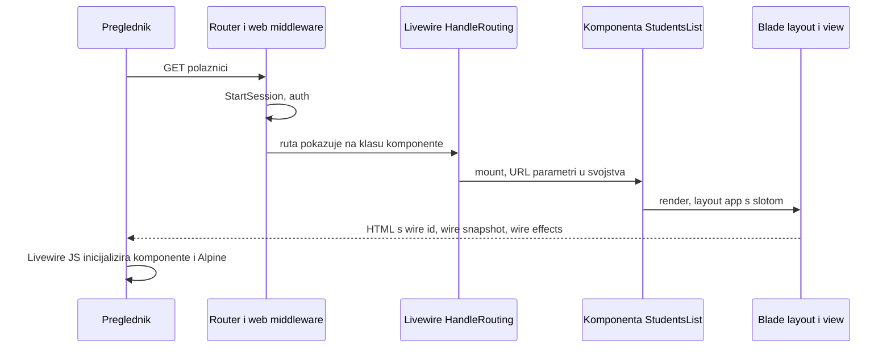
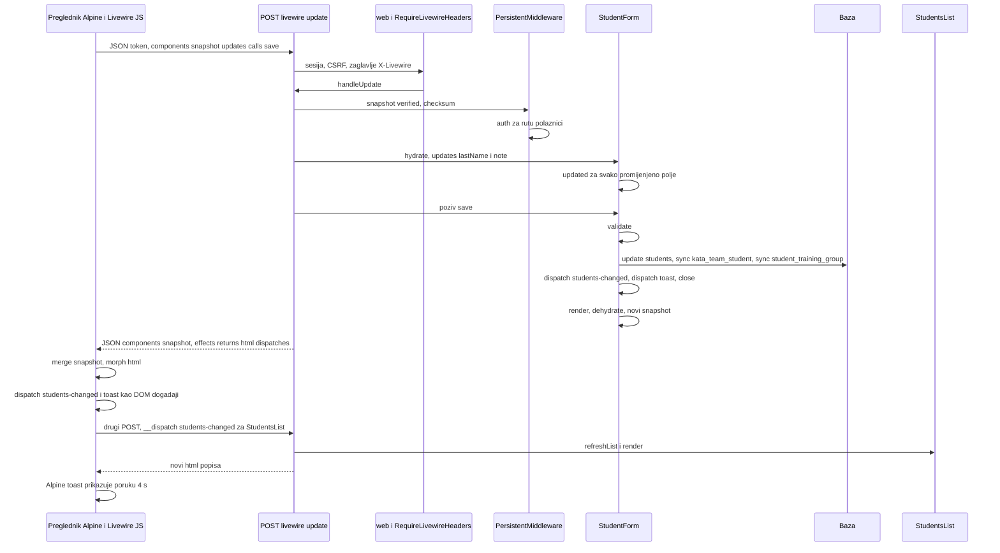
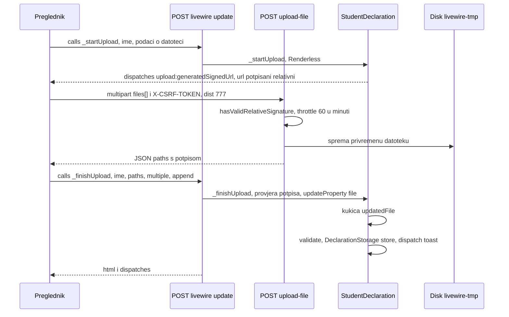

# HTTP rute, Livewire mehanizam, događaji i frontend

**Izvor istine:** `routes/web.php`, `bootstrap/app.php`, `app/Providers/AppServiceProvider.php`, `config/livewire.php`, `config/features.php`, `config/filesystems.php`, `resources/views/components/layouts/app.blade.php`, `resources/views/components/layouts/guest.blade.php`, `resources/views/partials/pwa.blade.php`, `resources/views/livewire/*.blade.php`, `resources/js/app.js`, `resources/css/app.css`, `resources/css/tokens.css`, `vite.config.js`, `public/sw.js`, `public/manifest.json`, `public/offline.html`, `app/Livewire/*.php`, `vendor/livewire/livewire/src/Mechanisms/HandleRequests/EndpointResolver.php`, `vendor/livewire/livewire/src/Mechanisms/HandleRequests/HandleRequests.php`, `vendor/livewire/livewire/src/Mechanisms/PersistentMiddleware/PersistentMiddleware.php`, `vendor/livewire/livewire/src/Mechanisms/HandleComponents/HandleComponents.php`, `vendor/livewire/livewire/dist/livewire.js`

**Stanje:** feature/clanarine @ 87307b0, 2026-10-20

Verzije: `laravel/framework` v13.35.0, `livewire/livewire` v4.4.7. Tvrdnje o Livewireu provjerene su čitanjem izvora u `vendor/` (putanje navedene); gdje je ponašanje preglednika izvedeno bez pokretanja, to je označeno. Ekrani i njihove akcije: [04-ekrani/](04-ekrani/). Autorizacija: [07-autorizacija-i-sigurnost.md](07-autorizacija-i-sigurnost.md).

## 1. Sve rute

Izvor: `php artisan route:list -v` (24 rute uz uključen `FEATURE_PAYMENTS`) uz `routes/web.php`. `web` je standardna grupa Laravela 13 (`EncryptCookies`, `AddQueuedCookiesToResponse`, `StartSession`, `ShareErrorsFromSession`, `PreventRequestForgery`, `SubstituteBindings`). `auth` = `Illuminate\Auth\Middleware\Authenticate`, `guest` = `Illuminate\Auth\Middleware\RedirectIfAuthenticated`, `can:x` = `Illuminate\Auth\Middleware\Authorize:x`. Prefiks Livewire endpointa je `/livewire-<hash>` gdje je `<hash>` prvih 8 heksadecimalnih znakova `sha256(APP_KEY . 'livewire-endpoint')` (`EndpointResolver::prefix()`, :13-18); stvarna vrijednost ovisi o ključu instalacije i ovdje se ne navodi.

### 1.1 Rute aplikacije

| Metoda | URI | Ime | Handler | Middleware / gate | Flag | Izvor |
|---|---|---|---|---|---|---|
| ANY | `/` | nema | `Illuminate\Routing\RedirectController` (302 na `/polaznici`) | `web` | n/a | `routes/web.php:18` |
| GET, HEAD | `/login` | `login` | `App\Livewire\Auth\Login` | `web`, `guest` | n/a | `routes/web.php:21` |
| GET, HEAD | `/polaznici` | `polaznici` | `App\Livewire\StudentsList` | `web`, `auth` | n/a | `routes/web.php:25` |
| GET, HEAD | `/natjecanja` | `natjecanja` | `App\Livewire\CompetitionsList` | `web`, `auth` | n/a | `routes/web.php:26` |
| GET, HEAD | `/popisi-natjecanja` | `rosters` | `App\Livewire\CompetitionRostersList` | `web`, `auth` | n/a | `routes/web.php:27` |
| GET, HEAD | `/popisi-natjecanja/{roster}` | `rosters.show` | `App\Livewire\CompetitionRosterShow` (binding na `CompetitionRoster`) | `web`, `auth` | n/a | `routes/web.php:28` |
| GET, HEAD | `/kata-timovi` | `kata-timovi` | `App\Livewire\KataTeamsList` | `web`, `auth` | n/a | `routes/web.php:29` |
| GET, HEAD | `/izjava/{student}` | `izjava` | `App\Http\Controllers\DeclarationController` (`__invoke`; binding na `Student`, soft-obrisani daju 404) | `web`, `auth` | n/a | `routes/web.php:30` |
| GET, HEAD | `/clanarine/tarife` | `fee-plans` | `App\Livewire\FeePlansList` | `web`, `auth`, `can:manage-fee-plans` | `FEATURE_PAYMENTS` (ruta se ne registrira bez njega) | `routes/web.php:34` |
| GET, HEAD | `/clanarine/postavke` | `fee-settings` | `App\Livewire\ClubBillingSettingsForm` | `web`, `auth`, `can:manage-fee-plans` | `FEATURE_PAYMENTS` | `routes/web.php:35` |
| GET, HEAD | `/clanarine/partneri` | `fee-partners` | `App\Livewire\EracuniPartnerLinks` | `web`, `auth`, `can:manage-fee-plans` | `FEATURE_PAYMENTS` | `routes/web.php:36` |
| POST | `/logout` | `logout` | closure u `routes/web.php:39` (`Auth::logout()`, `invalidate()`, `regenerateToken()`, preusmjerenje na `login`) | `web`, `auth` | n/a | `routes/web.php:39-45` |

Neprijavljeni korisnik na `auth` ruti preusmjerava se na `/login` (zadano ponašanje; `LoginTest::test_guest_is_redirected_to_login`). Isto vrijedi za sve unutar `Route::middleware('auth')->group(...)` (`routes/web.php:24`).

### 1.2 Rute okvira (Laravel)

| Metoda | URI | Ime | Handler | Middleware | Napomena |
|---|---|---|---|---|---|
| GET, HEAD | `/up` | nema | `Illuminate\Foundation\Configuration\ApplicationBuilder` (closure, :224 u frameworku) | nema | health check, `bootstrap/app.php:12` |
| GET, HEAD | `/storage/{path}` | `storage.local` | `Illuminate\Filesystem\FilesystemServiceProvider` (:111) | nema | postoji jer disk `local` ima `'serve' => true` (`config/filesystems.php:36`); traži valjan potpisani URL (inače 403, u produkciji 404) |
| PUT | `/storage/{path}` | `storage.local.upload` | `Illuminate\Filesystem\FilesystemServiceProvider` (:119) | nema | prijem datoteka preko potpisanog URL-a; aplikacija ga ne koristi |

### 1.3 Rute Livewirea

| Metoda | URI | Ime | Handler | Middleware | Svrha |
|---|---|---|---|---|---|
| POST | `/livewire-<hash>/update` | `default-livewire.update` | `Livewire\Mechanisms\HandleRequests\HandleRequests@handleUpdate` | `web`, `RequireLivewireHeaders` | jedini kanal za sve akcije komponenti (poglavlje 4) |
| POST | `/livewire-<hash>/upload-file` | `livewire.upload-file` | `Livewire\Features\SupportFileUploads\FileUploadController@handle` | `web`, `throttle:60,1` | privremeni upload datoteke; traži valjan potpisani relativni URL (`hasValidRelativeSignature()`, 401 inače) |
| GET, HEAD | `/livewire-<hash>/preview-file/{filename}` | `livewire.preview-file` | `Livewire\Features\SupportFileUploads\FilePreviewController@handle` | `web` | pregled privremene datoteke (potpisano); aplikacija ga ne koristi |
| GET, HEAD | `/livewire-<hash>/livewire.js` | nema | `FrontendAssets@returnJavaScriptAsFile` | nema | JavaScript Livewirea (u njemu je i Alpine) |
| GET, HEAD | `/livewire-<hash>/livewire.min.js.map`, `/livewire-<hash>/livewire.csp.min.js.map` | nema | `FrontendAssets@maps`, `@cspMaps` | nema | source mape |
| GET, HEAD | `/livewire-<hash>/js/{component}.js` | nema | `SupportJsModules` | nema | JS moduli komponenti (aplikacija ih ne koristi) |
| GET, HEAD | `/livewire-<hash>/css/{component}.css`, `…/{component}.global.css` | nema | `SupportCssModules` | nema | CSS moduli komponenti (ne koriste se) |

Zahtjev prema `update` bez zaglavlja `X-Livewire` ili bez JSON sadržaja dobiva 404 (`vendor/livewire/livewire/src/Mechanisms/HandleRequests/RequireLivewireHeaders.php:15-17`). U `app/Livewire` se ne koristi `wire:navigate`: prijelaz među stranicama je običan HTTP `GET` i potpuno učitavanje (pretraga `resources/views`).

## 2. Pokretanje: `bootstrap/app.php` i `AppServiceProvider`

`bootstrap/app.php` (21 linija):

| Linije | Sadržaj |
|---|---|
| 8-13 | `Application::configure(...)->withRouting(web: routes/web.php, commands: routes/console.php, health: '/up')` |
| 14-16 | `withMiddleware(...)` prazan: nema vlastitih aliasa, grupa ni `trustProxies` |
| 17-20 | `withExceptions`: `shouldRenderJsonWhen(fn => $request->is('api/*') \|\| $request->expectsJson())`; aplikacija nema `api/*` ruta, pa JSON odgovore dobiva samo zahtjev koji ih traži (`Accept: application/json`). Livewire fetch ne šalje takav `Accept`, pa greške (npr. 403) dolaze kao HTML |

`AppServiceProvider` (`app/Providers/AppServiceProvider.php`):

| Metoda / linije | Što radi |
|---|---|
| `register()` :20-28 | `EracuniClient` kao singleton: `config('eracuni.driver', 'mock')` jednako `http` daje `HttpEracuniClient`, inače `MockEracuniClient` (detalji u [06-eracuni.md](06-eracuni.md)) |
| `boot()` :36 | `RateLimiter::for('eracuni', fn => Limit::perSecond(1))`: najviše 1 poziv u sekundi za sve eRačuni poslove u redu čekanja |
| `boot()` :39 | `Gate::define('manage-payments', ...)` |
| `boot()` :42 | `Gate::define('manage-fee-plans', ...)` |
| `boot()` :45 | `Gate::define('assign-fee-plan', ...)` |

Semantika gateova u [07-autorizacija-i-sigurnost.md](07-autorizacija-i-sigurnost.md). Ograničenje prijave nije u provideru nego u `Login::ensureIsNotRateLimited()` (5 pokušaja po ključu e-mail+IP).

`config/livewire.php` (izdvojeno): `class_namespace` `App\Livewire`; `inject_assets` `true` (Livewire sam ugrađuje svoj `<script>` i `<style>`; layouti nemaju `@livewireScripts`/`@livewireStyles`); `smart_wire_keys` `true`; `legacy_model_binding` `false`; `render_on_redirect` `false`; `payload.max_size` 1 MB, `max_calls` 50, `max_components` 200, `max_nesting_depth` 10; `temporary_file_upload` sa zadanim vrijednostima (`disk` iz `LIVEWIRE_TEMPORARY_FILE_UPLOAD_DISK` ili zadani disk, `middleware` `throttle:60,1`, `max_upload_time` 5 min, `cleanup` `true`).

## 3. Kako se `auth` ponovno primjenjuje na Livewire pozive

Svaki poziv komponente ide na `POST /livewire-<hash>/update`, koji sam ima samo `web` + `RequireLivewireHeaders`. Zaštita stranice zato se nosi u snapshotu:

1. Pri renderiranju (`dehydrate`) Livewire u `memo` upisuje `path` i `method` izvorne stranice (npr. `polaznici` i `GET`; `vendor/livewire/livewire/src/Mechanisms/PersistentMiddleware/PersistentMiddleware.php:34-39`).
2. Pri svakom ažuriranju, nakon provjere checksuma (`snapshot-verified`), `PersistentMiddleware` (`:41-48`) čita `memo.path`/`memo.method`, gradi lažni zahtjev za tu putanju, nalazi rutu i propušta ga kroz pipeline **samo** onih middlewarea koji su na popisu `$persistentMiddleware` (`:16-25`): `Authenticate`, `Authorize`, `SubstituteBindings`, `AuthenticateWithBasicAuth` (te klase Sanctuma/Jetstreama koje ovdje ne postoje). Dio iza `:` u nazivu se zanemaruje (`Str::before($value, ':')`, `:210`), pa `Authorize:manage-fee-plans` prolazi.
3. Posljedica: `auth` na svim ekranima i `can:manage-fee-plans` na tarifama/postavkama/partnerima provodi se i pri svakom ažuriranju. `guest` (`Illuminate\Auth\Middleware\RedirectIfAuthenticated`) nije na popisu (na popisu je `App\Http\Middleware\RedirectIfAuthenticated` koji u projektu ne postoji).
4. Ugniježđene komponente (djeca u ladici polaznika) dijele `memo.path` stranice-roditelja, dakle imaju samo `auth`; njihove uloge provode metode (`abort_unless`).
5. Ako ruta za `memo.path` ne postoji (npr. flag je isključen pa ruta nije registrirana), `getRouteFromRequest` hvata `NotFoundHttpException` i vraća `null`, pa se ne primjenjuje nikakav middleware.

Dodatno: checksum je HMAC (`hash_hmac('sha256', json_encode($snapshot), <ključ aplikacije>)`, `Checksum::generate`) i obuhvaća `data` i `memo` (osim `memo.children`). Klijent zato ne može izmijeniti snapshot, ali **može** poslati proizvoljne `updates` za bilo koje javno svojstvo koje nije `#[Locked]` i pozvati bilo koju javnu metodu podklase (`vendor/livewire/livewire/src/Mechanisms/HandleComponents/HandleComponents.php:570-580`, `updateProperties` :389).

## 4. Livewire zahtjev: anatomija

### 4.1 Početno učitavanje stranice



`wire:snapshot` je JSON snapshot, a `wire:effects` nosi `listeners` (popis `#[On]` događaja) i `url` (definicije `#[Url]`), i to samo pri montiranju (`SupportEvents::dehydrate` :56-60, `BaseUrl::dehydrate` :31).

### 4.2 Primjer: „Spremi promjene" u obrascu polaznika

Akcija: trener je otvorio ladicu za postojećeg polaznika, promijenio „Prezime *" i „Napomena" (polja `wire:model.blur`, vidi 4.5, vrijednosti su još samo u pregledniku) i kliknuo „Spremi promjene" (`wire:submit="save"`).



**Ilustrativni primjer sirovog zahtjeva (vrijednosti su izmišljene)**

`POST /livewire-<hash>/update`, zaglavlja `Content-type: application/json`, `X-Livewire: 1`, kolačić sesije; CSRF je u tijelu kao `_token`. `snapshot` je u stvarnom zahtjevu **JSON-string** (ovdje prikazan raspakiran radi čitljivosti). Skraćeno je `memo.children`; točan oblik ključeva djece nije provjeren. [NEJASNO: točan oblik `memo.children` za djecu s ključem; ne utječe na logiku.]

```json
{
  "_token": "kXq3Lm0pZr8vTn2YbH7sJd4WcAeUo1GfIiN6Ra9S",
  "components": [
    {
      "snapshot": "{\"data\":{\"open\":true,\"studentId\":17,\"submitted\":false,\"lastName\":\"Primjer\",\"firstName\":\"Ivo\",\"birthDate\":\"2015-03-12\",\"oib\":\"\",\"belt\":\"8\",\"nextGradeStatus\":\"none\",\"nextGradeKyu\":\"\",\"medicalValidUntil\":\"2027-02-01\",\"hasNoMedical\":false,\"parentName\":\"Ana Primjer\",\"parentPhone\":\"091 000 0000\",\"parentEmail\":\"ana@primjer.example\",\"note\":\"\",\"flagT\":false,\"kataTeamIds\":[[\"2\"],{\"s\":\"arr\"}],\"trainingGroupIds\":[[\"1\",\"3\"],{\"s\":\"arr\"}]},\"memo\":{\"id\":\"vF2kQ9sLmN4xRt7BzC0y\",\"name\":\"student-form\",\"path\":\"polaznici\",\"method\":\"GET\",\"children\":{},\"scripts\":[],\"assets\":[],\"errors\":[],\"locale\":\"hr\",\"release\":\"a-a-\"},\"checksum\":\"3f9a1c0d5b7e2a64c8d1f0e9b3a7c5d2e4f6a8b0c1d3e5f7a9b2c4d6e8f0a1b3\"}",
      "updates": {
        "lastName": "Primjerić",
        "note": "Novi broj telefona roditelja"
      },
      "calls": [
        { "method": "save", "params": [], "metadata": {} }
      ]
    }
  ]
}
```

Raspakirani `snapshot`: `data` su sva javna svojstva komponente (prema `getPublicPropertiesDefinedOnSubclass`) u redoslijedu deklaracije; skalari su goli, nizovi su `[vrijednost, {"s":"arr"}]` (`ArraySynth::dehydrate` vraća `[$target, []]`, a `HandleSynths` dodaje oznaku sintetizatora); `memo.path`/`memo.method` služe za `PersistentMiddleware`; `memo.release` je `a-a-` (`ReleaseToken::generate`: `LIVEWIRE_RELEASE_TOKEN`, `config('livewire.release_token')`, token komponente); `checksum` je HMAC. `updates` sadrži samo ključeve čija se vrijednost promijenila u pregledniku (klijentski diff). `calls[].params` su argumenti metode (ovdje nema), a `metadata` je za obični `wire:click`/`wire:submit` prazan objekt (`{type: "model.live"}` je za `wire:model.live`, `vendor/livewire/livewire/dist/livewire.js:17189`).

**Ilustrativni primjer odgovora**

```json
{
  "components": [
    {
      "snapshot": "{\"data\":{\"open\":false,\"studentId\":17,\"submitted\":true,\"lastName\":\"Primjerić\",\"firstName\":\"Ivo\",\"birthDate\":\"2015-03-12\",\"oib\":\"\",\"belt\":\"8\",\"nextGradeStatus\":\"none\",\"nextGradeKyu\":\"\",\"medicalValidUntil\":\"2027-02-01\",\"hasNoMedical\":false,\"parentName\":\"Ana Primjer\",\"parentPhone\":\"091 000 0000\",\"parentEmail\":\"ana@primjer.example\",\"note\":\"Novi broj telefona roditelja\",\"flagT\":false,\"kataTeamIds\":[[\"2\"],{\"s\":\"arr\"}],\"trainingGroupIds\":[[\"1\",\"3\"],{\"s\":\"arr\"}]},\"memo\":{\"id\":\"vF2kQ9sLmN4xRt7BzC0y\",\"name\":\"student-form\",\"path\":\"polaznici\",\"method\":\"GET\",\"children\":{},\"scripts\":[],\"assets\":[],\"errors\":[],\"locale\":\"hr\",\"release\":\"a-a-\"},\"checksum\":\"b7c1e0a9d2f4683a5c7e9b1d3f5a7c9e0b2d4f6a8c0e2a4c6e8b0d2f4a6c8e0a\"}",
      "effects": {
        "returns": [null],
        "html": "<div wire:id=\"vF2kQ9sLmN4xRt7BzC0y\" wire:name=\"student-form\">…zatvorena ladica, isti DOM kao prije osim x-show…</div>",
        "dispatches": [
          { "name": "students-changed", "params": [] },
          { "name": "toast", "params": { "message": "Spremljeno: Primjerić Ivo" } }
        ]
      }
    }
  ],
  "assets": []
}
```

Značenje ključeva: `components[].snapshot` je novi snapshot (klijent ga spaja kroz `mergeNewSnapshot`); `effects.returns` je niz povratnih vrijednosti po pozivu (`void` daje `null`; odgovori tipa download/redirect se također zamjenjuju s `null`, `vendor/livewire/livewire/src/Mechanisms/HandleComponents/HandleComponents.php:558-563, 591-593`); `effects.html` je ponovno renderirani HTML komponente koji klijent morphom primjenjuje (`supportMorphDom`); `effects.dispatches` su događaji koje je komponenta pokrenula (`Event::serialize`: `name`, `params`, po potrebi `self`/`component`/`ref`/`el`); `assets` su dodatni skripti/stilovi koje stranica još nema. Drugi mogući efekti, ovisno o akciji: `redirect` (i `redirectUsingNavigate`), `download` (4.4), `url` (samo pri montiranju), `listeners` (samo pri montiranju), `xjs`, `islandFragments`, `slotFragments`, `returnsMeta`, `scriptModule`, `styleModule`, `transition` (popis iz `addEffect(` u `vendor/livewire/livewire/src`; aplikacija koristi `returns`, `html`, `dispatches`, `redirect`, `download`).

Drugi zahtjev iz istog primjera (događaj `students-changed` stiže do prozora i okida slušač `StudentsList`): tijelo `{"_token": "...", "components": [{"snapshot": "<StudentsList snapshot>", "updates": {}, "calls": [{"method": "__dispatch", "params": ["students-changed", []], "metadata": {}}]}]}`. Poslužitelj u `SupportEvents::call` mapira ime događaja na metodu (`refreshList`) i izvršava je.

### 4.3 Greške

| Situacija | Što se događa | Izvor |
|---|---|---|
| Ne valjani CSRF / istekla sesija | HTTP 419; preglednik: `confirm("This page has expired. Would you like to refresh the page?")` | `vendor/livewire/livewire/dist/livewire.js:6431-6437` |
| `abort(403/404/500)` u akciji, izuzetak, `ModelNotFoundException` | odgovor nije JSON (Livewire ne šalje `Accept: application/json`): preglednik otvara HTML modal s tijelom odgovora | `vendor/livewire/livewire/dist/livewire.js:6446` |
| Prazan odgovor 200 | `confirm("The server returned an empty response…")` | `vendor/livewire/livewire/dist/livewire.js:6438-6443` |
| `TypeError` pri hidrataciji svojstva | 419 (osim uz `APP_DEBUG`) | `vendor/livewire/livewire/src/Mechanisms/HandleRequests/HandleRequests.php:221-226` |
| `ValidationException` u akciji | **nije** HTTP greška: greške idu u `ErrorBag`, komponenta se renderira (HTTP 200) s porukama | `SupportValidation` |
| Pogrešan checksum | `CorruptComponentPayloadException`; nakon 10 neuspjeha u 10 min IP se blokira | `Checksum.php` |
| Više od 50 poziva, 200 komponenti ili tijelo > 1 MB | iznimke `TooManyCallsException` / `TooManyComponentsException` / `PayloadTooLargeException` | `config/livewire.php`, `vendor/livewire/livewire/src/Mechanisms/HandleRequests/HandleRequests.php:163-195` |

### 4.4 Preuzimanje datoteke (efekt `download`)

Akcije `export()`, `medicalReminders()`, `report(id)` (`StudentsList`), `export()` (`CompetitionRosterShow`, `KataTeamsList`) vraćaju `response()->download($path, $name)->deleteFileAfterSend()`. `SupportFileDownloads` (`vendor/livewire/livewire/src/Features/SupportFileDownloads/SupportFileDownloads.php`) hvata `BinaryFileResponse`/`StreamedResponse`, izvršava `sendContent()` u međuspremnik (Symfony tada briše privremenu datoteku), kodira sadržaj u base64 i dodaje efekt:

```json
{
  "effects": {
    "returns": [null],
    "download": {
      "name": "polaznici-2026-10-20.xlsx",
      "content": "UEsDBBQABgAIAAAAIQ…(base64)",
      "contentType": "application/vnd.openxmlformats-officedocument.spreadsheetml.sheet"
    }
  }
}
```

Klijent (`vendor/livewire/livewire/dist/livewire.js:16236-16270`) dekodira base64 (`atob`) u `Blob` i pokreće preuzimanje s `name`. Posljedica: cijela datoteka prolazi kroz JSON odgovor i memoriju PHP-a i preglednika (limit `payload.max_size` vrijedi za zahtjev, ne za odgovor).

### 4.5 Modifikatori `wire:model` i događaji (provjereno u `vendor/livewire/livewire/dist/livewire.js:17150-17235`)

| Zapis u view-u | Mrežni zahtjev? | Značenje |
|---|---|---|
| `wire:model="x"` | ne | vrijednost se samo upisuje u klijentsko stanje; šalje se kao dio `updates` uz sljedeću akciju |
| `wire:model.blur="x"` | ne | ista „odgođena" semantika, ali se stanje ažurira tek na `blur` (i prije slanja obrasca) |
| `wire:model.live="x"` | da, odmah | `$commit` s `metadata.type = "model.live"`; za tekstualna polja uz zadani debounce 150 ms |
| `wire:model.live.debounce.300ms="x"` | da, 300 ms nakon zadnje tipke | popis (`search`) i pretraga djece na popisu za natjecanje |
| `wire:click="m(a)"` | da | `calls: [{method: "m", params: [a]}]` |
| `wire:click="$dispatch('e', {…})"` | ne (do slušatelja) | klijentski `CustomEvent` (vidi poglavlje 5); slušatelj tek tada šalje `__dispatch` |
| `wire:click="$set('p', v)"` / `$toggle('p')` | da | `updates` + poziv `$set` (`vendor/livewire/livewire/dist/livewire.js:7347,7403`) |
| `wire:submit="m"` | da | sprječava zadano slanje obrasca i zove `m`; za vrijeme poziva Livewire onemogućuje polja obrasca |
| `wire:change="m(id, $event.target.value)"` | da | okida se na DOM događaj `change`, izraz se izvršava u pregledniku |
| `wire:loading`, `wire:target`, `wire:loading.attr` | ne | prikaz stanja učitavanja (npr. „Izvoz…", „Prijava…", „Spremam…") |

### 4.6 Učitavanje datoteke (izjava)

`StudentDeclaration` koristi `WithFileUploads`; `<input type="file" wire:model="file">` ne ide kroz obični `updates` već kroz `handleFileUpload` (`vendor/livewire/livewire/dist/livewire.js:673`).



Detalji: `_startUpload` je `#[Renderless]` i dispatchira `upload:generatedSignedUrl` na samu komponentu (`vendor/livewire/livewire/src/Features/SupportFileUploads/WithFileUploads.php:11-24`); URL je privremeno potpisan (`GenerateSignedUploadUrl::signedRoute`, trajanje `max_upload_time` = 5 min). `_finishUpload` provjerava potpis putanje (`TemporaryUploadedFile::extractPathFromSignedPath`, 403 ako nije valjan) i postavlja svojstvo `file`, što okida `updatedFile()` (`app/Livewire/StudentDeclaration.php:48`). Pogreška validacije vraća se kroz `_uploadErrored`. Nešifrirani privremeni primjerak vidi [07-autorizacija-i-sigurnost.md](07-autorizacija-i-sigurnost.md), odjeljak 6.2.

## 5. Globalni događaji

Livewire događaji putuju kao DOM `CustomEvent` (`bubbles`), a Livewire na `window` registrira slušač za svaku `#[On]` oznaku (`registerListeners`, `vendor/livewire/livewire/dist/livewire.js:15708-15731`). Kad događaj stigne, slušač zove `component.$wire.call("__dispatch", name, e.detail)`; poslužitelj dopušta samo ona imena koja komponenta deklarira (`SupportEvents::call`, `EventHandlerDoesNotExist` inače) i parametre prosljeđuje metodi (`wrap($component)->$method(...$params)`, pa `{ id: 5 }` postaje `id: 5`). Zato **svaki** događaj između komponenti znači dodatni HTTP zahtjev. `$dispatch` u `wire:click` je isključivo klijentski.

### 5.1 Događaji među komponentama

| Događaj | Parametri | Pokreće (datoteka:linija) | Sluša (datoteka:linija) → metoda |
|---|---|---|---|
| `new-student` | nema | `resources/views/livewire/students-list.blade.php:31` (`wire:click="$dispatch('new-student')"`) | `app/Livewire/StudentForm.php:105` → `openCreate()` (:106) |
| `edit-student` | `{ id }` | `resources/views/livewire/students-list.blade.php:179`, `:256`, `:291`, `:317` | `app/Livewire/StudentForm.php:114` → `openEdit(int $id)` (:115) |
| `confirm-delete-student` | `{ id }` | `resources/views/livewire/students-list.blade.php:261`, `:321`; `app/Livewire/StudentForm.php:181` (`requestDelete()`, `dispatch('confirm-delete-student', id: …)`) | `app/Livewire/StudentDelete.php:28` → `confirm(int $id)` (:29) |
| `student-deleted` | nema | `app/Livewire/StudentDelete.php:64` | `app/Livewire/StudentForm.php:146` → `closeAfterDelete()` (:147) |
| `students-changed` | nema | `app/Livewire/StudentForm.php:214` (`save`); `app/Livewire/StudentDelete.php:63` (`delete`), `:74` (`undo`); `app/Livewire/StudentDeclaration.php:63` (`updatedFile`), `:77` (`remove`) | `app/Livewire/StudentsList.php:91` → `refreshList()` (:92) |

Komponente koje mijenjaju podatke vidljive na popisu, a **ne** šalju `students-changed`: `StudentResults`, `StudentFeePlans`, `StudentCharges`.

### 5.2 Događaj `toast`

Sluša ga jedan Alpine blok u layoutu: `resources/views/components/layouts/app.blade.php:117-126` (`x-on:toast.window="msg = $event.detail.message; show = true; clearTimeout(timer); timer = setTimeout(() => show = false, 4000)"`). Novi toast zamjenjuje prethodni i resetira brojač od 4 s. Guest layout (prijava) nema toast element. Pokretači (`dispatch('toast', message: …)`):

| Datoteka | Linije |
|---|---|
| `app/Livewire/StudentForm.php` | 215 |
| `app/Livewire/StudentResults.php` | 119, 130 |
| `app/Livewire/StudentDeclaration.php` | 64, 78 |
| `app/Livewire/CompetitionsList.php` | 94, 119 |
| `app/Livewire/CompetitionRostersList.php` | 92, 117 |
| `app/Livewire/CompetitionRosterShow.php` | 112, 140, 146, 154, 163, 177, 185, 191, 206, 226, 255, 265, 303 |
| `app/Livewire/KataTeamsList.php` | 95, 120, 129 |
| `app/Livewire/FeePlansList.php` | 122, 150, 159 |
| `app/Livewire/StudentFeePlans.php` | 156, 170 |
| `app/Livewire/StudentCharges.php` | 117, 176, 187, 192, 223 |
| `app/Livewire/ClubBillingSettingsForm.php` | 164, 177, 182 |
| `app/Livewire/EracuniPartnerLinks.php` | 51, 78, 90, 121 |

Točni tekstovi poruka navedeni su u tablicama akcija pojedinog ekrana. `StudentDelete` ne koristi `toast`, nego vlastiti „Poništi" toast (poglavlje 6.3).

### 5.3 Događaji preglednika (PWA)

| Događaj | Pokreće | Sluša | Učinak |
|---|---|---|---|
| `pwa-installable` | `resources/views/partials/pwa.blade.php:13` (nakon `beforeinstallprompt`) | `resources/views/components/layouts/guest.blade.php:23` (`x-on:pwa-installable.window`) | prikazuje traku „Instaliraj Optimist — vođenje kluba" |
| `pwa-installed` | `resources/views/partials/pwa.blade.php:17` (nakon `appinstalled`) | `resources/views/components/layouts/guest.blade.php:23` (`x-on:pwa-installed.window`) | sakriva traku |

Interni Livewire događaji (`upload:generatedSignedUrl`, `upload:finished`, `upload:errored`, `upload:removed`) postoje samo uz upload izjave (poglavlje 4.6). Ostala `#[On]` pretplata nema (pretraga `app/`).

## 6. Layout i Alpine obrasci

### 6.1 Layout `app` (`components/layouts/app.blade.php`)

| Dio | Linije | Ponašanje |
|---|---|---|
| `<title>` | 6 | `{{ $title ?? config('app.name', 'Optimist') }}`; `#[Title]` komponente puni `$title` |
| Resursi | 8-10 | `@fonts`, `@vite(['resources/css/app.css', 'resources/js/app.js'])`, `partials/pwa` |
| Navigacijske stavke | 15-26 | `Polaznici` → `polaznici`, `Natjecanja` → `natjecanja`, `Popisi za natjecanje` → `rosters`, `Kata timovi` → `kata-timovi`; uz flag i `can('manage-fee-plans')` još `Članarine` → `fee-plans`, `Partneri` → `fee-partners`, `Postavke` → `fee-settings` |
| Bočni izbornik (desktop) | 41-68 | `aside` vidljiv od `lg` (1024 px) naviše, fiksno 240 px, `z-40`; aktivna stavka `request()->routeIs($route, $route.'.*')` (pa `rosters.show` označava „Popisi za natjecanje"); `aria-current="page"` |
| Gumb „Odjava" | 60-67, 98-104 | običan `<form method="POST" action="route('logout')">` s `@csrf` |
| Zaglavlje (mobilno/tablet) | 71-107 | `lg:hidden`; Alpine `x-data="{ open: false }"`; hamburger `x-on:click.stop="open = ! open"` (aria „Izbornik"); padajući izbornik `x-show="open"`, zatvara se s `x-on:click.outside` i `x-on:keydown.escape.window` |
| Sadržaj | 110-114 | omotač `lg:pl-[240px]` samo kad je korisnik prijavljen; `<main>` max 1344 px, `{{ $slot }}` |
| Toast | 117-126 | vidi 5.2 |

Z-slojevi (prema komentaru u kodu i klasama): bočni izbornik `z-40`, ladice `z-50`, dijalozi `z-[55]`, toast `z-[60]`, mobilni izbornik `z-50`.

Layout `guest` (`guest.blade.php`) ima samo logotip, traku za instalaciju (poglavlje 7.4) i `{{ $slot }}`; nema navigacije ni toasta.

### 6.2 Uzorak ladice (drawer)

Koristi ga `StudentForm`, `CompetitionsList`, `CompetitionRostersList`, `CompetitionRosterShow`, `KataTeamsList`, `FeePlansList`. Poslužitelj drži logičko stanje (`public bool $open`), a Alpine ga čita:

- korijen: `<div x-cloak x-show="$wire.open" class="fixed inset-0 z-50" @keydown.escape.window="$wire.open && $wire.close()">`
- pozadina: `<div x-show="$wire.open" x-transition.opacity.duration.200ms … @click="$wire.close()">`
- ploča: `x-show="$wire.open"`, prijelaz `translate-x-full` na `translate-x-0` (200 ms ulaz, 150 ms izlaz), širina `min(680px,100%)` za polaznika, `min(520px,100%)` za ostale, `role="dialog" aria-modal="true"`.
- obrazac: `<form wire:submit="save">` s gumbima „Odustani" (`wire:click="close"`) i `type="submit"`.

Posljedica: `$wire.close()` i `$wire.open` su pozivi poslužitelju (zatvaranje ladice, uključujući Esc i klik na pozadinu, je HTTP zahtjev). `[x-cloak]` je skriven globalno (`resources/css/app.css:27`).

### 6.3 Uzorak dijaloga i „Poništi" toast

- Dijalog potvrde: `x-show="$wire.confirmingDelete"` (u `StudentDelete`: `$wire.confirming`), `z-[55]`, `role="alertdialog"`, Esc i klik na pozadinu zovu `cancelDelete()` (odnosno `cancel()`); gumbi „Odustani" i „Da, obriši".
- Undo toast (`resources/views/livewire/student-delete.blade.php:34-44`): `x-data="{ timer: null }"` + `x-effect="$wire.showUndo ? (clearTimeout(timer), timer = setTimeout(() => $wire.dismissUndo(), 7000)) : clearTimeout(timer)"`. Svaki put kad `showUndo` postane `true`, postavlja se brojač od 7000 ms koji zove `dismissUndo()` (poslužiteljski poziv); gumb „Poništi" zove `undo()`.

## 7. Frontend i PWA

### 7.1 JavaScript i CSS

- `resources/js/app.js` sadrži samo komentar `//` (1 linija). Alpine **nije** uvezen u projekt: Livewire 4 ga ugrađuje u svoju datoteku (`/livewire-<hash>/livewire.js`, koju sam ubacuje jer je `inject_assets` uključen); layouti nemaju `@livewireScripts`.
- `vite.config.js`: ulazi `resources/css/app.css` i `resources/js/app.js`; `laravel-vite-plugin` s `refresh: true`; fontovi kroz `laravel-vite-plugin/fonts` (`bunny('Bricolage Grotesque', weights 600/700)`, `bunny('Hanken Grotesk', weights 400/500/600/700)`); plugin `@tailwindcss/vite`; `server.watch.ignored` isključuje `storage/framework/views`. Izgrađeni fontovi su lokalni (`public/build/assets/*.woff2`, `fonts-manifest.json`), pa se u radu ne zovu Googleovi poslužitelji (komentar u `tokens.css`). Blade direktiva `@fonts` (`Vite::fonts()`) u `<head>` ispisuje oznake za fontove deklarirane u `vite.config.js`. [NEJASNO: točan HTML koji `@fonts` ispisuje nije provjeravan.]
- `resources/css/app.css` (30 linija): `@import 'tailwindcss'` (Tailwind v4), `@import './tokens.css'`, `@source` za paginaciju i kompilirane poglede, `@theme` s `--font-sans` i `--font-display`, `@layer base` (boja pozadine/teksta, `:focus-visible` obrub na svim interaktivnim elementima, `[x-cloak]{display:none !important}`).
- `resources/css/tokens.css` (75 linija): CSS varijable na `:root`: tekst (`--ink`, `--ink2`, `--ink3`), površine i linije (`--bg`, `--surface`, `--line`, `--line2`, `--row-hover`, `--neutral-pill`), akcent (`--acc`, `--tint`), opasnost (`--danger`, `--danger-border`, `--danger-tint`), statusi (`--st-expired-*`, `--st-soon-*`, `--st-valid-*`, `--st-neutral-*`, `--dot-*`), boje pojaseva (`--belt-*`), tipografija, radijusi (`--r-tag`, `--r-control`, `--r-card`, `--r-dialog`, `--r-pill`), dimenzije, sjene i prekrivke (`--shadow-*`, `--overlay-*`). Pogledi ih koriste kao `var(--…)` u Tailwind klasama.
- `public/build/` (Vite izlaz) je u repozitoriju; `welcome.blade.php` nema rutu.

### 7.2 Service worker (`public/sw.js`)

Registrira se samo na `https:` nakon `load` (`resources/views/partials/pwa.blade.php:21-25`). Predmemorija `optimist-static-v1`.

| Zahtjev | Postupak |
|---|---|
| ne-`GET` (npr. `POST` Livewire poziva) | ne presreće se |
| druga domena | ne presreće se |
| navigacija (`request.mode === 'navigate'`) | mreža; ako ne uspije, `caches.match('/offline.html')`; HTML se nikad ne sprema |
| `/build/*`, `/icons/*`, `/manifest.json`, `/favicon.ico`, `*.woff2` | cache-first, uz upis u predmemoriju nakon dohvata |
| sve ostalo (uključujući `/livewire-<hash>/…`, `/izjava/*`, izvozi) | prolazi na mrežu, nikad se ne sprema |

Pre-cache (`install`): `/offline.html`, `/manifest.json`, `/icons/icon-192.png`, `/icons/icon-512.png`, `/icons/icon-maskable-512.png`. `activate` briše predmemorije s drugim imenom i poziva `clients.claim()`; `install` zove `skipWaiting()`. Pri izmjeni datoteke treba povećati verziju (`v1` na `v2`) (komentar u datoteci). Komentar u `sw.js` spominje `/livewire/*`, ali stvarni prefiks je `/livewire-<hash>/`; ponašanje je isto jer se ne podudara ni s jednim pravilom za predmemoriju.

### 7.3 Manifest i offline stranica

`public/manifest.json`: `name` „Optimist – evidencija polaznika", `short_name` „Optimist", `lang` `hr`, `id` `/`, `start_url` `/polaznici`, `scope` `/`, `display` `standalone`, `background_color` `#F4F5F7`, `theme_color` `#2D3E7B`, tri ikone (192, 512, 512 maskable). `public/offline.html`: samostalna stranica s naslovom „Nema internetske veze", tekstom „Provjeri vezu i pokušaj ponovno." i gumbom „Pokušaj ponovno" (`location.reload()`). `partials/pwa.blade.php` dodaje `<link rel="manifest">`, `theme-color`, ikonu i `apple-touch-icon`.

### 7.4 Traka za instalaciju

Prikazuje se samo u `guest` layoutu (stranica prijave); tok događaja i dijagram u [04-ekrani/prijava.md](04-ekrani/prijava.md).

## 8. Kako provjeriti ovaj dokument

- Rute: `php artisan route:list -v` (24 retka uz uključen flag, 21 bez).
- Događaji: `grep -rn "dispatch(\|#\[On" app resources/views`.
- Livewire izvor: `vendor/livewire/livewire/src/Mechanisms/` i `vendor/livewire/livewire/dist/livewire.js` (linije navedene u tekstu odnose se na instaliranu verziju 4.4.7).
