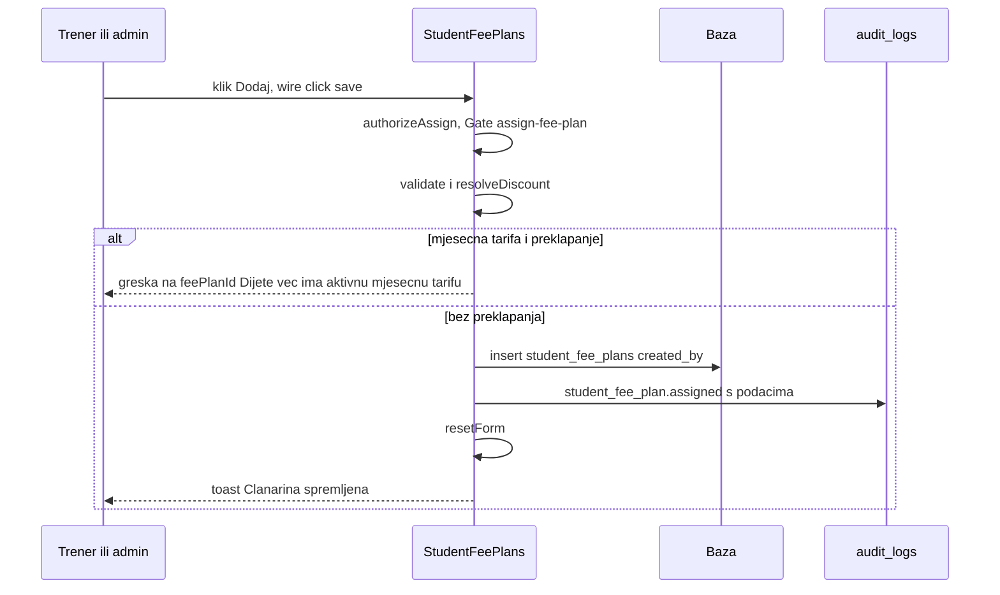
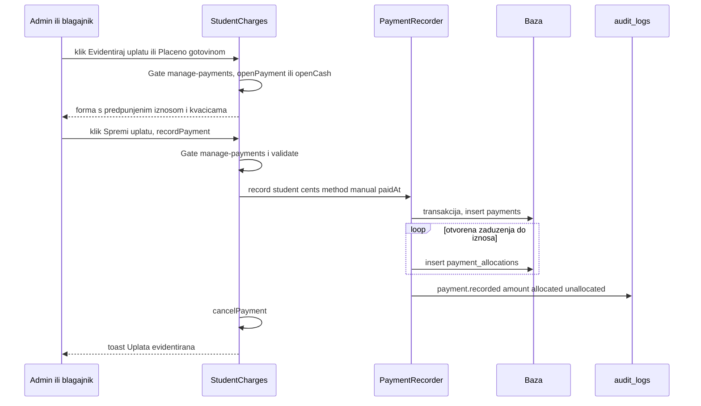
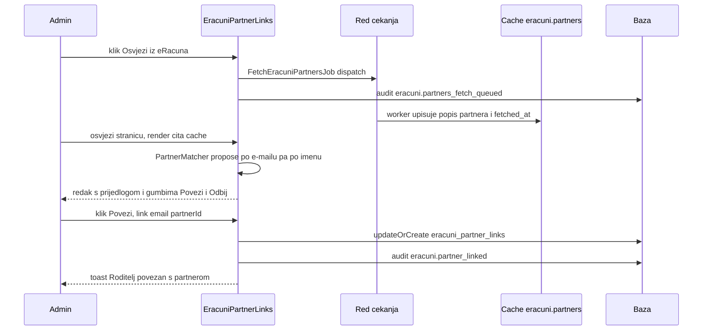

# Ekran: Članarine (tarife, dodjela, zaduženja i uplate, postavke naplate, partneri)

**Izvor istine:** `app/Livewire/FeePlansList.php`, `app/Livewire/StudentFeePlans.php`, `app/Livewire/StudentCharges.php`, `app/Livewire/ClubBillingSettingsForm.php`, `app/Livewire/EracuniPartnerLinks.php`, `resources/views/livewire/fee-plans-list.blade.php`, `resources/views/livewire/student-fee-plans.blade.php`, `resources/views/livewire/student-charges.blade.php`, `resources/views/livewire/club-billing-settings-form.blade.php`, `resources/views/livewire/eracuni-partner-links.blade.php`, `app/Providers/AppServiceProvider.php`, `app/Support/PaymentRecorder.php`, `app/Support/Money.php`, `app/Support/Auditer.php`, `routes/web.php`, `config/features.php`

**Stanje:** feature/clanarine @ 87307b0, 2026-10-20

Cijeli modul je **iza feature flaga `FEATURE_PAYMENTS`** (`config/features.php`, zadano `false`). Ovaj dokument opisuje samo korisničku stranu (ekrani, gumbi, metode, učinci). Integracija s eRačunima (klijent, JSON omotač, queue poslovi, limiter, API log, write guard) opisana je u [../06-eracuni.md](../06-eracuni.md); algoritmi (generiranje zaduženja, raspodjela uplata, novac u centima) u [../05-domena-i-servisi.md](../05-domena-i-servisi.md); uloge i gateovi u [../07-autorizacija-i-sigurnost.md](../07-autorizacija-i-sigurnost.md); opći Livewire tok u [../03-http-i-livewire.md](../03-http-i-livewire.md).

## Gdje flag utječe

| Mjesto | Učinak kad je flag isključen | Izvor |
|---|---|---|
| Rute `/clanarine/tarife`, `/clanarine/postavke`, `/clanarine/partneri` | rute se ne registriraju (404) | `routes/web.php:33-37` |
| Bočna/mobilna navigacija „Članarine", „Partneri", „Postavke" | stavke se ne prikazuju (i inače samo ako `can('manage-fee-plans')`) | `components/layouts/app.blade.php:22-26` |
| Odjeljak „Članarina" / „Zaduženja" u ladici polaznika | ne prikazuje se | `resources/views/livewire/student-form.blade.php:226` |
| Filter „Nedostaje način plaćanja" na popisu polaznika | gumb se ne prikazuje; brojač je 0; relacija `studentFeePlans` se ne učitava | `resources/views/livewire/students-list.blade.php:140`, `app/Livewire/StudentsList.php:188`, `:344` |

Gateovi (`app/Providers/AppServiceProvider.php:39,42,45`): `manage-payments` (admin, blagajnik), `manage-fee-plans` (samo admin), `assign-fee-plan` (admin, trener). Rute tarifa/postavki/partnera imaju `can:manage-fee-plans` (`routes/web.php:34-36`), a svaka od tri stranične komponente ponavlja provjeru u `mount()`.

Napomene o porukama: pravila bez prilagođene poruke daju zadane poruke frameworka (nema `lang/` mape: uz `APP_LOCALE=hr` korisnik vidi sirovi ključ prijevoda, uz `en` engleski tekst); atribut je ime svojstva, a gdje je u `validate()` zadan `attributes:` (kod `StudentCharges`) umjesto njega stoji hrvatska riječ (npr. uz `en` „The iznos field is required."). Iznosi se unose u eurima i pretvaraju u cente s `Money::parse` (`app/Support/Money.php:23`): prihvaća „1.234,50", „12,50" i „12.50", uz neobavezni „€"; sam „1.234" (točka bez zareza) tumači se kao decimalna točka (1,23 EUR).

## 1. FeePlansList (`/clanarine/tarife`, samo admin)

| Stavka | Vrijednost |
|---|---|
| Ruta | `GET /clanarine/tarife`, ime `fee-plans`, `auth` + `can:manage-fee-plans` + flag (`routes/web.php:34`) |
| Klasa | `App\Livewire\FeePlansList` (`app/Livewire/FeePlansList.php:23`, `final`) |
| Atributi | `#[Layout('components.layouts.app')]` (:21), `#[Title('Članarine — tarife')]` (:22) |
| `mount()` | `abort_unless(Gate::allows('manage-fee-plans'), 403)` (:47-50) |

Svojstva: `open` (`bool`, `false`), `editId` (`?int`, `null`), `submitted` (`bool`), `name` (`string`), `amount` (`string`, unos u EUR, sprema se u cente), `type` (`string`, `'monthly'`), `active` (`bool`, `true`), `confirmingDelete` (`bool`), `deleteId` (`?int`), `deleteName` (`string`), `deleteAssignments` (`int`, broj dodjela).

Validacija (`rules()` :52, `messages()` :62):

| Polje | Pravila | Prilagođena poruka |
|---|---|---|
| `name` | `required`, `string`, `max:255` | „Obavezno polje" |
| `amount` | `required`, `string`, `regex:/^[0-9.,\s€]+$/` | `required`: „Obavezno polje"; `regex`: „Unesi iznos u eurima, npr. 25,00" |
| `type` | `required`, `Rule::enum(FeePlanType::class)` (`monthly`, `yearly`, `one_time`; oznake „Mjesečno", „Godišnje", „Jednokratno") | `required`: „Odaberi vrstu" |
| `active` | `boolean` | nema |

Kukice: `updated(string $field)` (:72): `validateOnly` ako je `submitted`.

| Element (natpis) | Okidač | Metoda(parametri) | Autorizacija | Validacija | Učinak (baza / događaji / poruka) | Odgovor |
|---|---|---|---|---|---|---|
| Gumb „+ Nova tarifa" (:8) | `wire:click="openCreate"` | `openCreate()` (:79) | `can:manage-fee-plans` (ruta + `mount`); sama metoda nema dodatnu provjeru | nema | `reset(['editId','name','amount','submitted'])`, `type = 'monthly'`, `active = true`, `open = true` | `html` |
| Naziv tarife kao gumb (:18) | `wire:click="openEdit(id)"` | `openEdit(id)` (:87) | kao gore | `FeePlan::findOrFail($id)` | puni polja; `amount = number_format(amount_cents/100, 2, ',', '')`; `open = true` | `html` |
| Ikona olovke (aria „Uredi: <naziv>") (:29) | `wire:click="openEdit(id)"` | `openEdit(id)` | kao gore | kao gore | kao gore | `html` |
| Ikona koša (aria „Obriši: <naziv>") (:33) | `wire:click="confirmDelete(id)"` | `confirmDelete(id)` (:126) | kao gore | `FeePlan::withCount('studentFeePlans')->findOrFail($id)` | puni `deleteId`, `deleteName`, `deleteAssignments`, `confirmingDelete = true` | `html` |
| Pozadina ladice (:49) | Alpine `@click="$wire.close()"` | `close()` (:99) | kao gore | nema | `open = false` | `html` |
| Tipka Esc u ladici (:48) | Alpine `@keydown.escape.window="$wire.open && $wire.close()"` | `close()` | kao gore | nema | zatvara | `html` |
| Gumb „Zatvori" (ikona X) (:58) | `wire:click="close"` | `close()` | kao gore | nema | zatvara | `html` |
| Gumb „Odustani" u ladici (:95) | `wire:click="close"` | `close()` | kao gore | nema | zatvara | `html` |
| Obrazac (:55) | `wire:submit="save"` | `save()` (:104) | kao gore | `submitted = true`; `validate()` | vidi „Spremanje tarife" | `html` + `dispatches` |
| Gumb „Dodaj tarifu" / „Spremi promjene" (:96) | `type="submit"` | `save()` | kao gore | kao gore | kao gore | kao gore |
| Polje „Naziv *" (:66) | `wire:model.blur="name"` | svojstvo `name` | kao gore | `required`, `max:255` | stanje | nema |
| Polje „Iznos (EUR) *" (placeholder „npr. 25,00") (:74) | `wire:model.blur="amount"` | svojstvo `amount` | kao gore | `required`, regex | stanje | nema |
| Izbornik „Vrsta *" (:81) | `wire:model="type"` | svojstvo `type` | kao gore | enum | stanje | nema |
| Kvačica „Aktivna" (:90) | `wire:model="active"` | svojstvo `active` | kao gore | `boolean` | stanje | nema |
| Pozadina dijaloga brisanja (:104) | Alpine `@click="$wire.cancelDelete()"` | `cancelDelete()` (:135) | kao gore | nema | zatvara | `html` |
| Tipka Esc u dijalogu (:103) | Alpine `@keydown.escape.window="$wire.confirmingDelete && $wire.cancelDelete()"` | `cancelDelete()` | kao gore | nema | zatvara | `html` |
| Gumb „Odustani" u dijalogu (:121) | `wire:click="cancelDelete"` | `cancelDelete()` | kao gore | nema | zatvara | `html` |
| Gumb „Da, obriši" (:123; prikazuje se samo kad je `deleteAssignments === 0`) | `wire:click="delete"` | `delete()` (:140) | kao gore | ponovno dohvaća tarifu s brojem dodjela; ako je > 0: `confirmingDelete = false` i toast „Tarifa je dodijeljena djeci — deaktiviraj je umjesto brisanja." | `Auditer::log('fee_plan.deleted', $plan, <fillable stare vrijednosti>, null)`, `$plan->delete()`, toast „Tarifa obrisana" | `html` + `dispatches` |
| Metoda `mount()` | pri učitavanju | `mount()` (:47) | 403 ako nije admin | nema | nema | n/a |
| Metoda `updated()` | svaka promjena svojstva | `updated(field)` (:72) | n/a | `validateOnly` ako je `submitted` | nema | n/a |
| Metoda `render()` | svaki render | `render()` (:162) | n/a | nema | podaci `plans` (s `student_fee_plans_count`, po nazivu) i `types` (`FeePlanType::options()`) | HTML |

Tekstovi: naslov „Tarife članarine", podnaslov „N tarifa"; oznaka „neaktivna"; uz redak „N dodijeljeno"; prazno stanje „Još nema tarifa" / „Dodaj prvu tarifu gumbom gore desno."; dijalog „Obrisati tarifu?" s dvije varijante teksta.

### Spremanje tarife (`save()`, :104-124)

`validate()`; `$data = ['name', 'amount_cents' => Money::parse($amount), 'type', 'active']`; `FeePlan::findOrFail(editId)->update($data)` ili `FeePlan::create($data)`; `Auditer::log('fee_plan.updated'|'fee_plan.created', $plan, null, $data)`; toast `Spremljeno: <naziv>`; `close()`. Brisanje je dopušteno samo bez dodjela (FK `student_fee_plans.fee_plan_id` je `restrictOnDelete`); inače se tarifa deaktivira.

## 2. StudentFeePlans (odjeljak „Članarina" u ladici polaznika)

| Stavka | Vrijednost |
|---|---|
| Ugrađivanje | `<livewire:student-fee-plans :student-id="$studentId" :key="'feeplans-'.$studentId" />` (`resources/views/livewire/student-form.blade.php:229`), samo ako `config('features.payments') && (can('assign-fee-plan') \|\| can('manage-payments'))` |
| Klasa | `App\Livewire\StudentFeePlans` (`app/Livewire/StudentFeePlans.php:22`, `final`); nema `#[Layout]`/`#[Title]` |
| `mount(int $studentId)` | `authorizeAssign()` (zahtijeva gate `assign-fee-plan`, inače 403), `studentId`, zadani `payerName` i `payerEmail` iz podataka roditelja, `validFrom` = prvi dan tekućeg mjeseca (:46-53) |
| Posljedica za blagajnika | ulaz u ladicu je vidljiv za `manage-payments`, ali `mount()` traži `assign-fee-plan`; vidi [../07-autorizacija-i-sigurnost.md](../07-autorizacija-i-sigurnost.md) (`Praznine i rizici`, točka 3) |

Svojstva: `studentId` (`int`, nije `#[Locked]`), `editingId` (`?int`), `submitted` (`bool`), `feePlanId` (`string`), `discountType` (`string`, `'none'`; `none`/`percent`/`fixed`), `discountValue` (`string`), `payerName`, `validFrom`, `validUntil`, `nacinPlacanja` (`string`, `''`; `racun_email`/`gotovina`), `payerEmail`.

Validacija (`rules()` :60, `messages()` :74):

| Polje | Pravila | Prilagođena poruka |
|---|---|---|
| `feePlanId` | `required`, `exists:fee_plans,id` | „Odaberi tarifu" |
| `discountType` | `required`, `in:none,percent,fixed` | nema |
| `discountValue` | `nullable`, `string`, `max:20` | nema (nema numeričke provjere; vidi niže) |
| `payerName` | `nullable`, `string`, `max:150` | nema |
| `validFrom` | `required`, `date` | „Obavezno polje" |
| `validUntil` | `nullable`, `date`, `after_or_equal:validFrom` | „„Vrijedi do” ne može biti prije „Vrijedi od”" |
| `nacinPlacanja` | `nullable`, `in:racun_email,gotovina` | nema |
| `payerEmail` | `nullable`, `email`, `max:255`, `required_if:nacinPlacanja,racun_email` | `required_if`: „E-mail platitelja je obavezan za plaćanje računom"; `email`: „Neispravan e-mail" |

Dodatno pravilo u `save()`: za mjesečnu tarifu `StudentFeePlan::monthlyOverlapExists(studentId, validFrom, validUntil, editingId)` ne smije naći preklapanje; inače `addError('feePlanId', 'Dijete već ima aktivnu mjesečnu tarifu u tom razdoblju.')` i prekid. Popust: `percent` daje `max(0, min(100, (int) discountValue))`, `fixed` daje `Money::parse(discountValue)`; neispravan unos ne javlja grešku nego postaje 0.

| Element (natpis) | Okidač | Metoda(parametri) | Autorizacija | Validacija | Učinak (baza / događaji / poruka) | Odgovor |
|---|---|---|---|---|---|---|
| Ikona olovke postojeće dodjele (aria „Uredi članarinu") (:26) | `wire:click="editAssignment(id)"` | `editAssignment(id)` (:92) | `Gate assign-fee-plan` (`authorizeAssign`, 403) | dodjela mora pripadati `studentId` (`owned()`, 404) | puni polja iz dodjele, `submitted = false` | `html` |
| Ikona koša postojeće dodjele (aria „Ukloni članarinu") (:30) | `wire:click="deleteAssignment(id)"` | `deleteAssignment(id)` (:159) | `assign-fee-plan` | `owned()` | `Auditer::log('student_fee_plan.removed', $a, <stare vrijednosti>, null)`, `$a->delete()` (tvrdo, **bez potvrde**), po potrebi `resetForm()`, toast „Članarina uklonjena"; ne šalje `students-changed` | `html` + `dispatches` |
| Izbornik „Tarifa *" (opcija „— odaberi —") (:46) | `wire:model="feePlanId"` | svojstvo `feePlanId` | `assign-fee-plan` pri `save()` | `required`, `exists` | stanje | nema |
| Izbornik „Popust" („Bez popusta", „Postotak (%)", „Fiksni iznos (EUR)") (:60) | `wire:model.live="discountType"` | svojstvo `discountType` | `assign-fee-plan` pri `save()` | `in:...` | odmah prikazuje/skriva polje iznosa popusta | `html` |
| Polje „Postotak" / „Iznos (EUR)" popusta (placeholder „npr. 50" / „npr. 10,00") (:70) | `wire:model.blur="discountValue"` | svojstvo `discountValue` | kao gore | `max:20` | stanje | nema |
| Izbornik „Način plaćanja" („— nije postavljeno —", „Račun e-mailom", „Gotovina") (:80) | `wire:model.live="nacinPlacanja"` | svojstvo `nacinPlacanja` | kao gore | `in:...` | odmah dodaje „ *" uz natpis „E-mail platitelja" | `html` |
| Polje „E-mail platitelja" (placeholder „e-mail za račun") (:89) | `wire:model.blur="payerEmail"` | svojstvo `payerEmail` | kao gore | `email`, `required_if` | stanje | nema |
| Polje „Platitelj (ime)" (placeholder „Ime platitelja") (:98) | `wire:model="payerName"` | svojstvo `payerName` | kao gore | `max:150` | stanje | nema |
| Polje „Vrijedi od *" (:105) | `wire:model.blur="validFrom"` | svojstvo `validFrom` | kao gore | `required`, `date` | stanje | nema |
| Polje „Vrijedi do" (:112) | `wire:model.blur="validUntil"` | svojstvo `validUntil` | kao gore | `after_or_equal:validFrom` | stanje | nema |
| Gumb „Dodaj" / „Spremi promjene" (:120) | `wire:click="save"` (`type="button"`) | `save()` (:117) | `assign-fee-plan` | `submitted = true`; `validate()`; pravilo preklapanja | vidi niže | `html` + `dispatches` |
| Gumb „Odustani" (samo pri uređivanju) (:125) | `wire:click="cancelEdit"` | `cancelEdit()` (:112) | nema posebne provjere | nema | `resetForm()` (vraća zadane vrijednosti) | `html` |
| Metoda `mount()` | pri montiranju | `mount(studentId)` (:46) | `assign-fee-plan` (403) | nema | vidi tablicu pregleda | n/a |
| Metoda `updated()` | svaka promjena | `updated(field)` (:85) | n/a | `validateOnly` ako je `submitted` | nema | n/a |
| Metoda `render()` | svaki render | `render()` (:213) | n/a | nema | `assignments` (s tarifom, po `valid_from` silazno), `plans` (aktivne tarife po nazivu) | HTML |

Prikaz dodjele: naziv tarife, vrsta, oznaka „Nedostaje način plaćanja" kad je `nacin_placanja` prazan, efektivni iznos (`effectiveAmountCents()`), popust, razdoblje („dalje" kad nema kraja), način plaćanja („Račun e-mailom" / „Gotovina"), platitelj.

### Spremanje dodjele (`save()`, :117-157)

1. `authorizeAssign()`; `submitted = true`; `validate()`.
2. `FeePlan::findOrFail`; popust (`resolveDiscount()`); provjera preklapanja za mjesečnu tarifu.
3. `$data`: `student_id`, `fee_plan_id`, `discount_percent`, `discount_cents`, `valid_from`, `valid_until` (prazno u `null`), `payer_name` (ako je prazno, ime roditelja ili `null`), `payer_email`, `nacin_placanja`, `created_by` (= `Auth::id()`).
4. Uređivanje: `owned(editingId)->update($data)` + `Auditer::log('student_fee_plan.updated', $a, null, $data)`; novo: `StudentFeePlan::create($data)` + `Auditer::log('student_fee_plan.assigned', $a, null, $data)`.
5. `resetForm()`, toast „Članarina spremljena". Ne šalje `students-changed`: brojač „Nedostaje način plaćanja" na popisu polaznika ostaje star do idućeg zahtjeva prema `StudentsList`.

U `audit_logs.new_values` ovdje završavaju i `payer_name` i `payer_email` (osobni podaci), vidi [../07-autorizacija-i-sigurnost.md](../07-autorizacija-i-sigurnost.md).

## 3. StudentCharges (odjeljak „Zaduženja": saldo, uplate, otpis, ručno zaduženje)

| Stavka | Vrijednost |
|---|---|
| Ugrađivanje | `<livewire:student-charges :student-id="$studentId" :key="'charges-'.$studentId" />` (`resources/views/livewire/student-form.blade.php:232`) |
| Klasa | `App\Livewire\StudentCharges` (`app/Livewire/StudentCharges.php:29`, `final`) |
| `mount(int $studentId)` | `abort_unless(Gate::any(['assign-fee-plan', 'manage-payments']), 403)`; `studentId`; `mcPeriod = now()->format('Y-m')`; `payPaidAt = now()->toDateString()` (:69-75) |
| Autorizacija po radnji | pregled: `assign-fee-plan` ILI `manage-payments`; uplate, storno, otpis: `manage-payments` (i u metodi i kroz `@can` u view-u); ručno zaduženje: `assign-fee-plan` |

Svojstva:

| Svojstvo | Tip | Početno | Napomena |
|---|---|---|---|
| `studentId` | `int` | iz `mount` | nije `#[Locked]` |
| `mcSubmitted` | `bool` | `false` | postavlja se u `addCharge()`; ne koristi se za validaciju po polju |
| `mcFeePlanId`, `mcPeriod`, `mcAmount`, `mcDueDate` | `string` | `''` (`mcPeriod` = tekući mjesec) | ručno zaduženje |
| `showPayment` | `bool` | `false` | forma uplate otvorena |
| `paySubmitted` | `bool` | `false` | |
| `payAmount` | `string` | `''` | |
| `payMethod` | `string` | `'bank'` | `bank`/`cash`/`other` |
| `payPaidAt` | `string` | današnji datum | |
| `payBankReference` | `string` | `''` | „Poziv na broj / napomena" |
| `payNote` | `string` | `''` | validira se (`max:255`) i prosljeđuje u `PaymentRecorder`, ali **nijedan input nije vezan** na njega, pa je uvijek prazno |
| `paySelected` | `list<int>` | `[]` | označena zaduženja za raspodjelu |
| `payReceivedBy` | `string` | `''` | tko je primio gotovinu |
| `writeOffChargeId` | `?int` | `null` | zaduženje u otpisu |
| `writeOffReason` | `string` | `''` | |

Validacija:

- `addCharge()` (:92-97, u `validate([...], attributes: [...])`): `mcFeePlanId` `required|exists:fee_plans,id` (atribut „tarifa"), `mcPeriod` `required|regex:/^\d{4}-\d{2}$/` („mjesec"), `mcAmount` `required|string|regex:/^[0-9.,\s€]+$/` („iznos"), `mcDueDate` `nullable|date`. Nema prilagođenih poruka; **u view-u se ispisuje samo greška za `mcFeePlanId`** (`resources/views/livewire/student-charges.blade.php:168`), a za `mcPeriod`/`mcAmount` samo se obrub polja oboji crveno bez teksta. Posebna greška: „Za tu tarifu i mjesec zaduženje već postoji." (na `mcFeePlanId`, kad baza baci `UniqueConstraintViolationException`).
- `recordPayment()` (:151-160): `payAmount` `required|string|regex:/^[0-9.,\s€]+$/` („iznos"), `payMethod` `required|in:bank,cash,other`, `payPaidAt` `required|date` („datum"), `payBankReference` `nullable|string|max:255`, `payNote` `nullable|string|max:255`, `paySelected` `array`, `paySelected.*` `integer`, `payReceivedBy` `nullable|string|max:150|required_if:payMethod,cash` („primatelj"). Ispisuju se samo `payAmount` i `payReceivedBy`. Iznos 0 prolazi (regex ne traži > 0).
- `confirmWriteOff()`: ručna provjera `trim($writeOffReason) === ''` pa `addError('writeOffReason', 'Razlog je obavezan')`.

Kukice: `updatedMcFeePlanId(string $value)` (:79): kad je odabrana tarifa, `mcAmount` se predpuni iznosom tarife (`number_format(amount_cents/100, 2, ',', '')`). `updated()` ne postoji.

| Element (natpis) | Okidač | Metoda(parametri) | Autorizacija | Validacija | Učinak (baza / događaji / poruka) | Odgovor |
|---|---|---|---|---|---|---|
| Gumb „Evidentiraj uplatu" (:19; samo `@can('manage-payments')` i kad forma nije otvorena) | `wire:click="openPayment"` | `openPayment()` (:122) | `manage-payments` (`abort_unless`, 403) | nema | `paySelected` = id-evi svih otvorenih zaduženja, `payAmount` = zbroj otvorenog, `payPaidAt = danas`, `paySubmitted = false`, `showPayment = true` | `html` |
| Gumb „Plaćeno gotovinom" (:23) | `wire:click="openCash"` | `openCash()` (:134) | `manage-payments` | nema | kao `openPayment()` + `payMethod = 'cash'`, `payReceivedBy` = ime prijavljenog korisnika | `html` |
| Polje „Iznos (EUR) *" (:39) | `wire:model.blur="payAmount"` | svojstvo `payAmount` | `manage-payments` pri spremanju | `required`, regex | stanje | nema |
| Izbornik „Način *" („Transakcijski račun", „Gotovina", „Ostalo") (:46) | `wire:model.live="payMethod"` | svojstvo `payMethod` | kao gore | `in:bank,cash,other` | odmah prikazuje/skriva polje „Primio gotovinu *" | `html` |
| Polje „Datum *" (:54) | `wire:model="payPaidAt"` | svojstvo `payPaidAt` | kao gore | `required`, `date` | stanje | nema |
| Polje „Primio gotovinu *" (placeholder „ime osobe koja je primila"; samo za `cash`) (:60) | `wire:model="payReceivedBy"` | svojstvo `payReceivedBy` | kao gore | `required_if:payMethod,cash` | stanje | nema |
| Polje „Poziv na broj / napomena" (placeholder „bankovna referenca (opcionalno)") (:69) | `wire:model="payBankReference"` | svojstvo `payBankReference` | kao gore | `max:255` | stanje | nema |
| Kvačice „Rasporedi na (najstarije prvo):" (po otvorenom zaduženju) (:79) | `wire:model="paySelected"` | svojstvo `paySelected` | kao gore | `array`, `integer` | stanje | nema |
| Gumb „Spremi uplatu" (:89) | `wire:click="recordPayment"` | `recordPayment()` (:147) | `manage-payments` (403) | `paySubmitted = true`; `validate()` | `PaymentRecorder::record(...)` u transakciji; zatim `cancelPayment()` i toast „Uplata evidentirana" | `html` + `dispatches` |
| Gumb „Odustani" u formi uplate (:90) | `wire:click="cancelPayment"` | `cancelPayment()` (:141) | nema posebne provjere | nema | `reset(['showPayment','paySubmitted','payAmount','payBankReference','payNote','paySelected','payReceivedBy'])`, `payMethod = 'bank'` | `html` |
| Gumb „Otpiši" uz zaduženje (samo `manage-payments`, neotpisano i otvoreno) (:115) | `wire:click="startWriteOff(id)"` | `startWriteOff(chargeId)` (:197) | `manage-payments` | nema | `writeOffChargeId = chargeId`, `writeOffReason = ''` | `html` (otvara redak „Razlog otpisa *") |
| Polje „Razlog otpisa *" (:123) | `wire:model="writeOffReason"` | svojstvo `writeOffReason` | `manage-payments` pri potvrdi | ručna provjera praznine | stanje | nema |
| Gumb „Otpiši" u retku razloga (:126) | `wire:click="confirmWriteOff"` | `confirmWriteOff()` (:209) | `manage-payments` (403) | prazan razlog: greška „Razlog je obavezan" | `Charge::where('student_id', ...)->findOrFail($writeOffChargeId)`; `PaymentRecorder::writeOff(...)` (transakcija, `written_off_at/by/reason`, audit `charge.written_off`); `cancelWriteOff()`; toast „Zaduženje otpisano" | `html` + `dispatches` |
| Gumb „Odustani" u retku razloga (:127) | `wire:click="cancelWriteOff"` | `cancelWriteOff()` (:204) | nema posebne provjere | nema | `reset(['writeOffChargeId','writeOffReason'])` | `html` |
| Gumb „Storniraj" uz uplatu (samo `manage-payments`, ne za storno ni već stornirane) (:148) | `wire:click="reversePayment(id)"` | `reversePayment(paymentId)` (:179) | `manage-payments` (403) | `Payment::where('student_id', ...)->findOrFail($paymentId)` | `PaymentRecorder::reverse($payment, Auth::id())` (negativna zrcalna uplata + zrcalne raspodjele, audit `payment.reversed`); toast „Uplata stornirana"; na `RuntimeException` toast s porukom iz izuzetka („Storno zapis se ne može stornirati." / „Uplata je već stornirana."); **bez potvrde** | `html` + `dispatches` |
| Izbornik „Tarifa *" u „Dodaj zaduženje (ručno)" (:162; samo `@can('assign-fee-plan')`) | `wire:model.live="mcFeePlanId"` | svojstvo `mcFeePlanId`; kukica `updatedMcFeePlanId(value)` (:79) | `assign-fee-plan` pri `addCharge()` | `required`, `exists` | predpuni `mcAmount` iznosom odabrane tarife | `html` |
| Polje „Mjesec *" (`type="month"`) (:173) | `wire:model="mcPeriod"` | svojstvo `mcPeriod` | kao gore | regex `YYYY-MM` | stanje | nema |
| Polje „Iznos (EUR) *" (:177) | `wire:model.blur="mcAmount"` | svojstvo `mcAmount` | kao gore | regex iznosa | stanje | nema |
| Polje „Rok plaćanja" (:181) | `wire:model="mcDueDate"` | svojstvo `mcDueDate` | kao gore | `date` | stanje | nema |
| Gumb „Dodaj zaduženje" (:185) | `wire:click="addCharge"` | `addCharge()` (:88) | `assign-fee-plan` (403) | `mcSubmitted = true`; `validate()`; jedinstvenost (tarifa, mjesec) iz baze | `Charge::create([... 'reference' => BillingReference::for(studentId, period, null)])`; audit `charge.created_manually`; `reset(['mcSubmitted','mcFeePlanId','mcAmount','mcDueDate'])`; toast „Zaduženje dodano" | `html` + `dispatches` |
| Metoda `mount()` | pri montiranju | `mount(studentId)` (:69) | `Gate::any` (403) | nema | vidi pregled | n/a |
| Metoda `render()` | svaki render | `render()` (:238) | n/a | nema | `charges` (po `period` silazno, s raspodjelama), `payments`, `reversedIds`, `plans` (aktivne), `owedCents` (zbroj neotpisanog otvorenog), `unallocatedCents` (pretplata) | HTML |

Statusi zaduženja izračunavaju se, ne spremaju se (`Charge::status()`): „Plaćeno", „Djelomično", „Neplaćeno", „Kasni", „Otpisano". Tekstovi: „Otvoreno: <iznos>", „Pretplata: <iznos>", „Nova uplata", „Višak iznad odabranih zaduženja ostaje kao pretplata.", „Uplate", „(storno)", oznake načina „TR", „gotovina", „ostalo".

Ponašanje raspodjele: `recordPayment()` šalje `paySelected` kao popis id-eva zaduženja, a prazan popis pretvara u `null` (`$this->paySelected !== [] ? array_map('intval', ...) : null`); `PaymentRecorder::record` tada radi FIFO po najstarijem otvorenom zaduženju. Zato odznačivanje svih kvačica ne znači „ne raspoređuj", nego „raspoređuj na sva otvorena".

## 4. ClubBillingSettingsForm (`/clanarine/postavke`, samo admin)

| Stavka | Vrijednost |
|---|---|
| Ruta | `GET /clanarine/postavke`, ime `fee-settings`, `auth` + `can:manage-fee-plans` + flag (`routes/web.php:35`) |
| Klasa | `App\Livewire\ClubBillingSettingsForm` (`app/Livewire/ClubBillingSettingsForm.php:24`, `final`) |
| Atributi | `#[Layout('components.layouts.app')]` (:22), `#[Title('Postavke naplate')]` (:23) |
| `mount()` | `abort_unless(Gate::allows('manage-fee-plans'), 403)`; učitava `ClubBillingSettings::current()` (prvi redak tablice) u svojstva (:69-89) |

Svojstva: `submitted` (`bool`); osnovno i naplata: `clubName`, `address`, `invoiceLineTemplate`, `reminderDaysAfterDue`, `dueDay`, `billingMonths` (zarezom odvojeni brojevi, `string`); `eracuniEnvironment` (`'test'`); HUB (nekorišteno): `iban`, `model`, `referenceRule`, `purposeCode`; vjerodajnice za unos NOVE vrijednosti: `eracuniUsername`, `eracuniSecretKey`, `eracuniToken`, `eracuniEndpoint` (prazno = bez promjene); oznake postavljenosti `usernameSet`, `secretKeySet`, `tokenSet`, `endpointSet` (`bool`). Same vrijednosti vjerodajnica se **ne** učitavaju u svojstva (prikazuje se samo „postavljeno ••••").

Validacija (`rules()` :98, `messages()` :116):

| Polje | Pravila | Prilagođena poruka |
|---|---|---|
| `clubName`, `address` | `nullable`, `string`, `max:255` | nema |
| `invoiceLineTemplate` | `nullable`, `string` | nema |
| `reminderDaysAfterDue` | `nullable`, `integer`, `min:0`, `max:365` | nema |
| `dueDay` | `nullable`, `integer`, `min:1`, `max:31` | nema |
| `billingMonths` | `nullable`, `string`, `regex:/^\s*\d{1,2}(\s*,\s*\d{1,2})*\s*$/` | „Mjeseci kao brojevi odvojeni zarezom, npr. 9,10,11,12,1,2,3,4,5,6" |
| `eracuniEnvironment` | `required`, `in:test,production` | nema |
| `eracuniEndpoint` | `nullable`, `string`, `max:255` | nema |
| `iban` | `nullable`, `string`, `max:34` | nema |
| `model` | `nullable`, `string`, `max:7` | nema |
| `referenceRule` | `nullable`, `string`, `max:100` | nema |
| `purposeCode` | `nullable`, `string`, `max:4` | nema |

Greške se ispisuju samo za `reminderDaysAfterDue`, `dueDay` i `billingMonths`. Ostale (npr. `iban`, `eracuniEndpoint`) padaju bez teksta. Kukica `updated(string $field)` (:91): `validateOnly` ako je `submitted`.

| Element (natpis) | Okidač | Metoda(parametri) | Autorizacija | Validacija | Učinak (baza / događaji / poruka) | Odgovor |
|---|---|---|---|---|---|---|
| Crveni baner „⚠ Okruženje je PRODUKCIJA — računi se stvarno izdaju i šalju. Provjeri podatke prije spremanja." | prikaz kad je `eracuniEnvironment === 'production'` | nema | n/a | n/a | samo upozorenje | n/a |
| Polje „Naziv kluba" (:18) | `wire:model="clubName"` | svojstvo | `can:manage-fee-plans` (ruta + `mount`) | `max:255` | stanje | nema |
| Polje „Adresa" (:22) | `wire:model="address"` | svojstvo | kao gore | `max:255` | stanje | nema |
| Polje „Tekst stavke računa" (placeholder „Članarina {mjesec} {godina} – {ime djeteta}") (:32) | `wire:model="invoiceLineTemplate"` | svojstvo | kao gore | `string` | stanje | nema |
| Polje „Dani do podsjetnika (nakon roka)" (:40) | `wire:model="reminderDaysAfterDue"` | svojstvo | kao gore | `integer`, 0..365 | stanje | nema |
| Polje „Rok plaćanja (dan u mjesecu)" (:47) | `wire:model="dueDay"` | svojstvo | kao gore | `integer`, 1..31 | stanje | nema |
| Polje „Mjeseci naplate" (placeholder „9,10,11,12,1,2,3,4,5,6") (:54) | `wire:model="billingMonths"` | svojstvo | kao gore | regex popisa mjeseci | stanje | nema |
| Izbornik „Okruženje *" („Test", „Produkcija") (:67) | `wire:model.live="eracuniEnvironment"` | svojstvo | kao gore | `in:test,production` | odmah prikazuje/skriva crveni baner | `html` |
| Polja „Korisničko ime", „Secret key", „Token", „Endpoint URL" (`type="password"`, po jedan za svaku vjerodajnicu) (:84) | `wire:model="{{ $cred['prop'] }}"` (dinamički: `eracuniUsername`, `eracuniSecretKey`, `eracuniToken`, `eracuniEndpoint`) | svojstva | kao gore | samo `eracuniEndpoint` `max:255` | stanje; prazno znači „ne mijenjaj" | nema |
| Gumb „Provjeri vezu" / „Provjeravam…" (:90) | `wire:click="testConnection"`, `wire:loading.attr="disabled"`, `wire:target="testConnection"` | `testConnection(EracuniClient $client)` (:168; klijent se ubrizgava iz kontejnera) | `manage-fee-plans` (403) | nema | pozove `$client->partnerList(['partnerType' => 'buyer', 'searchKey' => '__optimist_ping__'])` (samo čitanje); toast: „Veza s eRačunima radi." (driver `http`) ili „Veza OK (MOCK klijent — nije pravi poziv)." ili „Veza nije uspjela: <poruka izuzetka>" kad `EracuniException`; čita vjerodajnice iz baze pa zahtijeva prethodno spremanje | `html` + `dispatches` |
| Zaglavlje „Nekorišteno (HUB uplatnica)" (:102) | Alpine `x-on:click="open = ! open"` | nema poziva servera | n/a | n/a | prikazuje/sakriva HUB polja (`x-data="{ open: false }"`, tekst „Prikaži"/„Sakrij") | nema HTTP |
| Polje „IBAN" (:111) | `wire:model="iban"` | svojstvo | `manage-fee-plans` pri spremanju | `max:34` | stanje | nema |
| Polje „Model" (:115) | `wire:model="model"` | svojstvo | kao gore | `max:7` | stanje | nema |
| Polje „Pravilo poziva na broj" (:119) | `wire:model="referenceRule"` | svojstvo | kao gore | `max:100` | stanje | nema |
| Polje „Šifra namjene" (:123) | `wire:model="purposeCode"` | svojstvo | kao gore | `max:4` | stanje | nema |
| Obrazac (:11) | `wire:submit="save"` | `save()` (:123) | `manage-fee-plans` (403) | `submitted = true`; `validate()` | vidi niže | `html` + `dispatches` |
| Gumb „Spremi postavke" (:130) | `type="submit"` | `save()` | kao gore | kao gore | kao gore | kao gore |
| Metoda `mount()` | pri učitavanju | `mount()` (:69) | 403 ako nije admin | nema | puni svojstva iz baze | n/a |
| Metoda `updated()` | svaka promjena | `updated(field)` (:91) | n/a | `validateOnly` ako je `submitted` | nema | n/a |
| Metoda `render()` | svaki render | `render()` (:200) | n/a | nema | `view('livewire.club-billing-settings-form')` bez podataka | HTML |

### Spremanje postavki (`save()`, :123-165)

1. `validate()`; `ClubBillingSettings::current() ?? new ClubBillingSettings`.
2. `$data` iz polja (prazno u `null`; `billing_months` kroz `parseBillingMonths()`: cijeli brojevi 1..12 ili `null`).
3. Vjerodajnice se dodaju u `$data` **samo ako je upisana nova vrijednost** (:146-150), pa se kroz sučelje vjerodajnica ne može obrisati (prazno = bez promjene). Model ih sprema šifrirane (`encrypted` cast na `eracuni_username`, `eracuni_secret_key`, `eracuni_token`, `eracuni_endpoint`, `app/Models/ClubBillingSettings.php:58-61`).
4. `$settings->fill($data)->save()`.
5. `Auditer::log('billing_settings.updated', $settings, null, <$data bez vjerodajnica>)` (u audit idu i `iban`, `address`, `club_name` i ostalo osim vjerodajnica).
6. Briše četiri svojstva za unos, osvježava oznake postavljenosti iz `fresh()`, toast „Postavke spremljene".

## 5. EracuniPartnerLinks (`/clanarine/partneri`, samo admin)

| Stavka | Vrijednost |
|---|---|
| Ruta | `GET /clanarine/partneri`, ime `fee-partners`, `auth` + `can:manage-fee-plans` + flag (`routes/web.php:36`) |
| Klasa | `App\Livewire\EracuniPartnerLinks` (`app/Livewire/EracuniPartnerLinks.php:33`, `final`) |
| Atributi | `#[Layout('components.layouts.app')]` (:31), `#[Title('Povezivanje roditelja')]` (:32) |
| `mount()` | `abort_unless(Gate::allows('manage-fee-plans'), 403)` (:38-41) |

Svojstva: `dismissed` (`list<string>`, `[]`): e-mailovi čiji je prijedlog odbijen; živi samo u stanju komponente (komentar kaže „samo za ovu sesiju"; zapravo se gubi pri osvježavanju stranice jer se ne sprema ni u sesiju ni u bazu).

Izvor podataka u `render()`: kandidati (`candidates()` :125) su različiti `payer_email` iz aktivnih dodjela (`StudentFeePlan`) s `nacin_placanja = 'racun_email'` i upisanim `payer_email`; partneri iz cachea `Cache::get(FetchEracuniPartnersJob::CACHE_KEY)` (`'eracuni.partners'`); postojeće veze iz tablice `eracuni_partner_links`; prijedlog daje `PartnerMatcher::propose` (prvo e-mail, zatim ime bez dijakritika), osim za već povezane ili odbijene.

| Element (natpis) | Okidač | Metoda(parametri) | Autorizacija | Validacija | Učinak (baza / događaji / poruka) | Odgovor |
|---|---|---|---|---|---|---|
| Gumb „Osvježi iz eRačuna" / „Pokrećem…" (:7) | `wire:click="refreshPartners"`, `wire:loading.attr="disabled"` | `refreshPartners()` (:44) | `manage-fee-plans` (403) | nema | `FetchEracuniPartnersJob::dispatch()` (red čekanja, rate limiter i `WithoutOverlapping`, vidi [../06-eracuni.md](../06-eracuni.md)); `Auditer::log('eracuni.partners_fetch_queued')`; toast „Dohvaćanje partnera pokrenuto — osvježi za koji trenutak." Rezultat se vidi tek nakon što worker obradi posao | `html` + `dispatches` |
| Poveznica „Postavkama" u crvenom okviru „Nisu upisane eRačuni vjerodajnice…" (:17; prikazuje se kad nema vjerodajnica) | `href="{{ route('fee-settings') }}"` | navigacija `GET /clanarine/postavke` | `auth` + `can:manage-fee-plans` | nema | puni page load | stranica iz odjeljka 4 |
| Gumb „Razveži" uz povezanog roditelja (:50) | `wire:click="unlink(id)"` | `unlink(linkId)` (:81) | `manage-fee-plans` (403) | ako veze nema, tiho prekida | `Auditer::log('eracuni.partner_unlinked', $link, <payer_email, eracuni_partner_id>, null)`, `$link->delete()`, toast „Veza uklonjena."; **bez potvrde** | `html` + `dispatches` |
| Gumb „Poveži" uz prijedlog (:61) | `wire:click="link('<e-mail>', '<id partnera>')"` | `link(email, partnerId)` (:55) | `manage-fee-plans` (403) | ako kandidat ili partner iz cachea nisu pronađeni, tiho prekida (bez poruke) | `EracuniPartnerLink::updateOrCreate(['payer_email' => email], [payer_name, eracuni_partner_id, eracuni_partner_name, linked_by = ime prijavljenog, confirmed_at = now])`; `Auditer::log('eracuni.partner_linked', $link, null, ['payer_email', 'eracuni_partner_id'])`; toast „Roditelj povezan s partnerom."; **nema poziva API-ja** | `html` + `dispatches` |
| Gumb „Odbij" uz prijedlog (:63) | `wire:click="reject('<e-mail>')"` | `reject(email)` (:95) | `manage-fee-plans` (403) | nema | dodaje e-mail u `dismissed` (bez baze, bez audita, bez toasta); prijedlog nestaje, ponudi se „Stvori novog partnera" | `html` |
| Gumb „Stvori novog partnera" (:70; kad nema prijedloga ili je odbijen) | `wire:click="createPartner('<e-mail>')"` | `createPartner(email)` (:105) | `manage-fee-plans` (403) | ako kandidata nema, tiho prekida | `CreateEracuniPartnerJob::dispatch($email, $ime, ['companyName' => ime, 'eMail' => email])` (red čekanja); `Auditer::log('eracuni.partner_create_queued', null, null, ['payer_email'])`; toast „Stvaranje partnera pokrenuto." Zapis veze nastaje tek kad posao uspije | `html` + `dispatches` |
| Metoda `mount()` | pri učitavanju | `mount()` (:38) | 403 ako nije admin | nema | nema | n/a |
| Metoda `render()` | svaki render | `render()` (:155) | n/a | nema | `rows` (kandidat, veza, prijedlog), `linkedCount`, `unlinkedCount`, `partnerCount`, `fetchedAt`, `hasCredentials` | HTML |

Tekstovi: „Zadnje dohvaćeno: <d.m.Y. H:i> · N partnera · povezano X, za povezivanje Y" ili „Partneri još nisu dohvaćeni · …"; prazno stanje „Nema roditelja s aktivnom tarifom „račun na e-mail". Dodaj način plaćanja djeci u karticama."; oznake „nema para", „prijedlog po e-mailu" / „prijedlog po imenu". E-mail se ugrađuje u JavaScript izraz atributa (`wire:click="link('{{ $c->email }}', ...)"`); Blade ga HTML-escapea, ali e-mail koji sadrži jednostruki navodnik prekinuo bi izraz. [NEJASNO: ponašanje s takvom adresom nije isprobano.]

