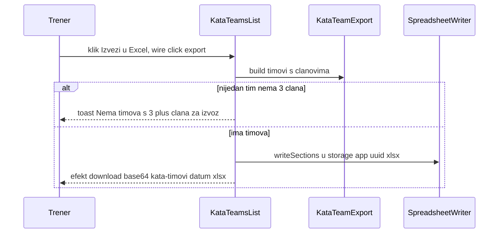
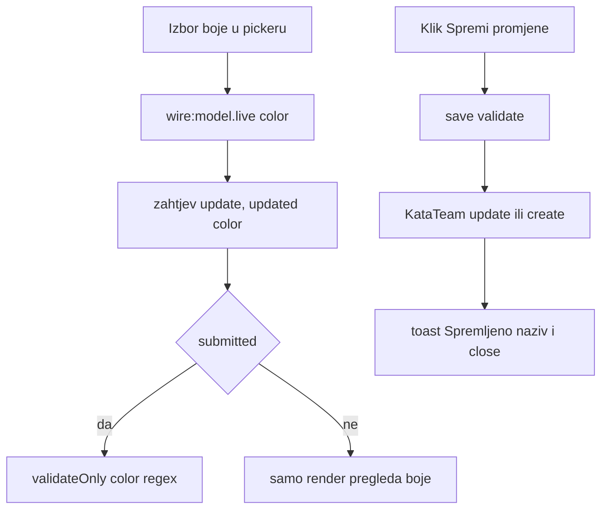

# Ekran: Kata timovi (KataTeamsList)

**Izvor istine:** `app/Livewire/KataTeamsList.php`, `resources/views/livewire/kata-teams-list.blade.php`, `app/Support/KataTeamExport.php`, `app/Support/SpreadsheetWriter.php`, `app/Models/KataTeam.php`, `routes/web.php`

**Stanje:** feature/clanarine @ 87307b0, 2026-10-20

Ekran vodi imenovane timove (naziv + boja oznake) i izvozi timove spremne za natjecanje. **Članovi se ne dodaju ovdje**: dijete se u tim stavlja kvačicom u obrascu polaznika (odjeljak „Kata timovi" u [polaznici.md](polaznici.md), svojstvo `kataTeamIds`, tablica `kata_team_student`). Ovaj ekran samo prikazuje članove. Opći tok Livewire poziva u [../03-http-i-livewire.md](../03-http-i-livewire.md); autorizacija je samo `auth` ([../07-autorizacija-i-sigurnost.md](../07-autorizacija-i-sigurnost.md)).

## Pregled

| Stavka | Vrijednost |
|---|---|
| Ruta | `GET /kata-timovi`, ime `kata-timovi` (`routes/web.php:29`), `auth` |
| Klasa | `App\Livewire\KataTeamsList` (`app/Livewire/KataTeamsList.php:20`, `final`) |
| Atributi | `#[Layout('components.layouts.app')]` (:18), `#[Title('Kata timovi')]` (:19); nema `#[Url]`/`#[On]`/`#[Locked]` |
| Događaji | samo `toast` |

## Svojstva

| Svojstvo | Tip | Početno | Napomena |
|---|---|---|---|
| `open` | `bool` | `false` | ladica |
| `editId` | `?int` | `null` | `null` = novi tim |
| `submitted` | `bool` | `false` | |
| `name` | `string` | `''` | naziv tima |
| `color` | `string` | `'#2D3E7B'` | heksadecimalna boja; `reset(['color'])` ga vraća na ovu zadanu vrijednost |
| `confirmingDelete` | `bool` | `false` | |
| `deleteId` | `?int` | `null` | |
| `deleteName` | `string` | `''` | |
| `deleteMembers` | `int` | `0` | broj članova koji gube oznaku |

## Validacija (`rules()` :40, `messages()` :48)

| Polje | Pravila | Prilagođena poruka |
|---|---|---|
| `name` | `required`, `string`, `max:60` | `required`: „Obavezno polje" |
| `color` | `required`, `regex:/^#[0-9A-Fa-f]{6}$/` | `regex`: „Neispravna boja" |

Poruka za `max:60` je zadana engleska. Greške se ispisuju pod „Naziv tima *" i „Boja oznake". Kao u `CompetitionsList`, `openCreate()` / `openEdit()` ne zovu `resetValidation()`.

## Kukice životnog ciklusa

- Nema `mount()`.
- `updated(string $field)` (:77): ako je `submitted`, `validateOnly($field)`. Boja je `wire:model.live`, pa svaki odabir boje u pickeru šalje zahtjev.
- `render()` (:141): `KataTeam::with('students')->orderBy('name')->get()`, a članovi svakog tima se sortiraju po hrvatskoj abecedi (`CroatianCollator`, prezime pa ime). Relacija izostavlja soft-obrisane polaznike (globalni scope modela `Student`).

## Tablica akcija

| Element (natpis) | Okidač | Metoda(parametri) | Autorizacija | Validacija | Učinak (baza / događaji / poruka) | Odgovor |
|---|---|---|---|---|---|---|
| Gumb „Izvezi u Excel" / „Izvoz…" (:9) | `wire:click="export"`, `wire:target="export"`, `wire:loading.attr="disabled"` | `export()` (:124) | `auth` | ako nijedan tim nema barem 3 člana: toast „Nema timova s 3+ člana za izvoz." i `null` | `KataTeamExport::build(...)` (samo timovi s `>= 3` člana, `MIN_MEMBERS`), `SpreadsheetWriter::writeSections(...)` u `storage/app/<uuid>.xlsx`; banner `<klub> — Kata timovi · <d.m.Y.>`; preuzimanje `kata-timovi-<Y-m-d>.xlsx`; brisanje privremene datoteke nakon slanja; bez upisa u bazu | efekt `download`; ili toast |
| Gumb „+ Novi tim" (:15) | `wire:click="openCreate"` | `openCreate()` (:56) | `auth` | nema | `reset(['editId','name','color','submitted'])`, `open = true` | `html` |
| Naziv tima i popis članova kao gumb (:26) | `wire:click="openEdit(id)"` | `openEdit(id)` (:62) | `auth` | `KataTeam::findOrFail($id)` (404) | puni `editId`, `name`, `color`, `submitted = false`, `open = true` | `html` |
| Ikona olovke (aria „Uredi: <naziv>") (:41) | `wire:click="openEdit(id)"` | `openEdit(id)` | `auth` | kao gore | kao gore | `html` |
| Ikona koša (aria „Obriši: <naziv>") (:45) | `wire:click="confirmDelete(id)"` | `confirmDelete(id)` (:99) | `auth` | `KataTeam::withCount('students')->findOrFail($id)` | puni `deleteId`, `deleteName`, `deleteMembers`, `confirmingDelete = true` | `html` |
| Pozadina ladice (:61) | Alpine `@click="$wire.close()"` | `close()` (:72) | `auth` | nema | `open = false` | `html` |
| Tipka Esc u ladici (:60) | Alpine `@keydown.escape.window="$wire.open && $wire.close()"` | `close()` | `auth` | nema | zatvara | `html` |
| Gumb „Zatvori" (ikona X) (:70) | `wire:click="close"` | `close()` | `auth` | nema | zatvara | `html` |
| Gumb „Odustani" u ladici (:98) | `wire:click="close"` | `close()` | `auth` | nema | zatvara | `html` |
| Obrazac (:67) | `wire:submit="save"` | `save()` (:84) | `auth` | `submitted = true`; `validate()` | vidi niže | `html` + `dispatches` |
| Gumb „Dodaj tim" / „Spremi promjene" (:99) | `type="submit"` | `save()` | `auth` | kao gore | kao gore | kao gore |
| Polje „Naziv tima *" (placeholder „npr. Tim A") (:78) | `wire:model.blur="name"` | svojstvo `name` | `auth` | `required`, `max:60` | stanje | nema |
| Birač „Boja oznake" (`type="color"`) (:86) | `wire:model.live="color"` | svojstvo `color` | `auth` | `regex` heks-boje | odmah osvježava pregled točkice i ispis koda boje | `html` |
| Pozadina dijaloga brisanja (:107) | Alpine `@click="$wire.cancelDelete()"` | `cancelDelete()` (:108) | `auth` | nema | zatvara | `html` |
| Tipka Esc u dijalogu (:106) | Alpine `@keydown.escape.window="$wire.confirmingDelete && $wire.cancelDelete()"` | `cancelDelete()` | `auth` | nema | zatvara | `html` |
| Gumb „Odustani" u dijalogu (:122) | `wire:click="cancelDelete"` | `cancelDelete()` | `auth` | nema | zatvara | `html` |
| Gumb „Da, obriši" (:123) | `wire:click="delete"` | `delete()` (:113) | `auth` | ako je `deleteId` null, ne briše | `KataTeam::findOrFail($deleteId)->delete()`; redci pivota `kata_team_student` brišu se kaskadom, polaznici ostaju; toast „Kata tim obrisan" | `html` + `dispatches` |
| Metoda `updated()` | svaka promjena svojstva | `updated(field)` (:77) | n/a | `validateOnly` ako je `submitted` | nema upisa | n/a |
| Metoda `render()` | svaki render | `render()` (:141) | n/a | nema | podatak `teams` s članovima | HTML |

`save()` (:84-97): `validate()`; `['name' => $name, 'color' => $color]`; `KataTeam::findOrFail(editId)->update` ili `KataTeam::create`; toast `Spremljeno: <naziv>`; `close()`. Tekstovi: podnaslov „N tim"/„N timova"; broj članova „N član"/„N članova"; prazno stanje „Još nema kata timova" / „Dodaj prvi tim gumbom gore desno, pa polaznike u njega rasporedi kroz njihovu formu."; „Još nema članova"; dijalog „Obrisati kata tim?" s tekstom „Tim <naziv> bit će obrisan. [N polaznik(a) će izgubiti ovu oznaku (ostaju u evidenciji).]".

Brisanje je trajno i bez poništavanja; ne piše u `audit_logs`. Promjena imena/boje tima odmah vrijedi i u oznakama u popisu polaznika (te se vrijednosti čitaju pri svakom renderu).

## Izvoz: što ulazi u datoteku

`KataTeamExport::build(KataTeam::with('students')->orderBy('name')->get(), now)` vraća `headers` = `Prezime`, `Ime`, `Datum rođenja`, `Uzrasna kategorija` i `sections` (jedan obojeni blok po timu, samo timovi s najmanje 3 člana). Pisanje blokova radi `SpreadsheetWriter::writeSections`. Algoritmi u [../05-domena-i-servisi.md](../05-domena-i-servisi.md).

