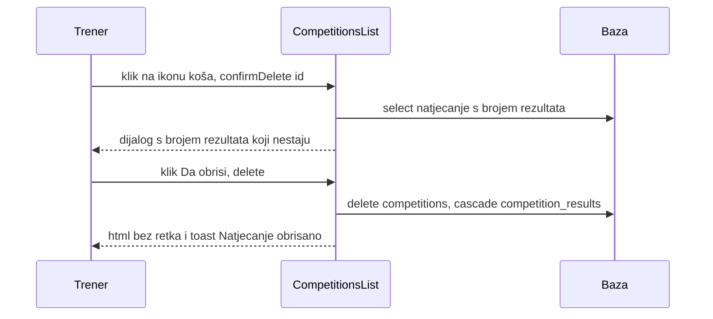

# Ekran: Natjecanja (CompetitionsList)

**Izvor istine:** `app/Livewire/CompetitionsList.php`, `resources/views/livewire/competitions-list.blade.php`, `app/Models/Competition.php`, `routes/web.php`

**Stanje:** feature/clanarine @ 87307b0, 2026-10-20

Šifrarnik natjecanja (naziv, datum, grad) iz kojeg se biraju natjecanja pri unosu rezultata djeteta (odjeljak „Natjecanja i rezultati" u ladici polaznika, vidi [polaznici.md](polaznici.md#studentresults)). To **nisu** isto što i „Popisi za natjecanje" ([popisi-natjecanja.md](popisi-natjecanja.md)), koji su zasebna tablica bez veze s ovom. Opći tok Livewire poziva i obrazac ladice/dijaloga u [../03-http-i-livewire.md](../03-http-i-livewire.md).

## Pregled

| Stavka | Vrijednost |
|---|---|
| Ruta | `GET /natjecanja`, ime `natjecanja` (`routes/web.php:26`), middleware `web` + `auth` |
| Klasa | `App\Livewire\CompetitionsList` (`app/Livewire/CompetitionsList.php:14`, `final`) |
| Atributi | `#[Layout('components.layouts.app')]` (:12), `#[Title('Natjecanja')]` (:13); nema `#[Url]`, `#[On]`, `#[Locked]` |
| Autorizacija | samo `auth`; nema provjere uloga (svaki prijavljeni korisnik može stvarati, mijenjati i brisati) |
| Događaji | šalje samo `toast`; ne šalje `students-changed` |

## Svojstva

| Svojstvo | Tip | Početno | Napomena |
|---|---|---|---|
| `open` | `bool` | `false` | vidljivost ladice (`x-show="$wire.open"`) |
| `editId` | `?int` | `null` | `null` = novo natjecanje |
| `submitted` | `bool` | `false` | nakon prvog pokušaja spremanja `updated()` validira polje po polje |
| `name` | `string` | `''` | naziv |
| `heldOn` | `string` | `''` | datum `Y-m-d` |
| `city` | `string` | `''` | grad / mjesto |
| `confirmingDelete` | `bool` | `false` | dijalog potvrde |
| `deleteId` | `?int` | `null` | natjecanje za brisanje |
| `deleteName` | `string` | `''` | za tekst dijaloga |
| `deleteResults` | `int` | `0` | broj rezultata koji će nestati |

## Validacija (`rules()` :36, `messages()` :45)

| Polje | Pravila | Prilagođena poruka |
|---|---|---|
| `name` | `required`, `string`, `max:255` | `required`: „Obavezno polje" |
| `heldOn` | `required`, `date` | `required`: „Obavezno polje"; `date`: „Neispravan datum" |
| `city` | `nullable`, `string`, `max:100` | nema (zadana engleska poruka; u view-u nema ispisa za `city`) |

Poruke bez prilagodbe (npr. `max`) dolaze iz frameworka; bez `lang/` mape uz `APP_LOCALE=hr` korisnik vidi sirovi ključ prijevoda (npr. `validation.max.string`), uz `en` engleski tekst. Greške se prikazuju pod poljima „Naziv *" i „Datum *".

`openCreate()` i `openEdit()` ne pozivaju `resetValidation()` (za razliku od `CompetitionRostersList`), pa greške s prethodnog neuspjelog pokušaja mogu ostati vidljive pri sljedećem otvaranju ladice. [NEJASNO: ponašanje u pregledniku nije pokrenuto; zaključak je izveden iz koda.]

## Kukice životnog ciklusa

- Nema `mount()`.
- `updated(string $field)` (:76): ako je `submitted`, `validateOnly($field)`.
- `render()` (:122): `competitions = Competition::withCount('results')->orderByDesc('held_on')->get()`.

## Tablica akcija

| Element (natpis) | Okidač | Metoda(parametri) | Autorizacija | Validacija | Učinak (baza / događaji / poruka) | Odgovor |
|---|---|---|---|---|---|---|
| Gumb „+ Novo natjecanje" (:8) | `wire:click="openCreate"` | `openCreate()` (:54) | `auth` | nema | `reset(['editId','name','heldOn','city','submitted'])`, `open = true` | `html` |
| Naziv natjecanja kao gumb (:18) | `wire:click="openEdit(id)"` | `openEdit(id)` (:60) | `auth` | `Competition::findOrFail($id)` (404 ako ne postoji) | puni `editId`, `name`, `heldOn`, `city`, `submitted = false`, `open = true` | `html` |
| Ikona olovke (aria „Uredi: <naziv>") (:26) | `wire:click="openEdit(id)"` | `openEdit(id)` | `auth` | kao gore | kao gore | `html` |
| Ikona koša (aria „Obriši: <naziv>") (:30) | `wire:click="confirmDelete(id)"` | `confirmDelete(id)` (:98) | `auth` | `Competition::withCount('results')->findOrFail($id)` | puni `deleteId`, `deleteName`, `deleteResults`, `confirmingDelete = true` | `html` |
| Pozadina ladice (klik) (:46) | Alpine `@click="$wire.close()"` | `close()` (:71) | `auth` | nema | `open = false` | `html` |
| Tipka Esc u ladici (:45) | Alpine `@keydown.escape.window="$wire.open && $wire.close()"` | `close()` | `auth` | nema | `open = false` | `html` |
| Gumb „Zatvori" (ikona X) (:55) | `wire:click="close"` | `close()` | `auth` | nema | `open = false` | `html` |
| Gumb „Odustani" u ladici (:85) | `wire:click="close"` | `close()` | `auth` | nema | `open = false` | `html` |
| Obrazac u ladici (:52) | `wire:submit="save"` | `save()` (:83) | `auth` | `submitted = true`; `validate()` | vidi „Spremanje" | `html` + `dispatches` |
| Gumb „Dodaj natjecanje" / „Spremi promjene" (:86) | `type="submit"` | `save()` | `auth` | kao gore | kao gore | kao gore |
| Polje „Naziv *" (:63) | `wire:model.blur="name"` | svojstvo `name` | `auth` | `required`, `max:255` | stanje do sljedećeg zahtjeva | nema |
| Polje „Datum *" (:71) | `wire:model.blur="heldOn"` | svojstvo `heldOn` | `auth` | `required`, `date` | stanje | nema |
| Polje „Grad / mjesto" (:78) | `wire:model.blur="city"` | svojstvo `city` | `auth` | `max:100` | stanje | nema |
| Pozadina dijaloga brisanja (klik) (:94) | Alpine `@click="$wire.cancelDelete()"` | `cancelDelete()` (:107) | `auth` | nema | `confirmingDelete = false` | `html` |
| Tipka Esc u dijalogu (:93) | Alpine `@keydown.escape.window="$wire.confirmingDelete && $wire.cancelDelete()"` | `cancelDelete()` | `auth` | nema | zatvara | `html` |
| Gumb „Odustani" u dijalogu (:108) | `wire:click="cancelDelete"` | `cancelDelete()` | `auth` | nema | zatvara | `html` |
| Gumb „Da, obriši" (:109) | `wire:click="delete"` | `delete()` (:112) | `auth` | ako je `deleteId` null, ne briše | `Competition::findOrFail($deleteId)->delete()`; rezultati se brišu kaskadno (FK `competition_results.competition_id` `cascadeOnDelete`); `confirmingDelete = false`; toast „Natjecanje obrisano" | `html` + `dispatches` |
| Metoda `updated()` | svaka promjena svojstva | `updated(field)` (:76) | n/a | `validateOnly` ako je `submitted` | nema upisa | n/a |
| Metoda `render()` | svaki render | `render()` (:122) | n/a | nema | podaci `competitions` s brojačem `results_count` | HTML |

Tekstovi dijaloga: naslov „Obrisati natjecanje?", tijelo „Natjecanje <naziv> bit će obrisano [zajedno sa N upisanih rezultata]. Ovo se ne može poništiti." Prazno stanje: „Još nema natjecanja" / „Dodaj prvo natjecanje gumbom gore desno."

## Spremanje (`save()`, :83-96)

1. `submitted = true`; `validate()`.
2. `$data = ['name', 'held_on', 'city' (prazno u null)]`.
3. `editId !== null` pa `Competition::findOrFail($editId)->update($data)`, inače `Competition::create($data)` (`Competition::$fillable = ['name','held_on','city']`).
4. `dispatch('toast', message: "Spremljeno: {naziv}")`, `close()`.

Nema transakcije (jedan upis), nema zapisa u `audit_logs`, brisanje je **trajno** (nema soft delete, nema poništavanja), a posljedica je i trajni gubitak svih rezultata djece za to natjecanje.

