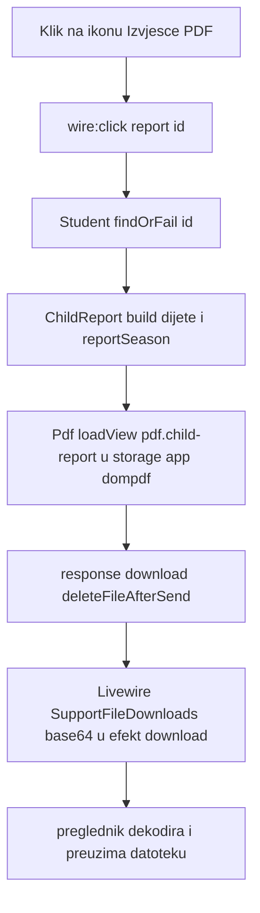
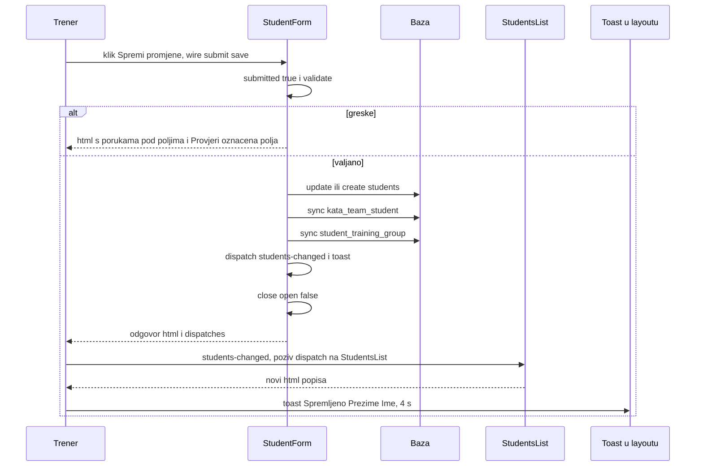
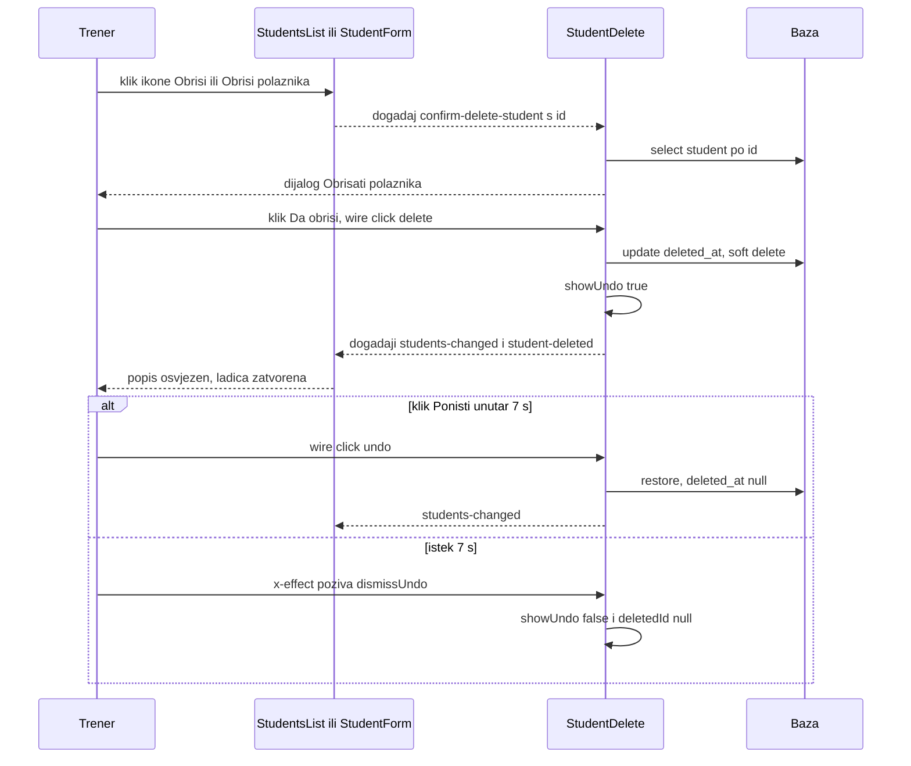
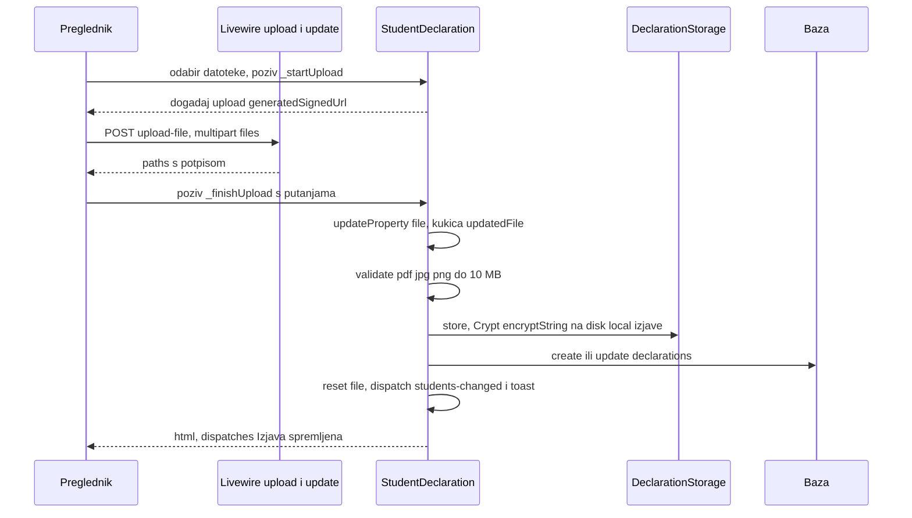

# Ekran: Polaznici (popis, obrazac, brisanje, rezultati, izjava, izvozi)

**Izvor istine:** `app/Livewire/StudentsList.php`, `app/Livewire/StudentForm.php`, `app/Livewire/StudentDelete.php`, `app/Livewire/StudentResults.php`, `app/Livewire/StudentDeclaration.php`, `app/Http/Controllers/DeclarationController.php`, `app/Support/DeclarationStorage.php`, `app/Support/ChildReport.php`, `app/Support/CompetitionExport.php`, `app/Support/MedicalReminders.php`, `resources/views/livewire/students-list.blade.php`, `resources/views/livewire/student-form.blade.php`, `resources/views/livewire/student-delete.blade.php`, `resources/views/livewire/student-results.blade.php`, `resources/views/livewire/student-declaration.blade.php`, `resources/views/pdf/child-report.blade.php`, `routes/web.php`

**Stanje:** feature/clanarine @ 87307b0, 2026-10-20

Ovo je glavni ekran aplikacije (`/polaznici`, ujedno odredište `/`). Jedna stranica sastoji se od pet Livewire komponenti:

| Komponenta | Uloga | Kako se učitava |
|---|---|---|
| `StudentsList` | popis, filteri, izvozi, PDF izvješće | ruta `GET /polaznici` (`routes/web.php:25`) |
| `StudentForm` | ladica „Novi polaznik" / „Uredi polaznika" | `<livewire:student-form />` na dnu `resources/views/livewire/students-list.blade.php:355` |
| `StudentDelete` | dijalog potvrde brisanja i 7-sekundni „Poništi" toast | `<livewire:student-delete />` (`resources/views/livewire/students-list.blade.php:356`) |
| `StudentResults` | rezultati natjecanja (odjeljak u ladici, samo za postojećeg polaznika) | `resources/views/livewire/student-form.blade.php:216` |
| `StudentDeclaration` | izjava roditelja (odjeljak u ladici, samo za postojećeg polaznika) | `resources/views/livewire/student-form.blade.php:222` |

Odjeljak „Članarina" u ladici (komponente `StudentFeePlans` i `StudentCharges`, iza `FEATURE_PAYMENTS`) dokumentiran je u [clanarine.md](clanarine.md). Opći tok Livewire poziva, događaji i Alpine obrasci ladice/dijaloga opisani su u [../03-http-i-livewire.md](../03-http-i-livewire.md). Autorizacija: samo `auth` middleware, bez provjere uloga (vidi [../07-autorizacija-i-sigurnost.md](../07-autorizacija-i-sigurnost.md)).

Napomena o porukama: pravila bez prilagođene poruke vraćaju zadane poruke frameworka: bez `lang/` mape uz `APP_LOCALE=hr` to je sirovi ključ prijevoda (npr. `validation.required`), uz `en` engleski tekst; atribut u poruci je ime svojstva u `snake_case` s razmacima (npr. `birthDate` postaje „birth date"). Dolje su navedene samo prilagođene poruke.

## StudentsList

### Pregled

| Stavka | Vrijednost |
|---|---|
| Klasa | `App\Livewire\StudentsList` (`app/Livewire/StudentsList.php:33`, `final`) |
| Atributi | `#[Layout('components.layouts.app')]` (:31), `#[Title('Polaznici')]` (:32), `#[On('students-changed')]` na `refreshList()` (:91), `#[Url]` na 11 svojstava (dolje) |
| Konstante | `NO_BIRTH_DATE = 'bez-datuma'` (:36), `AGE_ORDER` (:39, privatna) |
| View | `livewire.students-list`; podaci iz `render()` (:320-356) navedeni niže |

### Svojstva

| Svojstvo | Tip | Početno | URL alias (`#[Url]`) | Napomena |
|---|---|---|---|---|
| `search` | `string` | `''` | `q` (except `''`) | traži po normaliziranom `search_haystack` (prezime, ime, roditelj, e-mail roditelja, telefon, OIB; `app/Models/Student.php:178`) |
| `ageKey` | `string` | `''` | `uzrast` | ključ uzrasne kategorije ili `bez-datuma` |
| `slot` | `string` | `''` | `termin` | slug termina; učenik prolazi ako ijedna njegova grupa ima taj termin |
| `group` | `string` | `''` | `grupa` | slug grupe |
| `belt` | `string` | `''` | `pojas` | vrijednost `Belt` enuma kao string |
| `expiredOnly` | `bool` | `false` | `istekao` (except `false`) | filter „Liječnički istekao" |
| `expiringSoonOnly` | `bool` | `false` | `uskoro` | filter „Ističe uskoro" |
| `toRegisterOnly` | `bool` | `false` | `upisati` | filter „Treba upisati" |
| `noDeclarationOnly` | `bool` | `false` | `bez-izjave` | filter „Nema izjavu" |
| `crossingSoonOnly` | `bool` | `false` | `prelazi` | filter „Prelazi kategoriju" |
| `noPaymentMethodOnly` | `bool` | `false` | `bez-nacina` | filter „Nedostaje način plaćanja" (prikazan samo uz `config('features.payments')`) |
| `reportSeason` | `int` | `0`, u `mount()` postaje `Season::current(now)` | nema | početna godina sezone za PDF izvješće |
| `cache` (privatno) | `?Collection` | `null` | nema | nije u snapshotu; vrijedi samo unutar jednog zahtjeva |

Ako `reportSeason` dobije nenumeričku vrijednost, tipizirano svojstvo baca `TypeError`, a `HandleRequests::handleUpdate` to pretvara u HTTP 419 (`vendor/livewire/livewire/src/Mechanisms/HandleRequests/HandleRequests.php:221-226`). Nema `#[Locked]`.

### Podaci za view (`render()`, `app/Livewire/StudentsList.php:320`)

`rows` (filtrirani i po hrvatskoj abecedi sortirani polaznici, `CroatianCollator`), `today`, `ageChips`, brojači `expiredCount`, `expiringSoonCount`, `toRegisterCount`, `noDeclarationCount`, `crossingSoonCount`, `noPaymentMethodCount` (0 bez flaga), `trainingSlots` (`TrainingSlot` s lokacijom, po `sort_order`), `groups` (po `name`), `belts` (`Belt::options()`), `subtitle` („N upisanih polaznika" ili „Prikazano X od N"), `filtersActive`, `reportSeasons` (zadnjih 5 sezona). Svi polaznici se učitaju jednim upitom (`Student::with(...)->get()`, `allStudents()` :184) i filtriraju u PHP-u, pri svakom zahtjevu prema ovoj komponenti.

### Tablica akcija

Svaka redna radnja postoji dvaput u DOM-u: tablica za desktop (`max-[760px]:hidden`) i kartice za mobitel (`min-[761px]:hidden`); retci niže navode oba retka s brojevima linija u `students-list.blade.php`.

| Element (natpis) | Okidač | Metoda(parametri) | Autorizacija | Validacija | Učinak (baza / događaji / poruka) | Odgovor |
|---|---|---|---|---|---|---|
| Padajući izbornik „Sezona" (:12) | `wire:model.live="reportSeason"` | nema metode; svojstvo `reportSeason` | `auth` | tip `int` (inače 419) | samo stanje; koristi ga `report(id)` | `html` (cijela lista se ponovno renderira) |
| „Izvezi u Excel" / „Izvoz…" (:19) | `wire:click="export"`, `wire:target="export"`, `wire:loading.attr="disabled"` | `export()` (:103) | `auth` | nema | gradi `.xlsx` iz trenutno filtriranih redaka; bez upisa u bazu; privremena datoteka `storage/app/<uuid>.xlsx` briše se nakon slanja | efekt `download` (base64), vidi „Izvozi" niže |
| „Podsjetnici (Excel)" / „Izvoz…" (:25) | `wire:click="medicalReminders"` | `medicalReminders()` (:116) | `auth` | nema | `.xlsx` liječničkih podsjetnika; bez upisa | efekt `download` |
| „+ Novi polaznik" (:31) | `wire:click="$dispatch('new-student')"` | klijentski događaj `new-student` (nema poziva `StudentsList`-a) | `auth` | nema | `StudentForm::openCreate()` otvara ladicu | zasebni zahtjev prema `StudentForm` (`__dispatch`) |
| Čip „Svi" (:43, prvi čip) | `wire:click="$set('ageKey', '')"` | magična akcija `$set` | `auth` | nema | postavlja `ageKey` na `''` | `html`; adresa se klijentski ažurira (parametar `?uzrast=` nestaje; definicija `#[Url]` stigla je u efektu `url` pri prvom učitavanju, a povijest se mijenja s `replace`) |
| Čipovi uzrasta (naslovi iz `ageChips`, npr. „Bez datuma rođenja") (:43) | `wire:click="setAge('<ključ>')"` | `setAge(key)` (:85) | `auth` | nema | ako je ključ već aktivan, poništava ga (toggle) | `html` |
| Polje „Pretraga polaznika" (placeholder „Ime, roditelj, OIB…") (:61) | `wire:model.live.debounce.300ms="search"` | nema metode; svojstvo `search` | `auth` | nema | zahtjev 300 ms nakon zadnje tipke | `html` |
| Izbornik „Termin" (opcija „Svi termini") (:66) | `wire:model.live="slot"` | svojstvo `slot` | `auth` | nema | filtrira | `html` |
| Izbornik „Grupa" (opcija „Sve grupe") (:74) | `wire:model.live="group"` | svojstvo `group` | `auth` | nema | filtrira | `html` |
| Izbornik „Pojas" (opcija „Svi pojasevi") (:82) | `wire:model.live="belt"` | svojstvo `belt` | `auth` | nema | filtrira | `html` |
| Čip „Liječnički istekao" (:90) | `wire:click="$toggle('expiredOnly')"` | magična akcija `$toggle` | `auth` | nema | preokreće filter | `html` |
| Čip „Ističe uskoro" (:100) | `wire:click="$toggle('expiringSoonOnly')"` | `$toggle` | `auth` | nema | preokreće filter | `html` |
| Čip „Treba upisati" (:110) | `wire:click="$toggle('toRegisterOnly')"` | `$toggle` | `auth` | nema | preokreće filter | `html` |
| Čip „Nema izjavu" (:120) | `wire:click="$toggle('noDeclarationOnly')"` | `$toggle` | `auth` | nema | preokreće filter | `html` |
| Čip „Prelazi kategoriju" (:130) | `wire:click="$toggle('crossingSoonOnly')"` | `$toggle` | `auth` | nema | preokreće filter | `html` |
| Čip „Nedostaje način plaćanja" (:141; samo `config('features.payments')`) | `wire:click="$toggle('noPaymentMethodOnly')"` | `$toggle` | `auth` + flag | nema | preokreće filter (koristi `Student::missingPaymentMethod`) | `html` |
| „Poništi filtre" (:153; vidi se kad je `filtersActive`) | `wire:click="resetFilters"` | `resetFilters()` (:97) | `auth` | nema | `reset` svih 11 filter svojstava | `html`; URL parametri nestaju |
| „Poništi filtre" u praznom stanju, desktop (:275) i mobilno (:349) | `wire:click="resetFilters"` | `resetFilters()` | `auth` | nema | isto | `html` |
| Prezime Ime kao gumb, desktop (:179) i mobilno (:291) | `wire:click="$dispatch('edit-student', { id })"` | klijentski događaj `edit-student` | `auth` | nema | `StudentForm::openEdit(id)` | zasebni zahtjev prema `StudentForm` |
| Ikona „Izvješće (PDF)" (aria „Izvješće (PDF): Prezime Ime"), desktop (:251) i mobilno (:313) | `wire:click="report(id)"` | `report(id)` (:142) | `auth` (nema provjere vlasništva ni uloge) | `Student::findOrFail` (404 ako ne postoji ili je obrisan) | gradi PDF, vidi „Izvješće po djetetu" | efekt `download` |
| Ikona „Uredi: Prezime Ime", desktop (:256) i mobilno (:317) | `wire:click="$dispatch('edit-student', { id })"` | događaj `edit-student` | `auth` | nema | otvara ladicu | zasebni zahtjev prema `StudentForm` |
| Ikona „Obriši: Prezime Ime", desktop (:261) i mobilno (:321) | `wire:click="$dispatch('confirm-delete-student', { id })"` | događaj `confirm-delete-student` | `auth` | nema | `StudentDelete::confirm(id)` otvara dijalog | zasebni zahtjev prema `StudentDelete` |
| Slušač `students-changed` | `#[On('students-changed')]` (:91) | `refreshList()` (:92) | `auth` | nema | `$this->cache = null` (komponenta se zatim sama ponovno renderira) | `html` |
| Metoda `mount()` | pri prvom učitavanju stranice | `mount()` (:80) | `auth` (ruta) | nema | postavlja `reportSeason = Season::current(now)` | dio početnog HTML-a |
| Metoda `hasActiveFilters()` | poziva se iz `subtitle()` i `render()` | `hasActiveFilters()` (:168) | nije namijenjena klijentu (javna je pa je tehnički pozivljiva, vidi [../07-autorizacija-i-sigurnost.md](../07-autorizacija-i-sigurnost.md)) | nema | vraća `true` ako je ijedan filter aktivan | nema učinka na stanje |
| Metoda `render()` | svaki render | `render()` (:320) | n/a | nema | vraća `view('livewire.students-list', [...])` | HTML |
| Ugrađeno: obrazac i dijalog | `<livewire:student-form />`, `<livewire:student-delete />` (:355-356) | n/a | n/a | n/a | djeca s vlastitim stanjem (tablice niže) | n/a |

### Izvozi: gumb, metoda, sadržaj

| Gumb | Metoda | Gradnja sadržaja | Datoteka | Naslov u Excelu |
|---|---|---|---|---|
| „Izvezi u Excel" | `StudentsList::export()` (:103) | `CompetitionExport::build($this->rows(), $this->today())`: stupci `Prezime`, `Ime`, `Datum rođenja`, `Uzrasna kategorija`, `Pojas` (bez OIB-a i liječničkog); izvozi trenutno filtrirane retke | `polaznici-[<slug termina>-]<Y-m-d>.xlsx` | „Popis polaznika" ili uz aktivan filter termina „Popis polaznika · <oznaka termina>" |
| „Podsjetnici (Excel)" | `StudentsList::medicalReminders()` (:116) | `MedicalReminders::build($this->rows(), $this->today())`: stupci `Prezime`, `Ime`, `Lokacija`, `Vrijedi do`, `Status`, `Rok`, `Roditelj`, `Telefon`; samo statusi istekao / ističe uskoro / nepoznato, po hitnosti | `lijecnicki-podsjetnici-<Y-m-d>.xlsx` | „Liječnički podsjetnici" |

Oba idu kroz privatnu `downloadXlsx()` (:131): putanja `storage_path('app/'.<uuid>.'.xlsx')`, natpis `config('optimist.club_name').' — '.<naslov>.' · '.<d.m.Y.>`, `SpreadsheetWriter::write(...)`, pa `response()->download($path, $filename)->deleteFileAfterSend()`. Livewire hvata `BinaryFileResponse`, čita sadržaj u memoriju, kodira ga u base64 i vraća kao efekt `download` (`name`, `content`, `contentType`); preglednik ga dekodira i pokreće preuzimanje. Datoteka na disku briše se nakon slanja (Symfony `BinaryFileResponse::sendContent`). Detalji algoritama izvoza u [../05-domena-i-servisi.md](../05-domena-i-servisi.md).

### Izvješće po djetetu (PDF)

`report(int $id)` (`app/Livewire/StudentsList.php:142-166`):

1. `Student::findOrFail($id)`; `ChildReport::build($child, $this->reportSeason)` (rezultati iz sezone `Season::contains`, grupirani po disciplinama, sažetak: natjecanja, zlato, srebro, bronca, borbe).
2. Radna mapa `storage/app/dompdf`; ako se ne može stvoriti, `abort(500, 'Ne mogu pripremiti mapu za PDF.')`. Razlog (iz komentara u kodu): na dijeljenom hostingu zadani `/tmp` i `storage_path('fonts')` često nisu dostupni zbog `open_basedir`.
3. `Pdf::loadView('pdf.child-report', $data)->setPaper('a4')->setOption('temp_dir', $work)->setOption('font_cache', $work)->save($path)` (`Barryvdh\DomPDF\Facade\Pdf`).
4. Naziv datoteke `izvjesce-<slug "Prezime Ime">-<Season::slug>.pdf`; odgovor `response()->download(...)->deleteFileAfterSend()`, dakle isti efekt `download` kao za Excel.

View `resources/views/pdf/child-report.blade.php`: logo `public/images/KKoptimist.png` (ako postoji), naziv kluba, naslov „Izvješće o natjecanjima — sezona …", ime djeteta, sažetak u pet ćelija (Natjecanja, Zlato, Srebro, Bronca, Ukupno borbi), pa tablice po disciplinama.

## StudentForm

### Pregled

| Stavka | Vrijednost |
|---|---|
| Klasa | `App\Livewire\StudentForm` (`app/Livewire/StudentForm.php:20`, `final`); nema `#[Layout]`/`#[Title]` jer je dijete |
| Slušači | `#[On('new-student')]` → `openCreate()` (:105-106), `#[On('edit-student')]` → `openEdit(int $id)` (:114-115), `#[On('student-deleted')]` → `closeAfterDelete()` (:146-147) |
| Događaji koje šalje | `students-changed` (:214), `toast` (:215), `confirm-delete-student` (:181) |
| Ladica | Alpine `x-show="$wire.open"`, širina `min(680px,100%)`, `z-50` |

### Svojstva

| Svojstvo | Tip | Početno | Napomena |
|---|---|---|---|
| `open` | `bool` | `false` | vidljivost ladice (Alpine čita `$wire.open`) |
| `studentId` | `?int` | `null` | `null` = novi polaznik; nije `#[Locked]` |
| `submitted` | `bool` | `false` | greške se prikazuju/provjeravaju tek nakon prvog pokušaja spremanja (SPEC §4.6) |
| `lastName`, `firstName` | `string` | `''` | obavezna |
| `birthDate` | `string` | `''` | `Y-m-d` |
| `oib` | `string` | `''` | |
| `belt` | `string` | `''` | `'0'`..`'9'` ili prazno |
| `nextGradeStatus` | `string` | `'none'` | `none` / `to_register` / `registered` |
| `nextGradeKyu` | `string` | `''` | `'1'`..`'9'` |
| `medicalValidUntil` | `string` | `''` | |
| `hasNoMedical` | `bool` | `false` | |
| `parentName`, `parentPhone`, `parentEmail`, `note` | `string` | `''` | |
| `flagT` | `bool` | `false` | oznaka „t" |
| `kataTeamIds` | `array` | `[]` | id-evi kao stringovi (checkbox) |
| `trainingGroupIds` | `array` | `[]` | id-evi grupa kao stringovi (checkbox) |

### Validacija (`rules()` :64, `messages()` :92)

| Polje | Pravila | Prilagođena poruka |
|---|---|---|
| `lastName`, `firstName` | `required`, `string`, `max:100` | `required`: „Obavezno polje" |
| `birthDate` | `nullable`, `date`, `after_or_equal:1900-01-01`, `before_or_equal:today` | `before_or_equal`: „Datum rođenja ne može biti u budućnosti"; `after_or_equal`: „Provjeri datum rođenja" |
| `oib` | `nullable`, `App\Rules\Oib` (11 znamenki + kontrolna znamenka), `Rule::unique('students','oib')->ignore($this->studentId)` | `unique`: „Polaznik s ovim OIB-om već postoji"; pravilo `Oib`: „OIB mora imati 11 znamenki." odnosno „OIB nije ispravan." |
| `trainingGroupIds` / `.*` | `array` / `exists:training_groups,id` | nema (engleska poruka) |
| `belt` | `nullable`, `in:0..9` | nema |
| `nextGradeStatus` | `in:none,to_register,registered` | nema |
| `nextGradeKyu` | `requiredIf(nextGradeStatus === 'registered')`, `nullable`, `in:1..9` | `required`: „Odaberi stupanj" |
| `medicalValidUntil` | `nullable`, `date`, `prohibitedIf(hasNoMedical)` | nema |
| `hasNoMedical`, `flagT` | `boolean` | nema |
| `parentName` | `nullable`, `string`, `max:150` | nema |
| `parentPhone` | `nullable`, `string`, `max:30` | nema |
| `parentEmail` | `nullable`, `email` | `email`: „Provjeri e-mail adresu" |
| `note` | `nullable`, `string`, `max:2000` | nema |
| `kataTeamIds` / `.*` | `array` / `exists:kata_teams,id` | nema |

Prikaz grešaka u view-u postoji samo za `lastName`, `firstName`, `birthDate`, `oib`, `nextGradeKyu`, `medicalValidUntil`, `parentEmail`, `note`. Pogreške na ostalim poljima (npr. `trainingGroupIds`) ne dobivaju tekst, ali podnožje prikazuje „Provjeri označena polja" kad je `submitted` i `$errors->any()` (`resources/views/livewire/student-form.blade.php:250`). `Rule::unique` bez `withoutTrashed()` broji i soft-obrisane polaznike, pa OIB obrisanog polaznika i dalje blokira unos (zaključak iz zadanog ponašanja Laravela, nije pokretano).

### Kukice životnog ciklusa

- Nema `mount()`. Početno stanje je zatvorena prazna ladica.
- `updated(string $name)` (:152): ako je `$name === 'hasNoMedical'` i kvačica je uključena, briše `medicalValidUntil`; ako je `submitted`, poziva `validateOnly($name)`. Okida se za svaki promijenjeni ključ u zahtjevu (i `.blur` polja stižu tek uz sljedeći zahtjev).
- `render()` (:228) računa `ageCategory` (iz `birthDate`, `rescue` guta neispravan datum), `medicalStatus`, `groups`, `derivedSlots` (termini označenih grupa, samo za prikaz), `belts`, `kataTeams`.

### Tablica akcija

| Element (natpis) | Okidač | Metoda(parametri) | Autorizacija | Validacija | Učinak (baza / događaji / poruka) | Odgovor |
|---|---|---|---|---|---|---|
| Slušač za „+ Novi polaznik" | `#[On('new-student')]` | `openCreate()` (:106) | `auth` | nema | `resetForm()`, `studentId = null`, `open = true` | `html` ladice |
| Slušač za uredi | `#[On('edit-student')]` | `openEdit(id)` (:115) | `auth`; nema provjere uloga | `Student::findOrFail($id)` (404 za nepostojeći/obrisani) | puni sva svojstva iz baze (uključujući `kataTeamIds`, `trainingGroupIds`), `open = true`; pri renderu se montiraju djeca (rezultati, izjava, a uz flag i članarina) | `html` |
| Slušač nakon brisanja | `#[On('student-deleted')]` | `closeAfterDelete()` (:147) | `auth` | nema | `open = false` | `html` |
| Pozadina ladice (klik) (:5) | Alpine `@click="$wire.close()"` | `close()` (:141) | `auth` | nema | `open = false` | `html` |
| Tipka Esc (:2) | Alpine `@keydown.escape.window="$wire.open && $wire.close()"` | `close()` | `auth` | nema | zatvara ladicu bez spremanja (obrazac se ne briše do sljedećeg otvaranja) | `html` |
| Gumb „Zatvori" (ikona X, aria „Zatvori") (:21) | `wire:click="close"` | `close()` | `auth` | nema | isto | `html` |
| Gumb „Odustani" (:253) | `wire:click="close"` | `close()` | `auth` | nema | isto | `html` |
| Obrazac (:15) | `wire:submit="save"` | `save()` (:185) | `auth` | `submitted = true`; `validate()` sa svim pravilima | vidi „Spremanje" niže | `html` + `dispatches` |
| Gumb „Dodaj polaznika" / „Spremi promjene" (:257) | `type="submit"` unutar obrasca | `save()` | `auth` | kao gore | kao gore | kao gore |
| Polje „Prezime *" (:35) | `wire:model.blur="lastName"` | svojstvo `lastName` | `auth` | `required`, `max:100` | stanje se šalje uz sljedeći zahtjev | nema posebnog |
| Polje „Ime *" (:42) | `wire:model.blur="firstName"` | svojstvo `firstName` | `auth` | `required`, `max:100` | isto | nema |
| Polje „Datum rođenja" (:49) | `wire:model.live="birthDate"` | svojstvo `birthDate`; kukica `updated('birthDate')` | `auth` | `validateOnly` samo ako je `submitted` | odmah ažurira okvir „Uzrastna kategorija" i „Prelazi u višu kategoriju" | `html` |
| Polje „OIB" (placeholder „11 znamenki") (:56) | `wire:model.blur="oib"` | svojstvo `oib` | `auth` | `Oib` + `unique` | isto | nema |
| Izbornik „Pojas" (opcija „— nije uneseno") (:87) | `wire:model.live="belt"` | svojstvo `belt`; `updated('belt')` | `auth` | `in:0..9` | osvježava traku pojasa | `html` |
| Kvačice „Grupe" (:101) | `wire:model.live="trainingGroupIds"` | svojstvo `trainingGroupIds` | `auth` | `exists:training_groups,id` | prikazuje „Treninzi: …" (termini iz grupa) ili „Termini se određuju prema grupama; bez grupe dijete nema termin." | `html` |
| Gumbi „Nije potrebno" / „Treba upisati" / „Već upisan" (:117) | `wire:click="selectNextGrade('none'\|'to_register'\|'registered')"` | `selectNextGrade(status)` (:164) | `auth` | ako je `submitted`, `validateOnly('nextGradeKyu')` | postavlja `nextGradeStatus`; za `registered` bez vrijednosti predlaže `max(1, pojas-1)` ili 9 | `html` |
| Izbornik „Upisan na" (opcije „1. kyu"…, vidljiv samo za „Već upisan") (:127) | `wire:model.live="nextGradeKyu"` | svojstvo `nextGradeKyu` | `auth` | `requiredIf registered`; poruka „Odaberi stupanj" | stanje | `html` |
| Kvačice „Kata timovi" (:143) | `wire:model="kataTeamIds"` | svojstvo `kataTeamIds` | `auth` | `exists:kata_teams,id` | stanje do `save()` | nema |
| Poveznica „Kata timovi" (kad nema timova) (:150) | `href="{{ route('kata-timovi') }}"` | navigacija (GET `/kata-timovi`) | `auth` | nema | puni page load | nova stranica, vidi [kata-timovi.md](kata-timovi.md) |
| Polje „Vrijedi do" (:161) | `wire:model.live="medicalValidUntil"` | svojstvo `medicalValidUntil` | `auth` | `date`, `prohibitedIf hasNoMedical` | ažurira oznaku statusa | `html` |
| Kvačica „Nema liječnički pregled" (:169) | `wire:model.live="hasNoMedical"` | svojstvo; `updated('hasNoMedical')` | `auth` | `boolean` | kad se uključi, briše `medicalValidUntil` i onemogućuje polje | `html` |
| Polje „Roditelj / skrbnik" (:179) | `wire:model.blur="parentName"` | svojstvo `parentName` | `auth` | `max:150` | stanje | nema |
| Polje „Mobitel" (placeholder „091 234 5678") (:184) | `wire:model.blur="parentPhone"` | svojstvo `parentPhone` | `auth` | `max:30` | `trim` pri spremanju | nema |
| Polje „E-mail" (:190) | `wire:model.blur="parentEmail"` | svojstvo `parentEmail` | `auth` | `email` | stanje | nema |
| Polje „Napomena" (:202) | `wire:model.blur="note"` | svojstvo `note` | `auth` | `max:2000` | stanje | nema |
| Kvačica „Oznaka „t”" (:208) | `wire:model="flagT"` | svojstvo `flagT` | `auth` | `boolean` | stanje | nema |
| Odjeljak „Natjecanja i rezultati" (:216) | `<livewire:student-results :student-id="$studentId" :key="'results-'.$studentId" />` | mount `StudentResults::mount(studentId)` | `auth` | n/a | vidi [StudentResults](#studentresults) | n/a |
| Odjeljak „Izjava roditelja" (:222) | `<livewire:student-declaration :student-id="$studentId" :key="'declaration-'.$studentId" />` | mount `StudentDeclaration::mount(studentId)` | `auth` | n/a | vidi [StudentDeclaration](#studentdeclaration) | n/a |
| Odjeljak „Članarina" / „Zaduženja" (:226-233) | `config('features.payments') && (can('assign-fee-plan') \|\| can('manage-payments'))` pa `<livewire:student-fee-plans>` i `<livewire:student-charges>` | mount tih komponenti | vidi [clanarine.md](clanarine.md) | n/a | n/a | n/a |
| Gumb „Obriši polaznika" (samo kad je `studentId`) (:241) | `wire:click="requestDelete"` | `requestDelete()` (:178) | `auth` | ako `studentId === null`, ne radi ništa | `dispatch('confirm-delete-student', id: studentId)` | efekt `dispatches`; zatim zasebni zahtjev prema `StudentDelete` |
| Metoda `render()` | svaki render | `render()` (:228) | n/a | nema | vidi „Kukice" | HTML |

### Spremanje (`save()`, :185-217)

1. `submitted = true`; `validate()`. Greška: izuzetak, stanje se vraća s porukama; ništa se ne sprema.
2. Niz `$data`: `last_name`, `first_name`, `birth_date` (`''` → `null`), `oib` (`''` → `null`), `belt_kyu` (`''` → `null`, inače int), `next_grade_status`, `next_grade_kyu` (samo ako je status `registered`, inače `null`), `medical_valid_until` (`null` ako je `hasNoMedical`), `has_no_medical`, `parent_name`, `parent_phone` (trim), `parent_email`, `note`, `flag_t`.
3. Novi: `Student::create($data)`; postojeći: `Student::findOrFail($studentId)->update($data)`.
4. `$student->kataTeams()->sync($this->kataTeamIds)` (tablica `kata_team_student`) i `$student->trainingGroups()->sync($this->trainingGroupIds)` (tablica `student_training_group`).
5. Događaji: `students-changed`, pa `toast` s porukom `Spremljeno: <prezime> <ime>`; `close()`.

Ne postoji `DB::transaction`: tri pisanja (polaznik, sync timova, sync grupa) nisu atomarna. Stari stupac `location_id` ne dira se. U `audit_logs` se ništa ne upisuje.

## StudentDelete

| Stavka | Vrijednost |
|---|---|
| Klasa | `App\Livewire\StudentDelete` (`app/Livewire/StudentDelete.php:14`) |
| Slušač | `#[On('confirm-delete-student')]` → `confirm(int $id)` (:28-29) |
| Događaji | `students-changed` (:63, :74), `student-deleted` (:64) |

| Svojstvo | Tip | Početno | Napomena |
|---|---|---|---|
| `confirming` | `bool` | `false` | dijalog otvoren |
| `studentId` | `?int` | `null` | polaznik za brisanje; nije `#[Locked]` |
| `studentName` | `string` | `''` | „Prezime Ime" za prikaz |
| `showUndo` | `bool` | `false` | undo toast vidljiv |
| `deletedId` | `?int` | `null` | zadnje obrisani polaznik |
| `deletedName` | `string` | `''` | za tekst „Obrisano: …" |

Brisanje je **soft delete** (`Student` koristi `SoftDeletes`): postavlja se `deleted_at`, redak i vezane tablice ostaju netaknuti. Poništavanje radi `restore()`. U aplikaciji ne postoji ekran za vraćanje nakon što istekne 7-sekundni toast.

| Element (natpis) | Okidač | Metoda(parametri) | Autorizacija | Validacija | Učinak (baza / događaji / poruka) | Odgovor |
|---|---|---|---|---|---|---|
| Slušač iz popisa i ladice | `#[On('confirm-delete-student')]` | `confirm(id)` (:29) | `auth` | `Student::find($id)`; ako ga nema, tiho izlazi | puni `studentId`, `studentName`, `confirming = true` | `html` |
| Pozadina dijaloga (:5) | Alpine `@click="$wire.cancel()"` | `cancel()` (:42) | `auth` | nema | `confirming = false` | `html` |
| Tipka Esc (:3) | Alpine `@keydown.escape.window="$wire.confirming && $wire.cancel()"` | `cancel()` | `auth` | nema | zatvara | `html` |
| Gumb „Odustani" (:21) | `wire:click="cancel"` | `cancel()` | `auth` | nema | zatvara | `html` |
| Gumb „Da, obriši" (:25) | `wire:click="delete"` | `delete()` (:47) | `auth` | polaznik se ponovno dohvaća (`Student::find`); ako ga nema, samo zatvara | `deletedId`, `deletedName`, `$student->delete()` (soft), `showUndo = true`, događaji `students-changed` i `student-deleted` | `html` + `dispatches`; `StudentForm` se zatvara, popis se osvježava |
| Undo toast „Obrisano: Prezime Ime" (:34-41) | Alpine `x-effect` (:35): kad je `$wire.showUndo`, postavlja `setTimeout(() => $wire.dismissUndo(), 7000)` | `dismissUndo()` (:77) | `auth` | nema | `showUndo = false`, `deletedId = null` | `html` |
| Gumb „Poništi" (:42) | `wire:click="undo"` | `undo()` (:67) | `auth` | ako je `deletedId` null, preskače `restore` | `Student::withTrashed()->find($deletedId)?->restore()`, `dismissUndo()`, `students-changed` (bez toasta) | `html` + `dispatches` |
| Metoda `render()` | svaki render | `render()` (:83) | n/a | nema | `view('livewire.student-delete')` | HTML |

Posljedice dizajna: `deletedId` čuva samo zadnje brisanje (drugo brisanje unutar 7 s zamjenjuje prvo za potrebe „Poništi"); stanje živi u komponenti pa osvježavanje stranice gubi mogućnost poništavanja; brisanje nema potvrde izvan ovog dijaloga, a poništavanje nema zapisa u `audit_logs`.

## StudentResults

| Stavka | Vrijednost |
|---|---|
| Klasa | `App\Livewire\StudentResults` (`app/Livewire/StudentResults.php:17`); dijete u ladici, samo kad je `studentId` postavljen |
| Mount | `mount(int $studentId)` (:41) |
| Piše izravno u bazu | tablica `competition_results` (modeli `CompetitionResult`) |

| Svojstvo | Tip | Početno | Napomena |
|---|---|---|---|
| `studentId` | `int` | iz `mount` | nije `#[Locked]` |
| `editingId` | `?int` | `null` | rezultat koji se uređuje |
| `submitted` | `bool` | `false` | |
| `competitionId`, `discipline`, `category`, `place`, `wins`, `losses`, `bouts`, `note` | `string` | `''` | polja obrasca; cijeli brojevi se pri spremanju pretvaraju iz stringa |

Validacija (`rules()` :46, `messages()` :60): `competitionId` `required`, `exists:competitions,id` („Odaberi natjecanje"); `discipline` `required`, `Rule::enum(Discipline::class)` („Odaberi disciplinu"); `category` `nullable|string|max:60`; `place` `nullable|integer|min:1|max:99`; `wins`, `losses`, `bouts` `nullable|integer|min:0|max:127`; `note` `nullable|string|max:255`. Greške se prikazuju samo za `competitionId` i `discipline`. Ostale (npr. `place` izvan raspona) ne dobivaju tekst.

Kukice: `updated(string $field)` (:68) validira samo to polje ako je `submitted`. Sigurnost: `ownedResult(int $id)` (:133) dohvaća `CompetitionResult::where('student_id', $this->studentId)->findOrFail($id)`, pa se tuđi rezultat ne može uređivati kroz ovu komponentu dok `studentId` nije podmetnut (svojstvo nije zaključano).

| Element (natpis) | Okidač | Metoda(parametri) | Autorizacija | Validacija | Učinak (baza / događaji / poruka) | Odgovor |
|---|---|---|---|---|---|---|
| Ikona olovke (aria „Uredi rezultat") (:31) | `wire:click="editResult(id)"` | `editResult(id)` (:75) | `auth`; rezultat mora pripadati `studentId` | `findOrFail` | puni polja obrasca, `editingId` | `html` |
| Ikona koša (aria „Obriši rezultat") (:35) | `wire:click="deleteResult(id)"` | `deleteResult(id)` (:122) | `auth`; vlasništvo kao gore | `findOrFail` | `DELETE` retka (bez potvrde); ako se taj rezultat uređivao, `resetForm`; toast „Rezultat obrisan" | `html` + `dispatches` |
| Izbornik „Natjecanje *" (:54) | `wire:model="competitionId"` | svojstvo | `auth` | `required`, `exists` | stanje | nema |
| Izbornik „Disciplina *" (:64) | `wire:model="discipline"` | svojstvo | `auth` | `required`, enum | stanje | nema |
| Polje „Kategorija" (placeholder „npr. U12 -40kg") (:74) | `wire:model="category"` | svojstvo | `auth` | `max:60` | stanje | nema |
| Polje „Plasman (mjesto)" (:78) | `wire:model="place"` | svojstvo | `auth` | `integer`, 1..99 | stanje | nema |
| Polje „Pobjede" (:82) | `wire:model="wins"` | svojstvo | `auth` | `integer`, 0..127 | stanje | nema |
| Polje „Porazi" (:86) | `wire:model="losses"` | svojstvo | `auth` | `integer`, 0..127 | stanje | nema |
| Polje „Broj borbi" (:90) | `wire:model="bouts"` | svojstvo | `auth` | `integer`, 0..127 | stanje | nema |
| Polje „Napomena" (:94) | `wire:model="note"` | svojstvo | `auth` | `max:255` | stanje | nema |
| Gumb „Dodaj rezultat" / „Spremi rezultat" (:98) | `wire:click="save"` (`type="button"`) | `save()` (:95) | `auth` | `submitted = true`; `validate()` | novi: `CompetitionResult::create`; uređivanje: `ownedResult(editingId)->update`; `resetForm()`; toast „Rezultat spremljen"; **ne** šalje `students-changed` | `html` + `dispatches` |
| Gumb „Odustani" (samo pri uređivanju) (:100) | `wire:click="cancelEdit"` | `cancelEdit()` (:90) | `auth` | nema | `resetForm()` | `html` |
| Metoda `mount()` | pri montiranju djeteta | `mount(studentId)` (:41) | n/a | nema | postavlja `studentId` | n/a |
| Metoda `updated()` | svaka promjena svojstva | `updated(field)` (:68) | n/a | `validateOnly` ako je `submitted` | nema upisa | n/a |
| Metoda `render()` | svaki render | `render()` (:146) | n/a | nema | podaci: `results` (s natjecanjem, po datumu silazno), `competitions` (po `held_on` silazno), `disciplines` | HTML |

Ako ne postoji nijedno natjecanje, umjesto obrasca ispisuje se uputa „Za unos rezultata prvo dodaj natjecanje na stranici Natjecanja." (:47). Natjecanja se uređuju na [natjecanja.md](natjecanja.md).

## StudentDeclaration

| Stavka | Vrijednost |
|---|---|
| Klasa | `App\Livewire\StudentDeclaration` (`app/Livewire/StudentDeclaration.php:18`), `use WithFileUploads` |
| Mount | `mount(int $studentId)` (:27) |
| Pohrana | `DeclarationStorage::store()` (`app/Support/DeclarationStorage.php:26`): sadržaj datoteke se šifrira `Crypt::encryptString` i sprema na disk `local` (`storage/app/private/izjave/<uuid>`), uz zapis u tablici `declarations` (`path`, `original_name`, `mime`, `size`, `student_id` jedinstven) |

| Svojstvo | Tip | Početno | Napomena |
|---|---|---|---|
| `studentId` | `int` | iz `mount` | nije `#[Locked]` |
| `file` | netipizirano (`TemporaryUploadedFile` ili `null`) | `null` | privremeni upload; sprema se u kukici `updatedFile()` |

Validacija (`rules()` :32): `file` je `required|file|mimes:pdf,jpg,jpeg,png|max:10240`; poruke: `file.mimes` „Dozvoljeno: PDF, JPG ili PNG", `file.max` „Datoteka je prevelika (najviše 10 MB)". Greška se prikazuje pod poljem za datoteku (`@error('file')`).

| Element (natpis) | Okidač | Metoda(parametri) | Autorizacija | Validacija | Učinak (baza / događaji / poruka) | Odgovor |
|---|---|---|---|---|---|---|
| Datoteka „Učitaj izjavu" / „Zamijeni izjavu" (PDF ili slika, najviše 10 MB) (:29) | `wire:model="file"` na `<input type="file">` (Livewire upload) | `updatedFile()` (:48), kukica nakon završetka uploada | `auth` | `validate()` nad `file` | šifrira i sprema datoteku; ako izjava već postoji, briše staru datoteku i radi `update` retka, inače `create`; `reset('file')`; događaji `students-changed` i toast „Izjava spremljena" | `html` + `dispatches`; prije toga niz zahtjeva uploada (vidi [../03-http-i-livewire.md](../03-http-i-livewire.md)) |
| Indikator „Spremam…" (:31) | `wire:loading wire:target="file"` | n/a | n/a | n/a | samo prikaz tijekom uploada | n/a |
| Poveznica „Pregledaj" (vidljiva kad izjava postoji) (:14) | `href="{{ route('izjava', $studentId) }}"`, `target="_blank"` | navigacija: `GET /izjava/{student}` → `DeclarationController` | `auth` (bez provjere uloge) | `Student` route-model binding; 404 ako ne postoji, ako je obrisan ili nema izjave | dešifrira i vraća datoteku, vidi niže | PDF/slika u novoj kartici |
| Gumb „Ukloni izjavu" (ikona koša) (:16) | `wire:click="remove"` | `remove()` (:67) | `auth` | ako izjave nema, ne radi ništa | briše šifriranu datoteku (`DeclarationStorage::delete`) i redak; `reset('file')`; `students-changed`; toast „Izjava uklonjena"; **bez potvrde** | `html` + `dispatches` |
| Metoda `mount()` | pri montiranju | `mount(studentId)` (:27) | n/a | nema | postavlja `studentId` | n/a |
| Metoda `render()` | svaki render | `render()` (:81) | n/a | nema | podaci: `declaration` (`Declaration::where('student_id', ...)->first()`) | HTML |

Ostali tekstovi: „Nema učitane izjave." (:23), „Učitano <d.m.Y.>" (:10), „Datoteka se sprema automatski čim je odabereš." (:33).

### DeclarationController (`GET /izjava/{student}`, ime `izjava`)

`app/Http/Controllers/DeclarationController.php:18-28`: `abort_if($student->declaration === null, 404)`, zatim `response(DeclarationStorage::get($declaration->path), 200, ['Content-Type' => $declaration->mime, 'Content-Disposition' => 'inline; filename="'.addslashes($declaration->original_name).'"'])`. Jedina zaštita je `auth` middleware rute (`routes/web.php:24`). Datoteka na disku je šifrirana i izvan web korijena; `GET /storage/{path}` za disk `local` traži potpisani URL pa nije put do izjava. [NEJASNO: ponašanje kad zapis u `declarations` postoji, a datoteka na disku nedostaje; `Storage::get` bi vratio `null`, a `Crypt::decryptString` ne prima `null`, pa se očekuje 500; nije pokretano.]

## Poznata ograničenja ovog ekrana

Detalji i ozbiljnost u [../07-autorizacija-i-sigurnost.md](../07-autorizacija-i-sigurnost.md), odjeljak „Praznine i rizici". Za ovaj ekran relevantno: nema provjere uloga; `studentId`/`studentName`/`deletedId` nisu zaključani; brisanje rezultata, uklanjanje izjave i uklanjanje stavke popisa nemaju potvrdu; `Enter` u tekstualnom polju djeteta (npr. „Kategorija" u rezultatima) nalazi se unutar vanjskog `<form wire:submit="save">` (`resources/views/livewire/student-form.blade.php:15`) koji ima `type="submit"` gumb pa može spremiti polaznika i zatvoriti ladicu; izmjene u `StudentResults`, `StudentFeePlans` i `StudentCharges` ne šalju `students-changed`.
