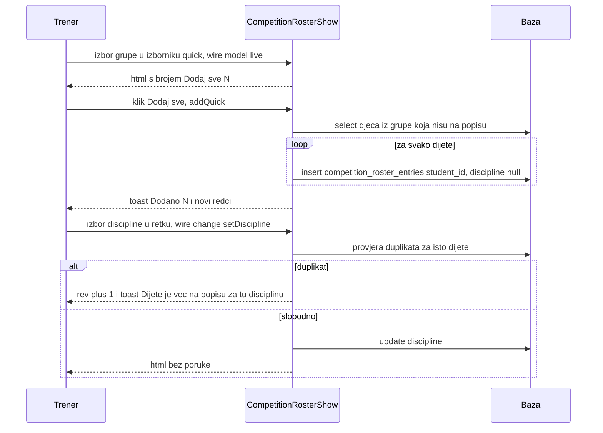
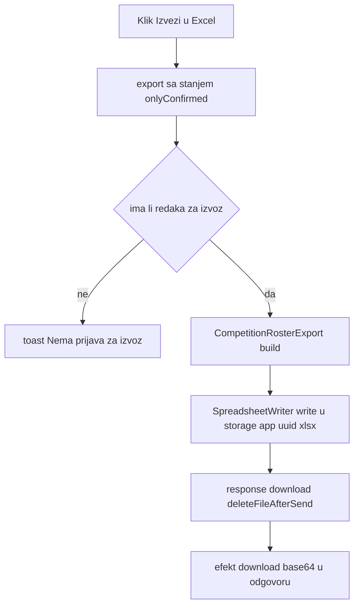

# Ekran: Popisi za natjecanje (CompetitionRostersList, CompetitionRosterShow)

**Izvor istine:** `app/Livewire/CompetitionRostersList.php`, `app/Livewire/CompetitionRosterShow.php`, `resources/views/livewire/competition-rosters-list.blade.php`, `resources/views/livewire/competition-roster-show.blade.php`, `app/Models/CompetitionRoster.php`, `app/Models/CompetitionRosterEntry.php`, `app/Support/CompetitionRosterExport.php`, `routes/web.php`

**Stanje:** feature/clanarine @ 87307b0, 2026-10-20

Popis za natjecanje je radni popis djece prijavljene na jedno natjecanje: svaki redak je par (dijete, disciplina) s kategorijom, napomenom i kvačicom „Potvrđeno". Tablice `competition_rosters` i `competition_roster_entries` **nisu** povezane s tablicom `competitions` ni s rezultatima ([natjecanja.md](natjecanja.md)). Opći Livewire tok u [../03-http-i-livewire.md](../03-http-i-livewire.md); autorizacija je samo `auth` ([../07-autorizacija-i-sigurnost.md](../07-autorizacija-i-sigurnost.md)).

Veze u bazi (migracije `2026_10_19_100000`, `2026_10_19_100001`): `competition_roster_entries.competition_roster_id` i `.student_id` imaju `cascadeOnDelete`; stupac `discipline` je `string(10)` `nullable`; jedinstvenost (popis, dijete, disciplina) provodi samo aplikacija jer MariaDB/sqlite tretiraju `NULL` disciplinu kao različitu (komentar u migraciji). Soft-obrisani polaznici ne okidaju kaskadu: njihovi retci ostaju u bazi, ali se ne prikazuju i ne broje (`whereHas('student')`); nakon poništavanja brisanja polaznika retci se vraćaju.

## 1. CompetitionRostersList (`/popisi-natjecanja`)

### Pregled

| Stavka | Vrijednost |
|---|---|
| Ruta | `GET /popisi-natjecanja`, ime `rosters` (`routes/web.php:27`), `auth` |
| Klasa | `App\Livewire\CompetitionRostersList` (`app/Livewire/CompetitionRostersList.php:14`, `final`) |
| Atributi | `#[Layout('components.layouts.app')]` (:12), `#[Title('Popisi za natjecanje')]` (:13); nema `#[Url]`/`#[On]`/`#[Locked]` |
| Događaji | samo `toast` |

### Svojstva

| Svojstvo | Tip | Početno | Napomena |
|---|---|---|---|
| `open` | `bool` | `false` | ladica |
| `editId` | `?int` | `null` | `null` = novi popis |
| `submitted` | `bool` | `false` | |
| `name` | `string` | `''` | |
| `eventDate` | `string` | `''` | `Y-m-d`, neobavezno |
| `confirmingDelete` | `bool` | `false` | |
| `deleteId` | `?int` | `null` | |
| `deleteName` | `string` | `''` | |
| `deleteEntries` | `int` | `0` | broj prijava koje nestaju (samo za nearhivirane polaznike) |

### Validacija (`rules()` :34, `messages()` :42)

| Polje | Pravila | Prilagođena poruka |
|---|---|---|
| `name` | `required`, `string`, `max:120` | `required`: „Obavezno polje"; `max`: „Najviše 120 znakova" |
| `eventDate` | `nullable`, `date` | `date`: „Neispravan datum" |

`openCreate()` i `openEdit()` zovu `resetValidation()` (:54, :65).

### Tablica akcija

| Element (natpis) | Okidač | Metoda(parametri) | Autorizacija | Validacija | Učinak (baza / događaji / poruka) | Odgovor |
|---|---|---|---|---|---|---|
| Gumb „+ Novi popis" (:7) | `wire:click="openCreate"` | `openCreate()` (:51) | `auth` | nema | `reset(['editId','name','eventDate','submitted'])`, `resetValidation()`, `open = true` | `html` |
| Naziv popisa kao poveznica (:17) | `href="{{ route('rosters.show', $r) }}"` | navigacija `GET /popisi-natjecanja/{roster}` | `auth` | route-model binding (404 ako nema) | puni page load stranice 2. razine | nova stranica, vidi odjeljak 2 |
| Ikona olovke (aria „Uredi: <naziv>") (:24) | `wire:click="openEdit(id)"` | `openEdit(id)` (:58) | `auth` | `CompetitionRoster::findOrFail($id)` | puni `editId`, `name`, `eventDate`, `submitted = false`, `resetValidation()`, `open = true` | `html` |
| Ikona koša (aria „Obriši: <naziv>") (:28) | `wire:click="confirmDelete(id)"` | `confirmDelete(id)` (:96) | `auth` | `findOrFail` | puni `deleteId`, `deleteName`, `deleteEntries` (= broj prijava s postojećim polaznikom), `confirmingDelete = true` | `html` |
| Pozadina ladice (:44) | Alpine `@click="$wire.close()"` | `close()` (:69) | `auth` | nema | `open = false` | `html` |
| Tipka Esc u ladici (:43) | Alpine `@keydown.escape.window="$wire.open && $wire.close()"` | `close()` | `auth` | nema | zatvara | `html` |
| Gumb „Zatvori" (ikona X) (:53) | `wire:click="close"` | `close()` | `auth` | nema | zatvara | `html` |
| Gumb „Odustani" u ladici (:76) | `wire:click="close"` | `close()` | `auth` | nema | zatvara | `html` |
| Obrazac (:50) | `wire:submit="save"` | `save()` (:81) | `auth` | `submitted = true`; `validate()` | vidi niže | `html` + `dispatches` |
| Gumb „Dodaj popis" / „Spremi promjene" (:77) | `type="submit"` | `save()` | `auth` | kao gore | kao gore | kao gore |
| Polje „Naziv *" (:61) | `wire:model.blur="name"` | svojstvo `name` | `auth` | `required`, `max:120` | stanje | nema |
| Polje „Datum natjecanja" (:68) | `wire:model.blur="eventDate"` | svojstvo `eventDate` | `auth` | `date` | stanje | nema |
| Pozadina dijaloga brisanja (:85) | Alpine `@click="$wire.cancelDelete()"` | `cancelDelete()` (:105) | `auth` | nema | zatvara | `html` |
| Tipka Esc u dijalogu (:84) | Alpine `@keydown.escape.window="$wire.confirmingDelete && $wire.cancelDelete()"` | `cancelDelete()` | `auth` | nema | zatvara | `html` |
| Gumb „Odustani" u dijalogu (:97) | `wire:click="cancelDelete"` | `cancelDelete()` | `auth` | nema | zatvara | `html` |
| Gumb „Da, obriši" (:98) | `wire:click="delete"` | `delete()` (:110) | `auth` | ako je `deleteId` null, ne briše | `CompetitionRoster::findOrFail($deleteId)->delete()`; prijave se brišu kaskadom; toast „Popis obrisan" | `html` + `dispatches` |
| Metoda `updated()` | svaka promjena svojstva | `updated(field)` (:74) | n/a | `validateOnly` ako je `submitted` | nema upisa | n/a |
| Metoda `render()` | svaki render | `render()` (:120) | n/a | nema | `rosters` s `entries_count` i `confirmed_count` (oba samo za nearhivirane polaznike); sortirano: popisi bez datuma zadnji, pa po datumu silazno, pa po nazivu | HTML |

`save()` (:81-94): `validate()`; `['name' => trim($name), 'event_date' => $eventDate !== '' ? $eventDate : null]`; `CompetitionRoster::findOrFail(editId)->update(...)` ili `create(...)`; toast `Spremljeno: <naziv>`; `close()`. Tekstovi: naslov dijaloga „Obrisati popis?", tijelo „Popis <naziv>: N prijava bit će obrisano. Polaznici ostaju u aplikaciji. Ovo se ne može poništiti."; prazno stanje „Još nema popisa" / „Napravi prvi popis gumbom gore desno."; podnaslov „Ukupno popisa: N"; redak „[d.m.Y. · ] prijava: N · potvrđeno: M".

## 2. CompetitionRosterShow (`/popisi-natjecanja/{roster}`)

### Pregled

| Stavka | Vrijednost |
|---|---|
| Ruta | `GET /popisi-natjecanja/{roster}`, ime `rosters.show` (`routes/web.php:28`), `auth`; parametar se veže na model `CompetitionRoster` (implicitni binding) |
| Klasa | `App\Livewire\CompetitionRosterShow` (`app/Livewire/CompetitionRosterShow.php:27`, `final`) |
| Atributi | `#[Layout('components.layouts.app')]` (:25), `#[Title('Popis za natjecanje')]` (:26); nema `#[Url]`/`#[On]`/`#[Locked]` |
| Konstanta | `SEARCH_LIMIT = 15` (:29): najviše 15 rezultata pretrage |
| Sigurnosni obrazac | `entry(int $id)` (:281) dohvaća prijavu samo preko `$this->roster->entries()`, pa „krivotvoreni" id iz drugog popisa daje 404 |

### Svojstva

| Svojstvo | Tip | Početno | Napomena |
|---|---|---|---|
| `roster` | `CompetitionRoster` | iz `mount` | Eloquent svojstvo; u snapshotu je spremljeno kao model s ključem |
| `search` | `string` | `''` | pretraga djece za dodavanje |
| `quick` | `string` | `''` | `g:<id grupe>` ili `a:<ključ uzrasta>`; prazno = ništa odabrano |
| `onlyConfirmed` | `bool` | `false` | utječe samo na izvoz |
| `rev` | `int` | `0` | povećava se kad se promjena discipline odbije, da se `<select>` ponovno stvori (`wire:key="disc-{id}-{rev}"`) |
| `open` | `bool` | `false` | ladica „Uredi popis" |
| `submitted` | `bool` | `false` | |
| `name` | `string` | `''` | |
| `eventDate` | `string` | `''` | |
| `confirmingDelete` | `bool` | `false` | |
| `studentCache` (privatno) | `?Collection` | `null` | po zahtjevu |

### Validacija

Samo za zaglavlje popisa (`rules()` :62, `messages()` :70): `name` `required|string|max:120` („Obavezno polje", „Najviše 120 znakova"), `eventDate` `nullable|date` („Neispravan datum"). Za inline izmjene redaka vrijede ručna pravila (tablica niže); njihove greške izlaze kao toast, ne kao tekst pod poljem.

### Podaci za view (`render()` :360)

`entries` (prijave postojećih polaznika, sortirane `CompetitionRosterExport::compare`), `onRoster` (id-evi djece koja su već na popisu), `matches` (pretraga po `Diacritics::normalize` i `search_haystack`, sortirano po prezimenu, max 15), `quickMissing` (broj djece iz odabrane grupe/uzrasta koja još nisu na popisu), `confirmedCount`, `groups`, `ageOptions` (`AgeCategory::options()`), `disciplines` (`Discipline::options()`: „Kate", „Kumite", „Kata team"), `ageLabels` (uzrast na dan natjecanja `asOf()`, inače danas; „Bez datuma rođenja" ako nema datuma).

### Tablica akcija

Redni elementi postoje dvaput: tablica za desktop i kartice za mobitel (`max-[760px]:hidden` / `min-[761px]:hidden`).

| Element (natpis) | Okidač | Metoda(parametri) | Autorizacija | Validacija | Učinak (baza / događaji / poruka) | Odgovor |
|---|---|---|---|---|---|---|
| Poveznica „← Popisi za natjecanje" (:3) | `href="{{ route('rosters') }}"` | navigacija `GET /popisi-natjecanja` | `auth` | nema | puni page load | lista, odjeljak 1 |
| Kvačica „Samo potvrđeni" (:13) | `wire:model="onlyConfirmed"` | svojstvo `onlyConfirmed` | `auth` | nema | stanje; primjenjuje se pri sljedećem izvozu | nema |
| Gumb „Izvezi u Excel" (:15) | `wire:click="export"` | `export()` (:260) | `auth` | ako nema redaka za izvoz, toast „Nema prijava za izvoz." i `null` | `CompetitionRosterExport::build($this->entries(), $this->asOf(), $this->onlyConfirmed)`; datoteka `storage/app/<uuid>.xlsx`, banner `<klub> — <naziv popisa> · <d.m.Y.>`; preuzimanje `popis-<slug naziva>-<Y-m-d>.xlsx` (današnji datum), brisanje privremene datoteke nakon slanja; bez upisa u bazu | efekt `download`; ili toast |
| Ikona olovke (aria „Uredi popis") (:16) | `wire:click="openEdit"` | `openEdit()` (:81) | `auth` | nema | puni `name`, `eventDate` iz `$this->roster`, `submitted = false`, `resetValidation()`, `open = true` | `html` |
| Ikona koša (aria „Obriši popis") (:17) | `wire:click="confirmDelete"` | `confirmDelete()` (:116) | `auth` | nema | `confirmingDelete = true` | `html` |
| Polje „Pretraži po imenu ili prezimenu" (naslov „Dodaj dijete") (:25) | `wire:model.live.debounce.300ms="search"` | svojstvo `search` | `auth` | nema | zahtjev 300 ms nakon tipke; render računa `matches` | `html` |
| Gumb „Dodaj" uz rezultat pretrage (:35; umjesto njega oznaka „Već na popisu") | `wire:click="addStudent(id)"` | `addStudent(studentId)` (:135) | `auth` | `Student::findOrFail`; ako dijete već ima bilo koju prijavu na ovom popisu: toast „<Prezime Ime> je već na popisu" i prekid | `$roster->entries()->create(['student_id' => id])` (disciplina `NULL`); toast „Dodano: <Prezime Ime>" | `html` + `dispatches` |
| Izbornik „Brzo dodavanje po grupi ili uzrastu" (opcija „Odaberi...", skupine „Grupa" i „Uzrast") (:47) | `wire:model.live="quick"` | svojstvo `quick` | `auth` | nema | render računa `quickMissing` | `html` |
| Gumb „Dodaj sve (N)" (:60; `disabled` kad je `quick` prazan ili N = 0) | `wire:click="addQuick"` | `addQuick()` (:149) | `auth` | ako nema nikoga, toast „Nema novih polaznika za dodavanje." | za svako dijete odabrane grupe (`g:<id>`) odnosno uzrasta (`a:<ključ>`, na dan `asOf()`) koje nije na popisu: `entries()->create(['student_id'])`, redom po prezimenu; toast „Dodano: N" | `html` + `dispatches` |
| Izbornik „Disciplina" u retku, desktop (:86) i mobilno (:118) | `wire:change="setDiscipline(entryId, $event.target.value)"` | `setDiscipline(entryId, value)` (:196) | `auth`; prijava mora pripadati popisu | prazno = `null`; inače `Rule::in` vrijednosti `kate`, `kumite`, `kata_team`, poruka „Neispravna disciplina"; zabrana duplikata (isto dijete, ista disciplina, drugi redak) | uspjeh: `$entry->update(['discipline' => ...])` bez poruke; duplikat: `rev++` i toast „Dijete je već na popisu za tu disciplinu"; neispravna vrijednost: toast s porukom | `html` + moguće `dispatches` |
| Polje „Kategorija" u retku, desktop (:92) i mobilno (:124) | `wire:change="setCategory(entryId, $event.target.value)"` | `setCategory(entryId, value)` (:234) | `auth`; prijava iz ovog popisa | `max:60`, poruka „Najviše 60 znakova" (kao toast) | `setText(...)`: `trim`, prazno u `null`, `update(['category' => ...])` | `html` (+ toast kod greške) |
| Polje „Napomena" u retku, desktop (:93) i mobilno (:125) | `wire:change="setNote(entryId, $event.target.value)"` | `setNote(entryId, value)` (:239) | `auth`; prijava iz ovog popisa | `max:255`, poruka „Najviše 255 znakova" (kao toast) | kao `setCategory` za stupac `note` | `html` (+ toast kod greške) |
| Kvačica „Potvrđeno" u retku, desktop (:94; aria „Potvrđeno: Prezime Ime") i mobilno (:128) | `wire:change="setConfirmed(entryId, $event.target.checked)"` | `setConfirmed(entryId, value)` (:244) | `auth`; prijava iz ovog popisa | tip `bool` | `update(['confirmed' => value])`; bez poruke | `html` |
| Gumb „+ disciplina" u retku, desktop (:96) i mobilno (:130) | `wire:click="addDiscipline(entryId)"` | `addDiscipline(entryId)` (:167) | `auth`; prijava iz ovog popisa | ako dijete ima samo jedan redak bez discipline: toast „Prvo odaberi disciplinu za: <ime>"; ako su zauzete sve tri discipline: toast „<ime> je već na popisu za sve discipline" | dodaje novi redak za isto dijete s prvom slobodnom disciplinom po redu Kate, Kumite, Kata team; toast „Dodana disciplina <naziv>: <ime>" | `html` + `dispatches` |
| Ikona koša u retku (aria „Ukloni: Prezime Ime"), desktop (:97) i mobilno (:116) | `wire:click="remove(entryId)"` | `remove(entryId)` (:249) | `auth`; prijava iz ovog popisa | `findOrFail` (404) | `DELETE` retka **bez potvrde**; toast „Uklonjeno: <ime>" | `html` + `dispatches` |
| Pozadina ladice (:140) | Alpine `@click="$wire.close()"` | `close()` (:90) | `auth` | nema | `open = false` | `html` |
| Tipka Esc u ladici (:139) | Alpine `@keydown.escape.window="$wire.open && $wire.close()"` | `close()` | `auth` | nema | zatvara | `html` |
| Gumb „Zatvori" (ikona X) (:149) | `wire:click="close"` | `close()` | `auth` | nema | zatvara | `html` |
| Gumb „Odustani" u ladici (:172) | `wire:click="close"` | `close()` | `auth` | nema | zatvara | `html` |
| Obrazac „Uredi popis" (:146) | `wire:submit="save"` | `save()` (:102) | `auth` | `submitted = true`; `validate()` | `$this->roster->update(['name' => trim, 'event_date' => ...])`; toast `Spremljeno: <naziv>`; `close()` | `html` + `dispatches` |
| Gumb „Spremi promjene" (:173) | `type="submit"` | `save()` | `auth` | kao gore | kao gore | kao gore |
| Polje „Naziv *" (:157) | `wire:model.blur="name"` | svojstvo `name` | `auth` | `required`, `max:120` | stanje | nema |
| Polje „Datum natjecanja" (:164) | `wire:model.blur="eventDate"` | svojstvo `eventDate` | `auth` | `date` | stanje | nema |
| Pozadina dijaloga brisanja (:181) | Alpine `@click="$wire.cancelDelete()"` | `cancelDelete()` (:121) | `auth` | nema | zatvara | `html` |
| Tipka Esc u dijalogu (:180) | Alpine `@keydown.escape.window="$wire.confirmingDelete && $wire.cancelDelete()"` | `cancelDelete()` | `auth` | nema | zatvara | `html` |
| Gumb „Odustani" u dijalogu (:193) | `wire:click="cancelDelete"` | `cancelDelete()` | `auth` | nema | zatvara | `html` |
| Gumb „Da, obriši" (:194) | `wire:click="delete"` | `delete()` (:126) | `auth` | nema | `$this->roster->delete()` (prijave kaskadom, polaznici ostaju); bez toasta | efekt `redirect` na `route('rosters')` |
| Metoda `mount()` | pri učitavanju stranice | `mount(roster)` (:57) | `auth` | model iz rute | `$this->roster = $roster` | n/a |
| Metoda `updated()` | svaka promjena svojstva | `updated(field)` (:95) | n/a | `validateOnly` samo za `name` i `eventDate` kad je `submitted` | nema upisa | n/a |
| Metoda `render()` | svaki render | `render()` (:360) | n/a | nema | vidi „Podaci za view" | HTML |

Tekstovi: tijelo dijaloga „Popis <naziv>: N prijava bit će obrisano. Polaznici ostaju u aplikaciji. Ovo se ne može poništiti."; prazno stanje „Popis je prazan. Dodaj djecu pretragom ili brzim dodavanjem iznad."; „Nema rezultata."; pomoć „Dodaju se samo oni koji još nisu na popisu; disciplinu odabireš poslije."

Napomena o `wire:change`: u Livewire 4 `wire:change` šalje poziv kad preglednik okine DOM događaj `change` (polje tekst: nakon gubitka fokusa ili Entera; kvačica i izbornik: odmah). Parametar `$event.target.value` / `.checked` ugrađuje se u `calls[].params` (vidi [../03-http-i-livewire.md](../03-http-i-livewire.md)).

### Zašto `rev`

Nakon odbijene promjene discipline (duplikat) DOM `<select>` zadržava vrijednost koju je korisnik odabrao jer morph ne vraća vrijednost. `rev++` mijenja `wire:key` pa se element stvori iznova s vrijednošću iz baze (komentar u `app/Livewire/CompetitionRosterShow.php:224`).

### Dijagram: brzo dodavanje i izmjena retka

### Dijagram: izvoz popisa

Stupci izvoza (`CompetitionRosterExport::HEADERS`): `Prezime`, `Ime`, `Datum rođenja`, `Uzrasna kategorija`, `Pojas`, `Disciplina`, `Kategorija`, `Napomena`, `Potvrđeno`. Algoritam spajanja disciplina u jedan redak po djetetu opisan je u [../05-domena-i-servisi.md](../05-domena-i-servisi.md).
