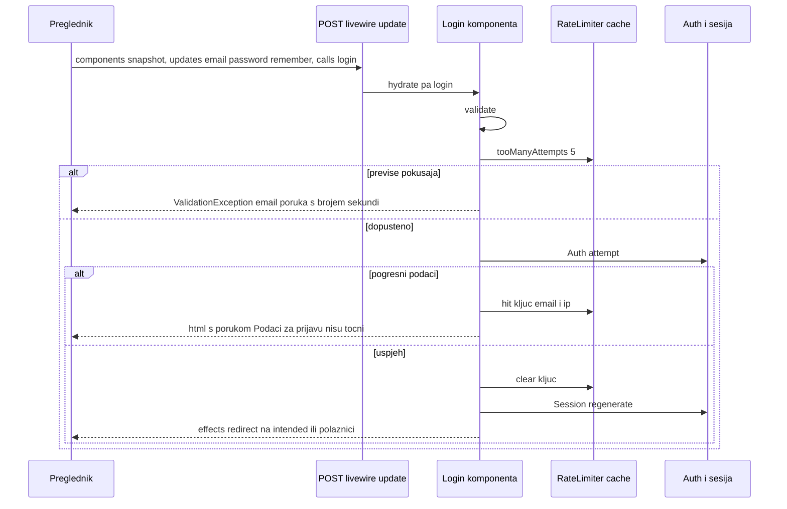
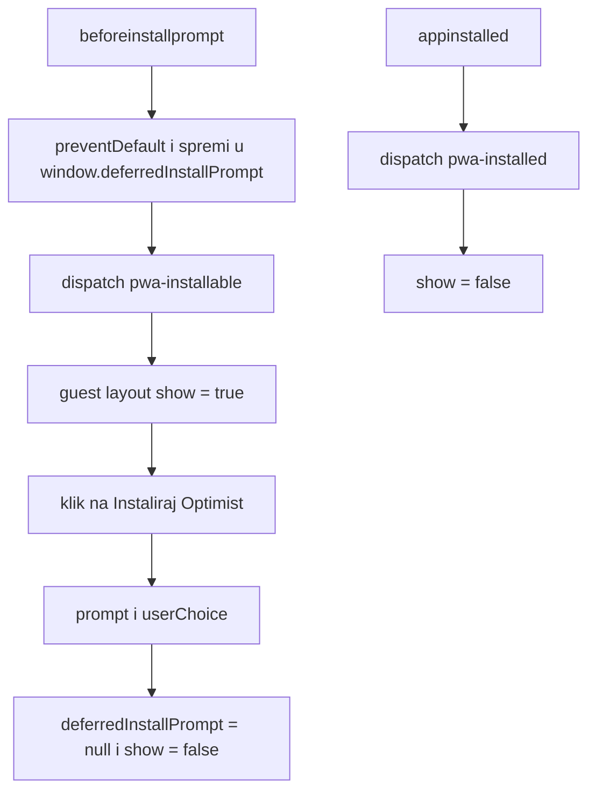

# Ekran: Prijava (Login, guest layout, PWA traka za instalaciju)

**Izvor istine:** `app/Livewire/Auth/Login.php`, `resources/views/livewire/auth/login.blade.php`, `resources/views/components/layouts/guest.blade.php`, `resources/views/partials/pwa.blade.php`, `routes/web.php`, `public/manifest.json`, `public/sw.js`

**Stanje:** feature/clanarine @ 87307b0, 2026-10-20

Ovaj ekran je jedini koji vide neprijavljeni korisnici. Nema samoregistracije (`tests/Feature/LoginTest.php` provjerava da ruta `register` ne postoji); računi nastaju samo preko `TrainerSeeder` (vidi [../07-autorizacija-i-sigurnost.md](../07-autorizacija-i-sigurnost.md)). Opći mehanizam Livewire poziva opisan je u [../03-http-i-livewire.md](../03-http-i-livewire.md).

## Pregled

| Stavka | Vrijednost |
|---|---|
| Ruta | `GET /login`, ime `login` (`routes/web.php:21`) |
| Middleware | `web` + `guest` (`routes/web.php:20`); prijavljen korisnik se preusmjerava (zadano ponašanje `Illuminate\Auth\Middleware\RedirectIfAuthenticated`, odredište nije mijenjano u `bootstrap/app.php`) |
| Klasa | `App\Livewire\Auth\Login` (`app/Livewire/Auth/Login.php:17`, `final`) |
| Atributi klase | `#[Layout('components.layouts.guest')]` (`app/Livewire/Auth/Login.php:16`); nema `#[Title]` pa vrijedi `<title>` iz layouta: „Prijava · Optimist" (`resources/views/components/layouts/guest.blade.php:6`) |
| `#[Url]` / `#[On]` / `#[Locked]` | nema |
| View | `resources/views/livewire/auth/login.blade.php` (`render()` ga vraća bez podataka, `app/Livewire/Auth/Login.php:64-67`) |
| Layout | `resources/views/components/layouts/guest.blade.php` (bez bočne navigacije, bez toast elementa) |

## Svojstva

| Svojstvo | Tip | Početno | Atribut | Napomena |
|---|---|---|---|---|
| `email` | `string` | `''` | `#[Validate('required\|string\|email')]` (`app/Livewire/Auth/Login.php:19`) | vezano `wire:model="email"` |
| `password` | `string` | `''` | `#[Validate('required\|string')]` (`app/Livewire/Auth/Login.php:22`) | vezano `wire:model="password"`; ide u snapshot kao običan string dok se ne pošalje akcija |
| `remember` | `bool` | `false` | nema | vezano `wire:model="remember"`; predaje se kao drugi argument `Auth::attempt` |

Nema URL aliasa ni zaključanih svojstava.

## Validacija i poruke

- `$this->validate()` (`app/Livewire/Auth/Login.php:29`) koristi `#[Validate]` pravila. Za njih **nema** prilagođenih hrvatskih poruka: ispisuju se zadane poruke frameworka; budući da u repozitoriju nema `lang/` mape, uz `APP_LOCALE=hr` (kako je u `.env.example`) korisnik vidi sirovi ključ prijevoda (npr. `validation.required`), a uz `en` engleski tekst (provjereno lokalno). Atribut u poruci je ime svojstva (`email`, `password`).
- Prilagođene poruke (točan tekst), obje na polju `email`:
  - `Podaci za prijavu nisu točni.` (`app/Livewire/Auth/Login.php:36`) kad `Auth::attempt` ne uspije;
  - `Previše pokušaja prijave. Pokušajte ponovno za {$seconds} s.` (`app/Livewire/Auth/Login.php:55`) kad je ograničenje dosegnuto.
- Ograničenje pokušaja: `RateLimiter::tooManyAttempts($key, maxAttempts: 5)` (`app/Livewire/Auth/Login.php:48`); `RateLimiter::hit($key)` bez drugog argumenta pa vrijedi zadano trajanje prozora od 60 s (Laravel `RateLimiter::hit`, `$decaySeconds = 60`). Ključ: `Str::transliterate(Str::lower($email).'|'.request()->ip())` (`app/Livewire/Auth/Login.php:61`), dakle po paru e-mail + IP. Brojač se sprema u cache store (`CACHE_STORE`, zadano `database`, `config/cache.php:18`). Uspješna prijava briše ključ (`app/Livewire/Auth/Login.php:40`). [NEJASNO: iza proxyja cPanela `request()->ip()` može biti adresa proxyja jer `bootstrap/app.php` ne konfigurira trusted proxies; provjeriti na produkciji.]

## Životni ciklus

1. `GET /login` renderira cijelu stranicu: Livewire ugrađuje komponentu u `guest` layout, umeće svoj JavaScript (Alpine je u paketu) i `wire:snapshot`.
2. Nema `mount()` ni `updated*` kukica. Svako polje je „odgođeno" (`wire:model` bez `.live`): vrijednost ostaje u pregledniku do slanja akcije (vidi [../03-http-i-livewire.md](../03-http-i-livewire.md), odjeljak o modifikatorima).
3. Slanje obrasca (`wire:submit="login"`) šalje `updates` (e-mail, lozinka, remember) i poziv `login` u istom zahtjevu na `POST /livewire-<hash>/update`.

## Tablica akcija

| Element (natpis) | Okidač | Metoda(parametri) | Autorizacija | Validacija | Učinak (baza / događaji / poruka) | Odgovor |
|---|---|---|---|---|---|---|
| Polje „E-mail" | `wire:model="email"` (samo klijentsko stanje do slanja) | nema (svojstvo `email`) | middleware `guest` na stranici | pravila `required\|string\|email` tek pri `login()` | nema upisa; vrijednost putuje u `updates` pri slanju obrasca | nema odvojenog odgovora; greška se prikazuje pod poljem nakon `login()` |
| Polje „Lozinka" | `wire:model="password"` | nema (svojstvo `password`) | kao gore | `required\|string` pri `login()` | nema upisa | kao gore |
| Kvačica „Zapamti me" | `wire:model="remember"` | nema (svojstvo `remember`) | kao gore | nema | `true` znači trajni „remember" kolačić pri `Auth::attempt(..., $remember)` | nema |
| Gumb „Prijava" (prikazuje „Prijava…" dok traje poziv) | `wire:submit="login"` na `<form>` (`resources/views/livewire/auth/login.blade.php:5`); gumb `type="submit"`, `wire:loading.attr="disabled"`, `wire:target="login"` | `login()` (`app/Livewire/Auth/Login.php:27`) | `guest`; `login()` sam nema dodatnu provjeru uloga | `validate()`; pa `ensureIsNotRateLimited()` (privatna, `app/Livewire/Auth/Login.php:46`); pa `Auth::attempt` | uspjeh: `RateLimiter::clear`, `Session::regenerate()`, `redirect()->intended(route('polaznici'))`; neuspjeh: `RateLimiter::hit`, `ValidationException` s `email`; nema upisa u `audit_logs` | uspjeh: efekt `redirect` (preglednik postavlja `window.location.href`); neuspjeh/ograničenje: `html` s porukom pod poljem „E-mail" (HTTP 200) |
| Metoda `render()` | poziva ga Livewire pri svakom renderu | `render()` (`app/Livewire/Auth/Login.php:64`) | nije akcija klijenta | nema | vraća `view('livewire.auth.login')` bez podataka | HTML komponente |
| Gumb „Instaliraj Optimist — vođenje kluba" | Alpine `x-on:click` (`resources/views/components/layouts/guest.blade.php:26`); vidljivost `x-on:pwa-installable.window` i `x-on:pwa-installed.window` (`resources/views/components/layouts/guest.blade.php:23`) | nema poziva servera; JS koristi `window.deferredInstallPrompt` | nema | nema | `p.prompt()` otvara nativni dijalog preglednika; nakon izbora `deferredInstallPrompt = null` i traka se skriva | nema HTTP odgovora |

## Dijagram: prijava

## PWA traka za instalaciju (guest layout)

Tok događaja (izvor: `resources/views/partials/pwa.blade.php`, uključen u oba layouta):

1. Skripta u `<head>` postavlja `window.deferredInstallPrompt = null` i sluša `beforeinstallprompt` (`resources/views/partials/pwa.blade.php:10`): zaustavlja zadani prikaz, sprema događaj i okida `window` događaj `pwa-installable` (`resources/views/partials/pwa.blade.php:13`).
2. `resources/views/components/layouts/guest.blade.php:22` inicijalizira Alpine stanje `show: !! window.deferredInstallPrompt` (traka se vidi i ako je događaj stigao prije učitavanja Alpinea) i sluša `pwa-installable` (postavlja `show = true`) i `pwa-installed` (`show = false`).
3. Klik na gumb poziva `prompt()` spremljenog događaja i nakon `userChoice` briše spremljeni događaj i skriva traku.
4. `appinstalled` okida `pwa-installed` (`resources/views/partials/pwa.blade.php:17`).
5. Service worker se registrira samo na `https:` nakon `load` (`resources/views/partials/pwa.blade.php:21-25`); pravila predmemoriranja u [../03-http-i-livewire.md](../03-http-i-livewire.md).

Traka je u HTML-u uvijek prisutna (`LoginTest` provjerava tekst), ali se prikazuje samo kad Chromium prijavi da je aplikacija instalabilna; na iOS-u i Firefoxu događaj ne postoji.

## Napomene

- Prijava se ne zapisuje u `audit_logs` (ni uspjeh ni neuspjeh); vidi [../07-autorizacija-i-sigurnost.md](../07-autorizacija-i-sigurnost.md).
- Odjava nije dio ovog ekrana: `POST /logout` (`routes/web.php:39-45`) poziva `Auth::logout()`, poništava sesiju, regenerira CSRF token i preusmjerava na `login`; gumbi „Odjava" su u `components/layouts/app.blade.php` (obični HTML obrasci s `@csrf`, ne Livewire).
- `Login` je jedina komponenta čije se ažuriranje (`/livewire-<hash>/update`) ne štiti auth middlewareom; `guest` (`Illuminate\Auth\Middleware\RedirectIfAuthenticated`) nije na Livewireovom popisu „persistent" middlewarea (vidi [../03-http-i-livewire.md](../03-http-i-livewire.md)), što je bez posljedica za prijavu.
