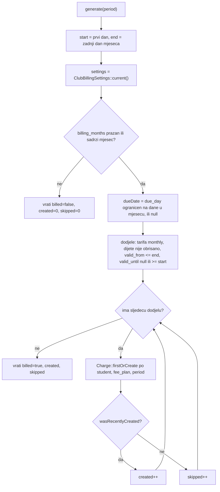
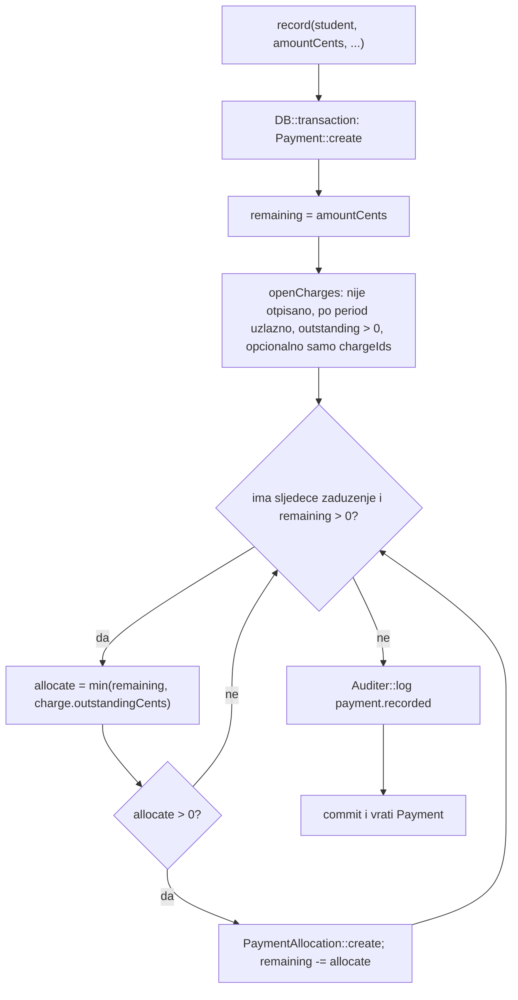
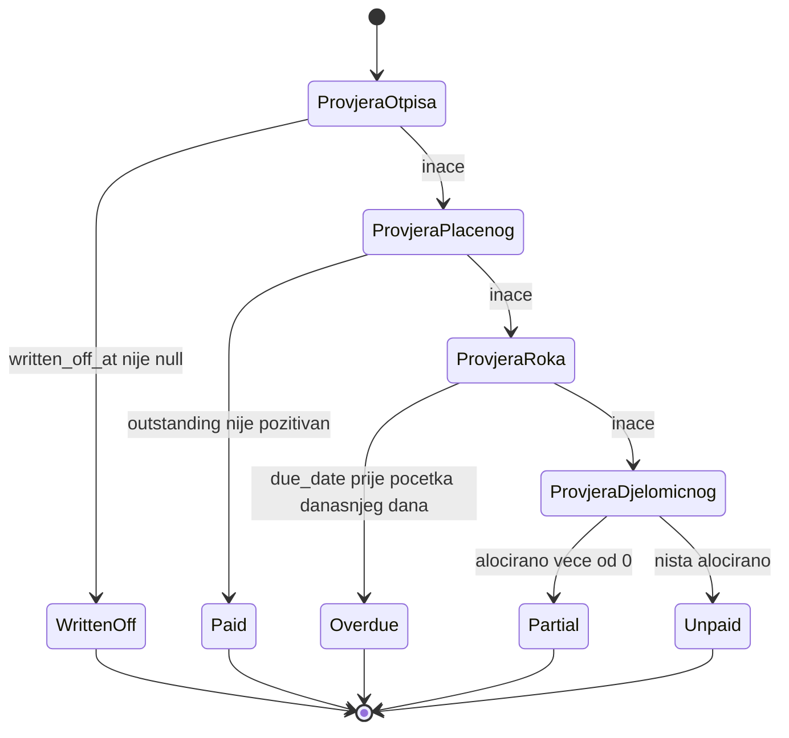

# Domena i servisi

**Izvor istine:** `app/Support/*.php` (18 klasa), `app/Rules/Oib.php`, `app/Console/Commands/GenerateChargesCommand.php`, `routes/console.php`, `app/Models/Student.php`, `app/Models/Charge.php`, `app/Models/StudentFeePlan.php`, `app/Models/Payment.php`, `app/Enums/*.php`, `resources/views/pdf/child-report.blade.php`, izvozne metode u `app/Livewire/StudentsList.php`, `app/Livewire/CompetitionRosterShow.php`, `app/Livewire/KataTeamsList.php`
**Stanje:** feature/clanarine @ 87307b0, 2026-10-20

Ovaj dokument opisuje poslovnu logiku koja nije u Livewire komponentama: pomoćne klase u `app/Support` (statičke, bez stanja), pravilo za OIB, naredbu i raspored za mjesečna zaduženja te računate atribute na modelima. Za tablice u koje ova logika piše vidi [02-baza-podataka.md](02-baza-podataka.md); za eRačune [06-eracuni.md](06-eracuni.md).

## Pregled

Sve klase u `app/Support` su `final`, bez instanci i bez ovisnosti o zahtjevu (osim `Auditer`, koji čita `Auth::id()` i `Request::ip()`). „Danas” se uvijek dodaje kao parametar (`CarbonInterface $today`) da se logika može testirati; pozivatelji prosljeđuju `CarbonImmutable::now()`. Izvozne klase (`*Export`, `MedicalReminders`) vraćaju čiste nizove, a datoteku piše tek `SpreadsheetWriter`.

| Klasa | Datoteka | Svrha | Odlomak |
| --- | --- | --- | --- |
| `AgeCategory` | `app/Support/AgeCategory.php:19` | uzrasna kategorija i datum prijelaza | [Uzrast i sezona](#uzrast-i-sezona) |
| `Season` | `app/Support/Season.php:15` | sezona 1. 9. – 1. 7. | [Uzrast i sezona](#uzrast-i-sezona) |
| `MedicalStatus` | `app/Support/MedicalStatus.php:17` | status liječničkog (enum) | [Liječnički pregled](#liječnički-pregled) |
| `MedicalReminders` | `app/Support/MedicalReminders.php:17` | popis za podsjećanje | [Liječnički pregled](#liječnički-pregled) |
| `Diacritics` | `app/Support/Diacritics.php:13` | normalizacija za pretragu | [Tekst, telefon i novac](#tekst-telefon-i-novac) |
| `CroatianCollator` | `app/Support/CroatianCollator.php:18` | hrvatsko abecedno uspoređivanje | [Tekst, telefon i novac](#tekst-telefon-i-novac) |
| `Phone` | `app/Support/Phone.php:12` | prikaz telefona | [Tekst, telefon i novac](#tekst-telefon-i-novac) |
| `Money` | `app/Support/Money.php:11` | cente ↔ tekst | [Tekst, telefon i novac](#tekst-telefon-i-novac) |
| `Oib` (pravilo) | `app/Rules/Oib.php:13` | validacija OIB-a | [Pravilo za OIB](#pravilo-za-oib) |
| `BillingReference` | `app/Support/BillingReference.php:14` | oznaka/poziv na broj zaduženja | [Članarine](#članarine) |
| `ChargeGenerator` | `app/Support/ChargeGenerator.php:18` | mjesečna zaduženja | [Članarine](#članarine) |
| `PaymentRecorder` | `app/Support/PaymentRecorder.php:20` | uplate, otpis, storno | [Članarine](#članarine) |
| `Auditer` | `app/Support/Auditer.php:16` | revizijski zapis | [Revizijski trag](#revizijski-trag-auditer) |
| `DeclarationStorage` | `app/Support/DeclarationStorage.php:17` | šifrirane izjave | [Izjave](#izjave-declarationstorage) |
| `CompetitionExport`, `CompetitionRosterExport`, `KataTeamExport`, `ChildReport`, `SpreadsheetWriter` | `app/Support/…` | izvozi i PDF | [Izvozi i PDF](#izvozi-i-pdf) |

## Uzrast i sezona

### `AgeCategory`

Svrha: WKF/HKS uzrasna kategorija djeteta i datum kad prelazi u sljedeću. Nikad se ne sprema, uvijek se izvodi iz `students.birth_date` i „danas” (docblock `AgeCategory.php:11-18`).

Javni API:

- `AgeCategory::options(): array` (`:43`): ključ kategorije → naziv, od najmlađe (`array_column(TIERS, 'label', 'key')`).
- `AgeCategory::for(?CarbonInterface $birthDate, CarbonInterface $today): ?self` (`:49`): `null` ako nema datuma rođenja.
- `AgeCategory::crossoverWithin(CarbonInterface $today, int $withinMonths = 6): ?array` (`:77`): `['months' => int, 'days' => int, 'nextLabel' => string, 'remaining' => string]` ili `null`.
- Javna read-only svojstva: `key`, `label`, `age`, `crossover` (`?CarbonImmutable`), `nextLabel` (`:34-40`).

Algoritam: dob je cijeli broj godina (`ageInYears`, `:102`): razlika godina, umanjena za 1 ako rođendan ove godine još nije bio; rođendan danas se računa kao već dosegnut. Kategorija je prva u tablici `TIERS` (`:22-32`) za koju vrijedi `dob < max`:

| Ključ | Naziv | Dob (godine) | Prijelaz u sljedeću (mjeseci od rođenja) |
| --- | --- | --- | --- |
| `ispod` | Ispod U8 | do 5 | 72 |
| `u08` | U08 · Cicibani | 6–7 | 96 |
| `u10` | U10 · Mlađi učenici | 8–9 | 120 |
| `u12` | U12 · Učenici | 10–11 | 144 |
| `u14` | U14 · Mlađi kadeti | 12–13 | 168 |
| `u16` | U16 · Kadeti | 14–15 | 192 |
| `u18` | U18 · Juniori | 16–17 | 216 |
| `u21` | U21 | 18–20 | 252 |
| `sen` | Seniori | 21 i više | nema (`months = 0` → `crossover = null`) |

Datum prijelaza je `birth_date->addMonthsNoOverflow(months)` (EDATE-stil: 31. u mjesecu bez tog dana ne preljeva u sljedeći mjesec). `crossoverWithin` vraća `null` ako nema prijelaza (Seniori) ili ako datum nije u intervalu `(danas 00:00, danas 00:00 + withinMonths mjeseci]`; inače razlika (mjeseci, dani) i tekst `remaining` oblika „3 mj 12 d” (nulti dio se ispušta; nikad prazan: `remainingLabel`, `:113`).

Rubni slučajevi: rođenje u budućnosti daje negativnu dob pa kategoriju `ispod` (forma to sprječava pravilom `before_or_equal:today`); `crossover == danas` vraća `null` jer je dijete tog dana već u novoj kategoriji.

Tko je zove: `app/Models/Student.php:148` (atribut `age_category`) i `:161` (`crossover_notice`, prag 6 mjeseci); `app/Livewire/StudentForm.php:235`; `app/Livewire/StudentsList.php:211`, `:281`, `:296`; `app/Livewire/CompetitionRosterShow.php:354`, `:380` (`options()`), `:383`; izvozi `CompetitionExport.php:26`, `CompetitionRosterExport.php:47`, `KataTeamExport.php:42`.

### `Season`

Svrha: karate sezona traje od 1. rujna do 1. srpnja sljedeće godine (srpanj i kolovoz su izvan sezone). Sezona se identificira početnom godinom (rujan), npr. 2025 = „2025/2026”.

Javni API (sve `static`):

- `current(CarbonInterface $today): int` (`:18`): `mjesec >= 9 ? godina : godina - 1`.
- `window(int $start): array` (`:26`): `[1. 9. start, 1. 7. start+1]`, početak uključen, kraj isključen.
- `contains(int $start, CarbonInterface $date): bool` (`:34`): `$date >= od && $date < do`.
- `label(int $start): string` (`:42`): `„2025/2026”`; `slug(int $start): string` (`:48`): `„2025-2026”`.

Tko je zove: `StudentsList.php:82` (početna vrijednost `reportSeason`), `:163` (ime PDF-a), `:352-353` (popis zadnjih 5 sezona u izborniku), `ChildReport.php:32`, `:60`. Rubni slučaj: natjecanje u srpnju/kolovozu ne spada ni u jednu sezonu pa ne ulazi ni u jedno izvješće.

## Liječnički pregled

### `MedicalStatus` (enum)

Svrha: status liječničkog iz `students.medical_valid_until` i `students.has_no_medical`; datum isteka je uključiv. Dani se računaju na UTC ponoćima da prijelaz na ljetno/zimsko vrijeme (kraj listopada u Europe/Zagreb) ne pomakne cijeli dan (`wholeDaysBetween`, `:69`).

Slučajevi (vrijednost): `None` (`nema`), `Unknown` (`nepoznato`), `Expired` (`istekao`), `SoonExpiring` (`uskoro`), `Valid` (`vrijedi`).

Javni API:

- `MedicalStatus::for(?CarbonInterface $validUntil, bool $hasNoMedical, CarbonInterface $today): self` (`:25`)
- `MedicalStatus::daysUntil(?CarbonInterface $validUntil, CarbonInterface $today): ?int` (`:49`): pozitivno = još vrijedi, negativno = isteklo prije toliko dana, `null` = nema datuma.
- `label(): string` (`:58`): „Nema”, „Nepoznato”, „Istekao”, „Ističe uskoro”, „Vrijedi”.

Redoslijed odlučivanja u `for`: `has_no_medical` → `None`; inače bez datuma → `Unknown`; inače `dani < 0` → `Expired`; `dani <= 30` → `SoonExpiring`; inače `Valid`. Na dan isteka (`dani = 0`) status je `SoonExpiring`, ne `Expired`.

Tko je zove: `Student.php:169` (atribut `medical_status`), `StudentsList.php:229`, `:234`, `:330`, `:333`, `StudentForm.php:236`, `MedicalReminders.php:37-38`, Blade komponenta `resources/views/components/medical-pill.blade.php`.

### `MedicalReminders`

Svrha: popis djece koju treba podsjetiti na obnovu: isteklo, ističe unutar 30 dana ili bez datuma. Sadrži kontakt roditelja (interni popis, za razliku od popisa za natjecanje).

Javni API: `MedicalReminders::HEADERS` (`:19`) i `MedicalReminders::build(Collection $students, CarbonImmutable $today): array` (`:32`) → `['headers' => list<string>, 'rows' => list<list<string>>]`.

Algoritam: za svako dijete se računa `MedicalStatus::for` i `daysUntil`; zadržavaju se samo statusi iz `ORDER` (`:22-26`): `istekao` (0), `uskoro` (1), `nepoznato` (2). Djeca sa statusom `nema` (`has_no_medical`) i `vrijedi` ne ulaze. Sortiranje: skupina hitnosti, pa broj dana (najmanji prvi, tj. najviše zakašnjelo odnosno najbliže isteku; `null` se tretira kao 0), pa prezime i ime hrvatskim abecednim redom (`CroatianCollator`). Stupac „Rok” (`rok`, `:69`): „istekao prije N dan/dana”, „ističe danas”, „ističe za N dan/dana”, „nema upisano”. Množina: `dayWord` (`:81`) vraća „dan” za brojeve koji završavaju na 1 osim 11 (1, 21, 31, …), inače „dana”. „Lokacija” su imena iz `Student::training_locations` spojena s „ · ”, ili „—”.

Tko je zove: `StudentsList.php:119` (`medicalReminders()`).

## Tekst, telefon i novac

### `Diacritics`

`Diacritics::normalize(?string $value): string` (`:15`). Pretvara u mala slova (`mb_strtolower`), ako postoji `Normalizer` razlaže u NFD i briše kombinirajuće oznake (`\p{Mn}`: č, ć, š, ž → c, s, z), a `đ` zasebno zamjenjuje s `d` (nije razgradivo slovo). `null` daje `''`. Bez ekstenzije `intl` ostaje samo `mb_strtolower` + `đ → d`.

Tko je zove: `Student.php:180` (`search_haystack`), `StudentsList.php:254`, `CompetitionRosterShow.php:365`, `CroatianCollator.php:32`, `PartnerMatcher.php:33`, `:36`.

### `CroatianCollator`

`CroatianCollator::compare(string $a, string $b): int` (`:20`). Koristi `Collator('hr_HR')` iz ekstenzije intl (instanca se čuva u `static` varijabli). Ako klasa `Collator` ne postoji (dijeljeni hosting), pada na `strcmp(Diacritics::normalize($a), Diacritics::normalize($b))`: poredak je tada približan (č, ć, š, ž, đ se slažu uz c, s, z, d), ali stabilan. `ext-intl` je deklariran u `composer.json`.

Tko je zove: `StudentsList.php:268-269`, `CompetitionRosterShow.php:332-333`, `KataTeamsList.php:147-148`, `CompetitionRosterExport.php:97-98`, `MedicalReminders.php:45-46`, `KataTeamExport.php:36-37`.

### `Phone`

`Phone::format(?string $value): string` (`:14`). Ukloni sve što nije znamenka; ako ostane točno 10 znamenki vraća `„091 234 5678”` (3 + 3 + ostatak); inače vraća izvorni tekst nepromijenjen (npr. međunarodni brojevi). Tko je zove: `Student.php:193` (`formatted_phone`).

### `Money`

Novac je uvijek cijeli broj centi (EUR), nikad `float` u pohrani.

- `Money::format(int $cents): string` (`:14`): `number_format($cents / 100, 2, ',', '.') . ' €'`, npr. `123450` → „1.234,50 €”.
- `Money::parse(string $input): int` (`:23`): miče `€`, razmake i nerazdvojni razmak; prazno daje 0; ako ima i `,` i `.`, točke su tisućice, a zarez decimala; zatim `,` → `.`, `(float)` × 100 i `round`.

Rubni slučajevi: sama točka se uvijek tumači kao decimalna ("1.234" → 1,234 € → 123 centa, ne 1234); nenumerički niz daje 0; `parse` ne odbija minus, ali ga forme prije toga sprječavaju regexom `^[0-9.,\s€]+$`. Zaokruživanje ide preko `float`-a.

Tko ih zove: `FeePlansList.php:111`, `StudentCharges.php:104`, `:164`, `StudentFeePlans.php:178`; `format` i u Blade pogledima (`student-charges`, `fee-plans-list`, `student-fee-plans`).

## Pravilo za OIB

`App\Rules\Oib` (`app/Rules/Oib.php:13`) implementira `ValidationRule`.

- `validate(string $attribute, mixed $value, Closure $fail): void` (`:15`): ako nije točno 11 znamenki → „OIB mora imati 11 znamenki.”; ako kontrolna znamenka ne štima → „OIB nije ispravan.”
- `Oib::hasValidCheckDigit(string $oib): bool` (`:30`): ISO 7064 MOD 11,10. Početni ostatak 10; za svaku od prvih 10 znamenki: `ostatak = (ostatak + znamenka) % 10`, ako je 0 postaje 10, zatim `ostatak = (ostatak × 2) % 11`; kontrolna znamenka = `(11 − ostatak) % 10` i mora biti jednaka 11. znamenki.

Tko ga koristi: `app/Livewire/StudentForm.php:70` (uz `Rule::unique('students', 'oib')`). U bazi nema CHECK-a; vidi [02-baza-podataka.md](02-baza-podataka.md#invarijante).

## Članarine

Modul je iza zastavice `FEATURE_PAYMENTS` ([08-konfiguracija.md](08-konfiguracija.md)); rute i izbornici provjeravaju `config('features.payments')`, a naredba `clanarine:zaduzi` provjerava istu zastavicu u izvršavanju.

### `BillingReference`

Svrha: tekstualna oznaka zaduženja `{student_id}-{YYYYMM}`. Za model `HR01` dodaje kontrolnu znamenku mod 11 (HUB/NKS „model 01”); to je u kodu označeno kao nepotvrđeno prema stvarnoj uplatnici (docblock `:7-13`).

- `BillingReference::for(int $studentId, string $period, ?string $model): string` (`:16`): `period` `YYYY-MM` → `YYYYMM`; ako je `$model === 'HR01'` dodaje `controlDigitMod11($studentId.$ym)`; inače bez znamenke. Primjer (provjereno): `for(12, '2026-10', null)` → `12-202610`; `for(12, '2026-10', 'HR01')` → `12-2026101`.
- `BillingReference::controlDigitMod11(string $digits): int` (`:32`): znamenke zdesna uz težine 2, 3, …, 9, pa opet 2, …; `kontrola = 11 − (zbroj % 11)`; vrijednosti 10 i 11 daju 0.

Stanje: **neaktivan kod.** Oba poziva prosljeđuju `model = null` (`ChargeGenerator.php:52`, `StudentCharges.php:106`, s komentarom „interna oznaka {id}-{GGGGMM}”), pa se grana `HR01` ne izvršava u aplikaciji (pokriva je samo `tests/Unit/BillingReferenceTest.php`). HUB-3 uplatnica je otkazana ([06-eracuni.md](06-eracuni.md)), `club_billing_settings.model`, `reference_rule` i `purpose_code` stoje u obrascu kao „HUB (nekorišteno)”.

### `ChargeGenerator`

Svrha: stvara mjesečna zaduženja za zadani mjesec: jedno po aktivnoj mjesečnoj dodjeli tarife čije razdoblje pokriva taj mjesec, ali samo ako je to mjesec naplate. Idempotentno.

API: `ChargeGenerator::generate(string $period): array{billed: bool, created: int, skipped: int}` (`:21`); `$period` je `YYYY-MM`.

Algoritam (dijagram niže):

1. `start` = prvi, `end` = zadnji dan mjeseca (`CarbonImmutable::parse($period.'-01')`).
2. `isBillingMonth` (`:62`): ako je `club_billing_settings.billing_months` `NULL` ili prazan, naplaćuje se svaki mjesec; inače mjesec mora biti u nizu. Ako nije mjesec naplate: vraća `['billed' => false, 'created' => 0, 'skipped' => 0]`.
3. `dueDate` (`:73`): `due_day` iz postavki, ograničen na broj dana u tom mjesecu (31. u veljači → 28./29.); `NULL` kad `due_day` nije postavljen.
4. Dodjele: `StudentFeePlan` čija tarifa je tipa `monthly`, dijete nije soft-obrisano (`whereHas('student')`), `valid_from <= end` i (`valid_until` je `NULL` ili `>= start`). Dodjela koja pokriva makar jedan dan mjeseca daje puni iznos (nema razmjernog obračuna).
5. Za svaku dodjelu `Charge::firstOrCreate` s ključem (`student_id`, `fee_plan_id`, `period`); pri stvaranju upisuje `student_fee_plan_id`, `nacin_placanja` (kopija s dodjele), `amount_cents = effectiveAmountCents()` (tarifa − popust), `due_date`, `reference` (`BillingReference::for(…, null)`). Brojač: `wasRecentlyCreated` → `created`, inače `skipped`.

Rubni slučajevi: postojeće zaduženje se **ne** ažurira (promjena popusta ili iznosa tarife nakon prvog generiranja ne mijenja već stvoreno zaduženje); tarife tipa `yearly` i `one_time` ovdje se ne generiraju (samo ručno u `StudentCharges::addCharge`, koji ne postavlja `student_fee_plan_id` ni `nacin_placanja`); neispravan mjesec poput `2026-13` baca `InvalidFormatException` (provjereno: `CarbonImmutable::parse('2026-13-01')`).

Tko ga zove: samo `GenerateChargesCommand.php:37`.

### `GenerateChargesCommand` i raspored

`App\Console\Commands\GenerateChargesCommand` (`app/Console/Commands/GenerateChargesCommand.php:15`), potpis `clanarine:zaduzi {period?}` (`:17`); `handle(): int` (`:21`).

1. Ako `config('features.payments')` nije uključen: upozorenje „Modul članarina je isključen (FEATURE_PAYMENTS=false) — ništa nije napravljeno.” i izlaz `SUCCESS` (`:23-27`).
2. `period` = argument ili `now()->format('Y-m')` (`:29`); mora odgovarati `^\d{4}-\d{2}$`, inače `FAILURE` (`:31-35`).
3. `ChargeGenerator::generate($period)`; ako `billed = false`, informativna poruka i `SUCCESS` (`:39-43`).
4. `Auditer::log('charges.generated', null, null, ['period', 'created', 'skipped'])` (`:45`) pa ispis broja stvorenih i preskočenih.

Raspored: `routes/console.php:12`: `Schedule::command('clanarine:zaduzi')->monthlyOn(1, '06:00')` (u `php artisan schedule:list` se vidi kao `0 6 1 * *`). Raspored radi **samo** ako na poslužitelju postoji cron koji poziva `php artisan schedule:run` svake minute; to nije dokumentirano u `docs/deploy-cpanel*.md` (pretraga ne nalazi ni cron ni `schedule`). Bez tog cron-a zaduženja se ne stvaraju sama, nego se naredba mora pokrenuti ručno ([10-deploy-i-operacije.md](10-deploy-i-operacije.md)).

### `PaymentRecorder`

Svrha: bilježi uplate, otpise i storna. Svaka operacija je u `DB::transaction` i piše revizijski zapis. Alokacije nikad ne premašuju ni uplatu ni zaduženje; preplata ostaje neraspoređena („Pretplata” u sučelju).

API:

- `PaymentRecorder::record(Student $student, int $amountCents, string $method, string $source, string $paidAt, ?string $bankReference, ?string $note, ?int $recordedBy, ?array $chargeIds = null, ?string $receivedBy = null): Payment` (`:28`)
- `PaymentRecorder::writeOff(Charge $charge, string $reason, ?int $userId): void` (`:86`)
- `PaymentRecorder::reverse(Payment $payment, ?int $userId): Payment` (`:106`)

**`record`:** stvara `Payment`, zatim prolazi kroz otvorena zaduženja djeteta (`openCharges`, `:152`: nije otpisano, `orderBy('period')`, samo s `outstandingCents() > 0`, opcionalno ograničeno na `$chargeIds`) od najstarijeg: `allocate = min(preostalo, outstanding)`; ako je `allocate > 0`, stvara `PaymentAllocation` i smanjuje preostalo; staje kad preostalo dosegne 0 ili nema više zaduženja. Zatim `Auditer::log('payment.recorded', …, new: amount_cents, allocated, unallocated)`. Zaduženja istog `period`-a (npr. dvije tarife u istom mjesecu) nemaju zadani međusobni poredak (sortira se samo po `period`).

**`writeOff`:** `trim($reason) === ''` → `RuntimeException('Razlog otpisa je obavezan.')`. U transakciji ažurira `written_off_at = now()`, `written_off_by`, `written_off_reason` i piše `charge.written_off` sa starim i novim vrijednostima. Ne provjerava je li zaduženje već otpisano niti ima li alokacija.

**`reverse`:** odbija storno stornog retka (`isReversal()` → „Storno zapis se ne može stornirati.”, `:108`) i dvostruki storno (postoji `Payment` s `reversed_payment_id` = ovaj → „Uplata je već stornirana.”, `:112`). Inače stvara zrcalnu uplatu (`amount_cents` negativan, `paid_at` = danas, isti `method`, `source`, `bank_reference`, `note` = „Storno uplate #id”, `reversed_payment_id`) i zrcalne alokacije s negativnim iznosima, pa zaduženja ponovno postaju otvorena. Piše `payment.reversed`.

Rubni slučajevi: forma dopušta iznos 0 (regex `^[0-9.,\s€]+$`, bez minimuma) što stvara uplatu od 0 centi bez alokacija; negativne iznose forma ne dopušta; `$chargeIds` je samo dodatni filter nad zaduženjima tog djeteta (upit uvijek ima `student_id`), pa tuđi ID-ovi tiho ostaju neraspoređeni.

Tko ga zove: `app/Livewire/StudentCharges.php:162` (`recordPayment`, uvijek `source = 'manual'`, `:166`), `:185` (`reversePayment`), `:220` (`confirmWriteOff`). Sve tri radnje traže gate `manage-payments` ([07-autorizacija-i-sigurnost.md](07-autorizacija-i-sigurnost.md)).

### Status zaduženja (`Charge`)

Status nije stupac; računa ga `Charge::status(?CarbonInterface $today = null): ChargeStatus` (`app/Models/Charge.php:57`) uz pomoćne `allocatedCents(): int` (`:44`, zbroj `payment_allocations.amount_cents`, koristi učitanu relaciju ako postoji) i `outstandingCents(): int` (`:51`, `amount_cents − allocatedCents()`).

Redoslijed provjera: otpisano → plaćeno → kasni → djelomično → neplaćeno.

Značenje: `WrittenOff` ako je `written_off_at` postavljen; `Paid` ako je `outstandingCents() <= 0`; `Overdue` ako `due_date` postoji i `due_date < danas 00:00` (zaduženje koje dospijeva danas još nije „Kasni”); `Partial` ako je nešto alocirano; inače `Unpaid`. Oznake u sučelju (`ChargeStatus::label`): „Plaćeno”, „Djelomično”, „Neplaćeno”, „Kasni”, „Otpisano”. Zaduženje bez `due_date` nikad nije `Overdue`. Preplaćeno zaduženje (negativan `outstanding`) je `Paid`.

### `StudentFeePlan`: popust i preklapanje

- `StudentFeePlan::discountAmountCents(int $baseCents): int` (`app/Models/StudentFeePlan.php:31`): ako je `discount_percent` postavljen → `round(osnovica × postotak / 100)`; inače ako je `discount_cents` postavljen → `min(discount_cents, osnovica)`; inače 0. Postotak ima prednost.
- `StudentFeePlan::effectiveAmountCents(): int` (`:45`): `max(0, tarifa − popust)`; traži učitanu relaciju `feePlan`.
- `StudentFeePlan::monthlyOverlapExists(int $studentId, string $from, ?string $until, ?int $ignoreId = null): bool` (`:56`): postoji li druga dodjela mjesečne tarife istog djeteta koja se preklapa: `existing.valid_from <= (until ?? '9999-12-31')` i (`existing.valid_until` je `NULL` ili `>= from`); `$ignoreId` isključuje dodjelu koja se uređuje.

Tko ih zove: `ChargeGenerator.php:50` (`effectiveAmountCents`), `StudentFeePlans.php:127-128` (`monthlyOverlapExists`, samo kad je odabrana tarifa mjesečna); postotak se u formi ograničava na 0–100, a „fiksni” popust parsira `Money::parse` (`StudentFeePlans.php:174-181`). Popust se ne smije kombinirati: obrazac uzima ili postotak ili iznos.

### Revizijski trag (`Auditer`)

`Auditer::log(string $action, ?Model $auditable = null, ?array $old = null, ?array $new = null): AuditLog` (`app/Support/Auditer.php:22`) stvara jedan `audit_logs` redak s `user_id = Auth::id()`, `auditable_type = klasa modela`, `auditable_id = $auditable->getKey()`, `old_values`, `new_values`, `ip = Request::ip()`. U konzoli je `user_id` `NULL`.

Akcije u kodu (pretraga `Auditer::log`):

| Akcija | Gdje |
| --- | --- |
| `payment.recorded`, `charge.written_off`, `payment.reversed` | `PaymentRecorder.php:75`, `:101`, `:137` |
| `charge.created_manually` | `StudentCharges.php:114` |
| `charges.generated` | `GenerateChargesCommand.php:45` |
| `student_fee_plan.assigned`, `.updated`, `.removed` | `StudentFeePlans.php:152`, `:149`, `:163` |
| `fee_plan.created`, `.updated`, `.deleted` | `FeePlansList.php:120`, `:155` |
| `billing_settings.updated` (bez vjerodajnica) | `ClubBillingSettingsForm.php:155` |
| `eracuni.partners_fetch_queued`, `eracuni.partner_linked`, `eracuni.partner_unlinked`, `eracuni.partner_create_queued` | `EracuniPartnerLinks.php:49`, `:77`, `:88`, `:120` |

## Izjave: `DeclarationStorage`

Svrha: pohrana potpisane izjave roditelja na privatni disk, šifrirano ključem aplikacije, pod slučajnim imenom; nikad nije dostupna preko weba ni u gitu (docblock `:12-16`).

API (sve `static`):

- `DeclarationStorage::store(UploadedFile $file): array{path, original_name, mime, size}` (`:26`): putanja `izjave/{uuid}` na disku `local` (korijen `storage/app/private`, [08-konfiguracija.md](08-konfiguracija.md)); sadržaj ide kroz `Crypt::encryptString`; `mime` iz `getMimeType()` (zadano `application/octet-stream`); `size` u bajtovima izvorne datoteke.
- `DeclarationStorage::get(string $path): string` (`:40`): dešifrirani sadržaj (`Crypt::decryptString`).
- `DeclarationStorage::delete(string $path): void` (`:45`).

Tko ih zove: `StudentDeclaration.php:52` (`store` u `updatedFile()`), `:56` i `:72` (`delete`); `app/Http/Controllers/DeclarationController.php:24` (`get`, odgovor `inline` uz `Content-Type` iz baze). Ograničenja učitavanja (validira komponenta, `StudentDeclaration.php:35`): `pdf, jpg, jpeg, png`, najviše 10 MB.

Rubni slučajevi: promjena `APP_KEY` čini sve izjave nečitljivima (a s njima i šifrirane vjerodajnice u `club_billing_settings`); ako datoteka na disku nedostaje, `get` baca iznimku (ruta vraća 404 samo kad nema retka u `declarations`).

## Računati atributi na modelima

Atributi u `app/Models/Student.php` (Eloquent `Attribute::get`); nikad se ne spremaju.

| Atribut / metoda | Redak | Što radi |
| --- | --- | --- |
| `age_category` | `:145` | `AgeCategory::for($this->birth_date, now)` |
| `crossover_notice` | `:158` | `age_category?->crossoverWithin(now, 6)`, `null` ako nema prijelaza u 6 mjeseci |
| `medical_status` | `:166` | `MedicalStatus::for(medical_valid_until, has_no_medical, now)` |
| `training_slots` | `:114` | termini svih grupa djeteta (`trainingGroups` → `slots`), jedinstveni po `id`, sortirani po `sort_order`; traži eager-load `trainingGroups.slots.location` |
| `training_locations` | `:127` | lokacije izvedenih termina; ako termina nema a stari `location` postoji, vraća samo tu staru lokaciju |
| `hasLegacyLocationOnly(): bool` | `:139` | nema izvedenih termina, a `students.location_id` je postavljen (u popisu se prikazuje prigušeno) |
| `search_haystack` | `:178` | `Diacritics::normalize` nad prezime, ime, roditelj, e-mail roditelja, telefon, OIB, spojeno razmakom; koristi ga pretraga |
| `formatted_phone` | `:191` | `Phone::format($this->parent_phone)` |
| `missingPaymentMethod(?CarbonInterface $today = null): bool` | `:98` | ima li dijete aktivnu dodjelu tarife (`valid_from <= danas` i `valid_until` je `NULL` ili `>= danas`) bez `nacin_placanja`; koristi se za oznaku i filter „Nedostaje način plaćanja” |

Ostali računati atributi: `CompetitionResult::medal` (`app/Models/CompetitionResult.php:49`, `Medal::fromPlace`: 1 zlato, 2 srebro, 3 bronca, inače `null`), `TrainingSlot::label()` / `timeRange()` (`app/Models/TrainingSlot.php:32`, `:38`; cijeli sati ispisuju se kao „20–21 h”, inače „17:30–18:30 h”). Za `Charge` i `StudentFeePlan` vidi odlomak o članarinama.

## Izvozi i PDF

Svi izvozi su Livewire akcije koje vraćaju preuzimanje datoteke; autorizacija je samo prijava (ruta je u `auth` skupini), metode nemaju dodatni gate. Excel datoteku piše `SpreadsheetWriter` u `storage/app/{uuid}.xlsx` i šalje je s `response()->download($path, $naziv)->deleteFileAfterSend()`.

| Gumb (stranica) | Metoda | Klasa koja gradi retke | Naziv datoteke | Naslov (banner) |
| --- | --- | --- | --- | --- |
| „Izvezi u Excel” (Polaznici) | `StudentsList::export()` (`app/Livewire/StudentsList.php:103`) | `CompetitionExport::build` | `polaznici-{Y-m-d}.xlsx` | „Popis polaznika” |
| „Izvezi u Excel” uz aktivan filter termina (Polaznici) | isto `export()` | `CompetitionExport::build` | `polaznici-{slug termina}-{Y-m-d}.xlsx` | „Popis polaznika · {termin}” (`TrainingSlot::label()`) |
| „Podsjetnici (Excel)” (Polaznici) | `StudentsList::medicalReminders()` (`:116`) | `MedicalReminders::build` | `lijecnicki-podsjetnici-{Y-m-d}.xlsx` | „Liječnički podsjetnici” |
| „Izvezi u Excel” (Popis za natjecanje); polje „Samo potvrđeni” | `CompetitionRosterShow::export()` (`app/Livewire/CompetitionRosterShow.php:260`) | `CompetitionRosterExport::build` | `popis-{slug naziva popisa}-{Y-m-d}.xlsx` | „{naziv popisa} · {datum događaja ili danas}” |
| „Izvezi u Excel” (Kata timovi) | `KataTeamsList::export()` (`app/Livewire/KataTeamsList.php:124`) | `KataTeamExport::build` + `writeSections` | `kata-timovi-{Y-m-d}.xlsx` | „Kata timovi” |
| ikona „Izvješće (PDF)” uz dijete | `StudentsList::report(int $id)` (`:142`) | `ChildReport::build` + DomPDF | `izvjesce-{slug prezime ime}-{GGGG-GGGG}.pdf` | „Izvješće o natjecanjima — sezona …” |

Napomene uz tablicu: ako je „Izvezi u Excel” na stranici Polaznici, izvoz obuhvaća trenutno filtriran i hrvatski sortiran popis (`StudentsList::rows()`, `:264`). Banner svih Excel izvoza je `{OPTIMIST_CLUB_NAME} — {naslov} · {d.m.Y.}` (`StudentsList.php:134`, `CompetitionRosterShow.php:271`, `KataTeamsList.php:135`). Izvoz popisa za natjecanje bez redaka daje poruku „Nema prijava za izvoz.” i ne vraća datoteku (`:264-268`); izvoz kata timova bez timova s 3+ člana poruku „Nema timova s 3+ člana za izvoz.” (`:128-132`). To su četiri Livewire metode koje čine pet varijanti izvoza (popis polaznika, popis po terminu, podsjetnici, popis za natjecanje, kata timovi) uz PDF izvješće.

### `SpreadsheetWriter`

Svrha: piše stilizirani `.xlsx` (OpenSpout v5.3). Boje kao u aplikaciji: indigo `2D3E7B`, zebra `EAF0FF`, mreža `D9DCE3`, tinta `14171F`.

- `SpreadsheetWriter::write(string $path, string $banner, array $export): void` (`:43`): redak 1 je spojeni naslov preko svih stupaca (13 pt, podebljano, indigo), redak 2 zaglavlje (bijelo na indigu), zatim podaci sa zebrastim redcima.
- `SpreadsheetWriter::writeSections(string $path, string $banner, array $headers, array $sections): void` (`:77`): naslov, zatim za svaku sekciju spojeni redak s nazivom tima u boji tima (tekst tamni ili bijeli prema luminanciji, prag 150: `0.299 R + 0.587 G + 0.114 B`), zaglavlje, redci i prazan razmak.
- Širina stupca: najdulja vrijednost (zaglavlje ili podaci) + 2, ograničena na raspon 10–45 (`applyColumnWidths`, `:170`).

### `CompetitionExport` (popis polaznika)

`CompetitionExport::build(Collection $students, CarbonImmutable $today): array` (`:23`). Bez OIB-a i liječničkog. Ne sortira (redoslijed daje pozivatelj). Stupci (`HEADERS`, `:17`):

| # | Stupac | Izvor |
| --- | --- | --- |
| 1 | Prezime | `last_name` |
| 2 | Ime | `first_name` |
| 3 | Datum rođenja | `birth_date` kao `d.m.Y.`, prazno ako nema |
| 4 | Uzrasna kategorija | `AgeCategory::for(...)->label`, „Bez datuma rođenja” ako nema |
| 5 | Pojas | `Belt::label()`, „Nije uneseno” ako je `belt_kyu` `NULL` |

### `MedicalReminders` (podsjetnici)

Vidi [Liječnički pregled](#liječnički-pregled). Stupci (`HEADERS`, `:19`): Prezime, Ime, Lokacija, Vrijedi do, Status, Rok, Roditelj, Telefon.

### `CompetitionRosterExport` (popis za natjecanje)

`CompetitionRosterExport::build(Collection $entries, CarbonImmutable $asOf, bool $onlyConfirmed = false): array` (`:31`); `compare(a, b): int` (`:95`). Stupci (`HEADERS`, `:18`): Prezime, Ime, Datum rođenja, Uzrasna kategorija, Pojas, Disciplina, Kategorija, Napomena, Potvrđeno.

Algoritam: odbacuje prijave kojima je dijete soft-obrisano (`student === null`); uz `$onlyConfirmed` zadržava samo `confirmed`; sortira (prezime, ime hrvatskim abecednim redom, pa disciplina kate → kumite → kata_team → bez discipline, rang 99); grupira po `student_id` i stvara **jedan redak po djetetu**. Disciplina je „Kate/Kumite” (nazivi spojeni s „/”). „Kategorija” i „Napomena” spajaju se pravilom `merged`: ako je svim neprazno-popunjenim prijavama isti tekst, ispiše se jednom; inače „Kate: X / Kumite: Y”. „Potvrđeno” je „Da” ako su sve prijave potvrđene, „Ne” ako nijedna, inače po disciplini („Kate: Da / Kumite: Ne”). Uzrasna kategorija računa se na `$asOf`, a to je datum događaja popisa ili danas ako ga nema (`CompetitionRosterShow::asOf`, `:311`). Rubni slučaj: prijava bez discipline ispisuje se kao „Bez discipline” samo u mješovitom stupcu „Potvrđeno”; u stupcu „Disciplina” se izostavlja.

### `KataTeamExport` (kata timovi)

`KataTeamExport::build(Collection $teams, CarbonImmutable $today): array{headers, sections}` (`:28`). Uključuje samo timove s najmanje 3 člana (`MIN_MEMBERS = 3`, `:22`). Svaki tim je odjeljak s `title` (naziv tima), `color` i redcima članova sortiranim po prezimenu i imenu. Stupci (`HEADERS`, `:19`): Prezime, Ime, Datum rođenja, Uzrasna kategorija.

### `ChildReport` i PDF izvješće djeteta

`ChildReport::build(Student $child, int $seasonStart): array` (`:27`) vraća `childName` („Prezime Ime”), `season` (`Season::label`), `club` (`config('optimist.club_name')`), `disciplines` (po disciplini lista redaka), `summary` i `hasResults`.

Algoritam: učitava rezultate djeteta s natjecanjem, zadržava one čiji je `held_on` u sezoni (`Season::contains`), sortira po datumu natjecanja; po disciplinama redom kate, kumite, kata_team (`Discipline::options()`) i samo neprazne. Redak: natjecanje, datum `d.m.Y.`, grad, kategorija, plasman, medalja (`medal?->label()`), borbe, pobjede, porazi. Borbe: `bouts` ako postoji, inače `wins + losses` (`bouts()`, `:74`). Sažetak: broj različitih natjecanja, zlato, srebro, bronca (iz `Medal`) i zbroj borbi.

PDF: `StudentsList::report` (`:142`) renderira pogled `pdf.child-report` (`resources/views/pdf/child-report.blade.php`) pomoću DomPDF (`barryvdh/laravel-dompdf`), `setPaper('a4')`. Privremeni direktorij i predmemorija fontova postavljeni su na `storage/app/dompdf` (`setOption('temp_dir', …)`, `setOption('font_cache', …)`, `:151-161`) jer zadani `/tmp` i `storage/fonts` na dijeljenom hostingu (cPanel) znaju biti blokirani `open_basedir`-om ili ne postojati, pa PDF vrati 500; mapa se stvara pri prvom pozivu (ako ne uspije, `abort(500, 'Ne mogu pripremiti mapu za PDF.')`). Datoteka se piše kao `storage/app/dompdf/{uuid}.pdf` i šalje s `deleteFileAfterSend()`. Sezona se bira izbornikom „Sezona” (`reportSeason`, zadnjih 5 sezona).

Stupci PDF tablice po disciplini: Natjecanje (30 %), Datum (14 %), Grad (14 %), Kategorija (16 %), Plasman (12 %: „N. mjesto” i medalja), Borbe (14 %: ukupno, uz „(pobjede–porazi)” ako postoje). Iznad su pločice sažetka: Natjecanja, Zlato, Srebro, Bronca, Ukupno borbi. Ako nema rezultata ispisuje se „Za sezonu … nema zabilježenih natjecanja.” Logotip `public/images/KKoptimist.png` ulazi samo ako datoteka postoji.

Tko ga zove: `StudentsList.php:145`.
