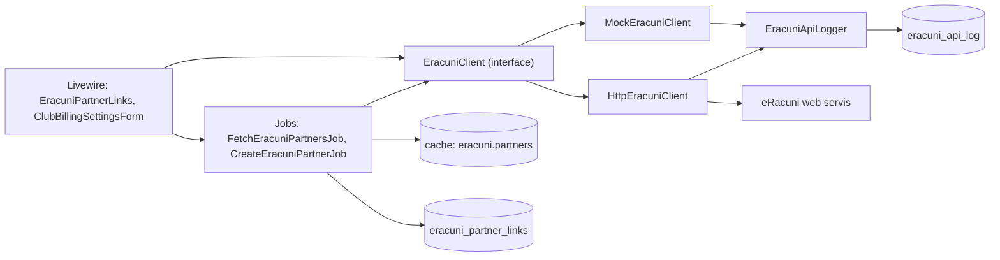
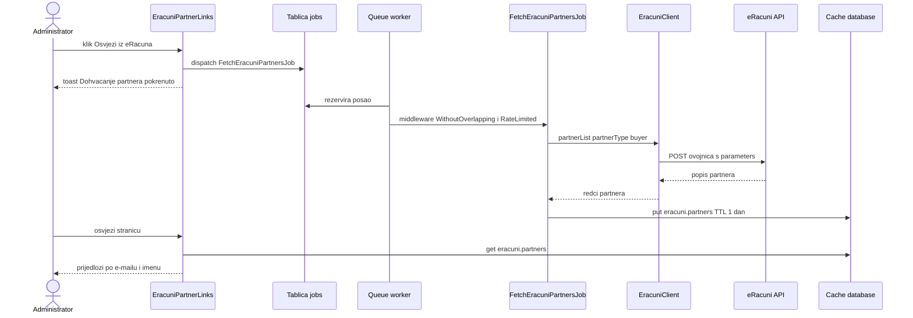
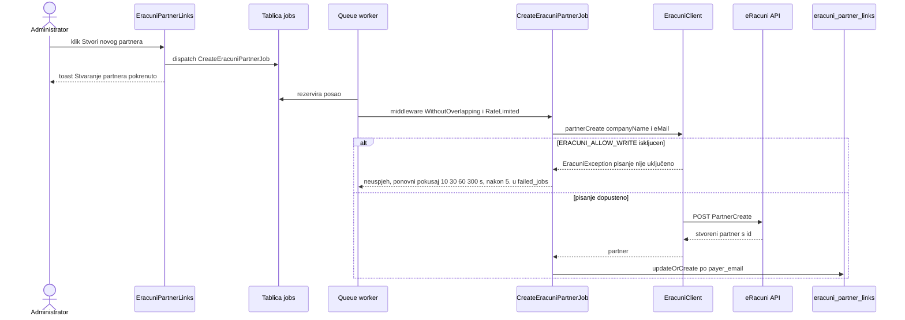
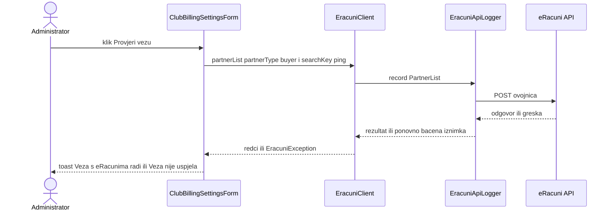

# Integracija s eRačunima

**Izvor istine:** `app/Services/Eracuni/*.php` (9 datoteka), `app/Jobs/FetchEracuniPartnersJob.php`, `app/Jobs/CreateEracuniPartnerJob.php`, `config/eracuni.php`, `app/Providers/AppServiceProvider.php`, `app/Livewire/EracuniPartnerLinks.php`, `app/Livewire/ClubBillingSettingsForm.php`, `app/Models/ClubBillingSettings.php`, `app/Models/EracuniApiLog.php`, `app/Models/EracuniPartnerLink.php`, `config/queue.php`, `tests/Fakes/FakeEracuniClient.php`, `tests/Feature/HttpEracuniClientTest.php`, `tests/Feature/EracuniQueueTest.php`
**Stanje:** feature/clanarine @ 87307b0, 2026-10-20

Dokument opisuje što u kodu postoji od integracije s eRačunima (Eurofaktura), kako radi i, jednako važno, što još nije napravljeno. Tablice u koje integracija piše (`eracuni_api_log`, `eracuni_partner_links`, `jobs`, `failed_jobs`, `cache`) opisane su u [02-baza-podataka.md](02-baza-podataka.md); varijable okoline u [08-konfiguracija.md](08-konfiguracija.md). Cijeli modul je iza zastavice `FEATURE_PAYMENTS`.

## Svrha i podjela odgovornosti

Odluka projekta: **račune izdaje i fiskalizira eRačuni, a Optimist prati uplate**. Zbog toga je HUB-3 uplatnica otkazana: polja `iban`, `model`, `reference_rule` i `purpose_code` u postavkama naplate ostaju u bazi i obrascu pod naslovom „HUB (nekorišteno)” (`app/Livewire/ClubBillingSettingsForm.php:42`), a `BillingReference` s kontrolnom znamenkom nije u upotrebi ([05-domena-i-servisi.md](05-domena-i-servisi.md)). Razlozi odluke nisu zapisani u repozitoriju osim komentara u kodu i migracijama (vidi `docs/sql/2026-10-18-clanarine-U.sql`, „Faza U: usklađivanje s eRačuni smjerom”, i commit `556259a`): [NEJASNO: razlog otkazivanja HUB-3 uplatnice nije zapisan u izvorima, potvrditi s vlasnikom].

| Što | Tko |
| --- | --- |
| Izdavanje i fiskalizacija računa, slanje računa e-poštom | eRačuni (nije implementirano u Optimistu, vidi [Stanje integracije](#stanje-integracije)) |
| Zaduženja (obveze po djetetu i mjesecu) | Optimist (`charges`) |
| Evidencija uplata, raspodjela na zaduženja, storno, otpis | Optimist (`payments`, `payment_allocations`) |
| Povezivanje platitelja (roditelja po e-mailu) s partnerom u eRačunima | Optimist (`eracuni_partner_links`) uz potvrdu administratora |
| Trag svih poziva prema eRačunima | Optimist (`eracuni_api_log`) |

## Pregled komponenti



Koji se klijent veže odlučuje `config('eracuni.driver')`: `AppServiceProvider::register()` registrira `EracuniClient` kao singleton (`app/Providers/AppServiceProvider.php:24`): `'http'` → `HttpEracuniClient`, sve ostalo (uključujući zadano `mock`) → `MockEracuniClient`. Ograničavač brzine `eracuni` definiran je u `boot()` (`:36`).

## Sučelje `EracuniClient`

`App\Services\Eracuni\EracuniClient` (`app/Services/Eracuni/EracuniClient.php:12`). Nazivi metoda preslikavaju metode dokumentiranog JSON API-ja (PartnerList, SalesInvoiceCreate, …). Sve metode mogu baciti `EracuniException` (`final class … extends RuntimeException`).

| Metoda | API metoda | Čita / piše | Povrat | HTTP klijent ju blokira bez `ERACUNI_ALLOW_WRITE` |
| --- | --- | --- | --- | --- |
| `partnerList(array $criteria = []): array` (`:18`) | `PartnerList` | čita | `list<array>` sirovi redci partnera | ne |
| `partnerCreate(array $data): array` (`:24`) | `PartnerCreate` | **piše** | stvoreni partner (mora imati `id`) | da |
| `salesInvoiceCreate(array $data): array` (`:30`) | `SalesInvoiceCreate` | **piše (fiskalizira)** | odgovor s `documentID` | da |
| `salesInvoiceList(array $criteria = []): array` (`:36`) | `SalesInvoiceList` | čita | `list<array>` | ne |
| `salesInvoiceGet(string $documentId): array` (`:39`) | `SalesInvoiceGet` | čita | `array` | ne |
| `salesInvoiceSendByEmail(string $documentId, array $to = []): array` (`:45`) | `SalesInvoiceSendByEmail` | **piše** | `array` | da |

Pomoćni tipovi: `EracuniPartner` (`readonly`, `id`, `name`, `email`, `oib`; `fromArray` preslikava `id`/`partnerCode`, `name`/`companyName`, `eMail`/`email`, `personalID`/`oib`, `app/Services/Eracuni/EracuniPartner.php:23`), `PayerCandidate` (e-mail, ime, OIB koji se ne puni), `MatchProposal` (partner + razlog `email`/`name`; `reasonLabel()` daje „po e-mailu”/„po imenu”).

## `MockEracuniClient`

`app/Services/Eracuni/MockEracuniClient.php:14`. Zadani klijent (`ERACUNI_DRIVER=mock`): ne radi nikakve mrežne pozive i deterministički je.

- Svaka metoda ide kroz isti `EracuniApiLogger` kao i pravi klijent, s punom (lažnom) ovojnicom vjerodajnica, da se redakcija u dnevniku vježba i lokalno (`call()`, `:74`). Ovojnica je **ravna** (`[...credentials, 'method' => …, ...$params]`), za razliku od ugniježđenog `parameters` u pravom klijentu.
- Vjerodajnice su iz `ClubBillingSettings` ako postoje, inače `mock-user`, `mock-secret`, `mock-token` (`:90`).
- `failNext(bool $fail = true): void` (`:19`): sljedeći poziv baca `EracuniException('Mock eRačuni greška (simulacija).')` (jednokratno).
- `partnerList` vraća tri fiksna uzorka partnera s ID-evima `1001`–`1003` (`samplePartners`, `:102`); `partnerCreate` vraća `id` oblika `mock-{10 znakova md5}`; `salesInvoiceCreate` vraća `documentID` oblika `60:{broj}`; `salesInvoiceList` prazan niz; `salesInvoiceGet` status `issued`; `salesInvoiceSendByEmail` `sent = true`.
- U testovima se umjesto njega koristi `tests/Fakes/FakeEracuniClient.php` (bilježi nazive poziva u `$calls`, `$fail = true` baca `EracuniException('Simulirana greška.')`, `$partners` je podesiv).

## `HttpEracuniClient`

`app/Services/Eracuni/HttpEracuniClient.php:21` (`ERACUNI_DRIVER=http`). Samo čitanje po zadanom.

### Ovojnica zahtjeva

Endpoint i vjerodajnice dolaze iz jedinog retka `club_billing_settings` (stupci su šifrirani, vidi [02-baza-podataka.md](02-baza-podataka.md)). `call()` (`:70`) prvo provjerava da su postavljeni korisničko ime, secret key, token i endpoint (inače `EracuniException('eRačuni vjerodajnice nisu potpune …')`, `:74-76`) te da endpoint počinje s `https://` (`:81-83`): vjerodajnice putuju u tijelu zahtjeva, pa nešifriran kanal nije dopušten. Zatim šalje `POST` s JSON tijelom:

```json
{
  "username": "…",
  "secretKey": "…",
  "token": "…",
  "method": "PartnerList",
  "parameters": { "partnerType": "buyer" }
}
```

Argumenti metode idu ugniježđeni pod `parameters` (uvijek objekt: `(object) $parameters`, `:90`), ostalo je na vrhu (`:85-91`). Zaglavlja: `Accept: application/json`, `Content-Type: application/json`, `Accept-Encoding: identity`. Vremensko ograničenje je `config('eracuni.timeout', 60)` sekundi (`:97`).

### Zašto `Accept-Encoding: identity` i `decode_content=false`

eRačuni šalje odgovor s neispravnim zaglavljem `Content-Encoding: 8-bit` koje cURL ne zna dekodirati. Rezultat je cURL greška 61, koja se u aplikaciji pojavila kao prazan HTTP 500. Zato klijent traži nekomprimiran odgovor (`Accept-Encoding: identity`) i isključuje automatsko dekodiranje (`withOptions(['decode_content' => false])`, `:97-102`; komentar u kodu `:95-96`; popravak je u commitu `99301f7`). Ne uklanjati ta dva retka.

### Oblici grešaka

`call()` zamata poziv u `EracuniApiLogger::record`, pa se svaka greška zapiše u `eracuni_api_log` i ponovno baci kao `EracuniException`:

| Situacija | Poruka iznimke | Redak |
| --- | --- | --- |
| nema veze (DNS, TLS, istek vremena) | `eRačuni nije dostupan: {poruka}` | `:103-104` |
| aplikacijska greška: tijelo `{"response":{"status":"error","description":"…"}}`, tipično uz **HTTP 500** | `eRačuni greška: {description}` | `:113-115` |
| ostali ne-2xx odgovor | `eRačuni HTTP {status}: {tekst}`; tekst je tijelo bez HTML oznaka, razmaci sažeti, **najviše 300 znakova**; prazno tijelo daje `eRačuni HTTP {status} (prazan odgovor).` | `:117-122` |
| 2xx koji nije JSON niz | `eRačuni je vratio odgovor koji nije JSON.` | `:124-126` |

Napomena: aplikacijske greške dolaze kao HTTP 500, pa se opis iz tijela uvijek provjerava **prije** statusa. Grana `catch (RequestException)` (`:105`) u praksi je nedostižna jer se `->throw()` ne poziva; odgovor se čita iz `Http::post` neovisno o statusu.

Uspješan odgovor vraća se kao polje. Za liste `rows()` (`:139`) uzima sadržaj ključa `response` ako je to polje (inače cijelo tijelo); ako je to već lista, vraća je, a inače traži ključ `result`, `partners`, `invoices` ili `items`; ako ničega nema, vraća prazan niz. Komentar u kodu kaže da je točan oblik potvrđen u API konzoli, a sirovo tijelo ostaje u dnevniku.

### Zaštita pisanja: `ERACUNI_ALLOW_WRITE`

`assertWriteAllowed` (`:59`) baca `EracuniException("{metoda} je onemogućen: pisanje u eRačune nije uključeno (ERACUNI_ALLOW_WRITE).")` za `PartnerCreate`, `SalesInvoiceCreate` i `SalesInvoiceSendByEmail` dok je `config('eracuni.allow_write')` isključen (zadano `false`, `config/eracuni.php:21`). Razlog (komentar u `config/eracuni.php` i u docblocku klase): fiskalizacija je automatska i nepovratna, a **nema test organizacije**, pa bi svaki probni `SalesInvoiceCreate` stvorio stvaran fiskalizirani račun. Posljedica: s `http` driverom i isključenim pisanjem akcija „Stvori novog partnera” ne može uspjeti (posao `CreateEracuniPartnerJob` pada na svakom pokušaju).

## `EracuniApiLogger`

`app/Services/Eracuni/EracuniApiLogger.php:15`. Jedino mjesto gdje se piše `eracuni_api_log`; prolaze kroz njega i mock i pravi klijent.

- `EracuniApiLogger::record(string $method, array $request, callable $call): mixed` (`:27`): mjeri trajanje (`microtime`), izvrši `$call`, zapiše redak (`ok = 1`) i vrati rezultat; na `Throwable` zapiše redak s `ok = 0` i `error = $e->getMessage()` pa **ponovno baci** iznimku.
- **Redakcija:** iz zahtjeva se brišu ključevi `username`, `secretKey`, `secret_key`, `token`, `md5pass`, `password` (`SECRET_KEYS`, `:18`; `array_diff_key`, `:64`). Redakcija pogađa samo **gornju razinu** ovojnice (dovoljno jer su vjerodajnice na vrhu).
- **Odgovor** se sprema kao JSON skraćen na **2000 znakova** (`mb_substr`, `:52`); dulji odgovori su nepotpuni JSON u `text` stupcu.
- **Samo dodavanje:** nema koda koji bi mijenjao ili brisao retke; model `EracuniApiLog` nema `updated_at` (`app/Models/EracuniApiLog.php:15`). Dnevnik nema ograničenje veličine ni čišćenje.
- **`http_status` se nikad ne postavlja:** `write()` ne prima HTTP status (`:46`), pa je stupac uvijek `NULL`. Status je vidljiv samo u poruci greške.

## `PartnerMatcher`

`PartnerMatcher::propose(PayerCandidate $payer, iterable $partners): ?MatchProposal` (`app/Services/Eracuni/PartnerMatcher.php:20`) predlaže najboljeg partnera za platitelja:

1. **E-mail:** točno podudaranje nakon `trim` i `mb_strtolower` (`:24-31`); razlog `email`.
2. **Ime:** točno podudaranje nakon `Diacritics::normalize` (`:33-40`); razlog `name`. Prazno ime ne uspoređuje.
3. Inače `null`.

Razina po OIB-u namjerno ne postoji jer se OIB roditelja ne sprema (docblock `:9-14`, `eracuni_partner_links.oib` se ne puni). Prijedlog je samo prijedlog: vezu uvijek potvrđuje administrator.

## Redni poslovi

### Zajednička pravila

Oba posla (`App\Jobs\FetchEracuniPartnersJob`, `App\Jobs\CreateEracuniPartnerJob`) implementiraju `ShouldQueue`, koriste `Queueable` i imaju isti raspored pokušaja i ograničenja:

| Svojstvo | Vrijednost | Redak |
| --- | --- | --- |
| `$tries` | 5 | `FetchEracuniPartnersJob.php:22`, `CreateEracuniPartnerJob.php:23` |
| `backoff()` | `[10, 30, 60, 300]` sekundi | `:27`, `:35` |
| `middleware()` | `(new WithoutOverlapping('eracuni'))->releaseAfter(5)`, `new RateLimited('eracuni')` | `:33`, `:41` |

Ograničavač `eracuni`: `Limit::perSecond(1)` (`AppServiceProvider.php:36`), dakle najviše jedan posao u sekundi i, zbog `WithoutOverlapping`, nikad dva istodobno. Razlog: prema dokumentaciji dobavljača (vanjski izvor, nije provjereno u ovom repozitoriju) API dopušta otprilike 1 zahtjev u sekundi po IP adresi uz *burst* do 4 i ne dopušta istodobne zahtjeve za isti API račun. Neuspjeh zbog ograničenja ili preklapanja posao vraća u red (`release`), a svako vraćanje troši pokušaj, jer database driver povećava `attempts` pri svakoj rezervaciji (`vendor/laravel/framework/src/Illuminate/Queue/DatabaseQueue.php:612`). Nakon petog neuspjeha posao ide u `failed_jobs` (`QUEUE_FAILED_DRIVER=database-uuids`).

### `FetchEracuniPartnersJob`

`handle(EracuniClient $client): void` (`:41`): `partnerList(['partnerType' => 'buyer'])`, zatim `Cache::put('eracuni.partners', ['partners' => <sirovi redci>, 'fetched_at' => ISO 8601], now()->addDay())`. Ključ je konstanta `FetchEracuniPartnersJob::CACHE_KEY` (`:24`), vrijeme života 1 dan. Cache je `database` driver (`CACHE_STORE`), tablica `cache`. Čitaju ga `EracuniPartnerLinks::partners()` (`:145`) i `render()` (`:171`).

### `CreateEracuniPartnerJob`

`__construct(string $payerEmail, string $payerName, array $partnerData)`; `handle(EracuniClient $client): void` (`:49`): `partnerCreate($this->partnerData)` pa `EracuniPartnerLink::updateOrCreate(['payer_email' => …], [payer_name, eracuni_partner_id (id ili partnerCode), eracuni_partner_name (companyName, name ili ime platitelja), confirmed_at = now()])`. `linked_by` ovdje ostaje `NULL`. Posao se šalje isključivo nakon izričitog klika administratora („Stvori novog partnera”), nikad automatski. Ako `partnerCreate` baci iznimku, veza se ne zapisuje (`tests/Feature/EracuniPartnerLinksTest.php:104`).

### Red čekanja i praznina u radu

`QUEUE_CONNECTION=database` (`config/queue.php:16`; `.env.example` ga također postavlja): `dispatch()` samo upisuje redak u tablicu `jobs`. Posao se izvršava tek kad netko pokrene radnika (`php artisan queue:work`). Repozitorij ne sadrži ni konfiguraciju radnika ni cron koji bi ga pokretao, a `docs/deploy-cpanel*.md` ne spominju ni `queue:work` ni cron (pretraga). Bez radnika „Osvježi iz eRačuna” i „Stvori novog partnera” izgledaju kao da rade (poruka o pokretanju), ali se ništa ne događa; to je uzrok čekajućih redaka u `jobs`. Lokalno `jobs` trenutno ima 3 retka na čekanju, a `failed_jobs` 9 (samo brojevi, bez sadržaja). U testovima je `QUEUE_CONNECTION=sync` pa se poslovi izvode odmah. `retry_after` je 90 s (`config/queue.php:43`), veći od vremenskog ograničenja HTTP poziva (60 s).

Prijedlog rješenja je izvan opsega ovog dokumenta; vidi [10-deploy-i-operacije.md](10-deploy-i-operacije.md) i [11-poznata-ogranicenja.md](11-poznata-ogranicenja.md).

## Ekrani i tokovi

Ekran „Povezivanje roditelja” (`/clanarine/partneri`, `app/Livewire/EracuniPartnerLinks.php`) i odlomak „eRačuni” na ekranu postavki (`/clanarine/postavke`) dostupni su samo korisnicima s gateom `manage-fee-plans` (samo uloga `admin`, `AppServiceProvider.php:42`); svaka metoda ponovno provjerava gate (`abort_unless`, 403).

| Gumb | Metoda | Učinak |
| --- | --- | --- |
| „Osvježi iz eRačuna” | `EracuniPartnerLinks::refreshPartners()` (`:44`) | `FetchEracuniPartnersJob::dispatch()`, audit `eracuni.partners_fetch_queued`, toast „Dohvaćanje partnera pokrenuto — osvježi za koji trenutak.” |
| „Poveži” | `link(string $email, string $partnerId)` (`:55`) | lokalno `updateOrCreate` u `eracuni_partner_links` (bez poziva API-ja), `linked_by` = ime prijavljenog korisnika, audit `eracuni.partner_linked` |
| „Odbij” | `reject(string $email)` (`:95`) | samo u svojstvu komponente (`$dismissed`), traje do kraja sesije komponente |
| „Stvori novog partnera” | `createPartner(string $email)` (`:105`) | `CreateEracuniPartnerJob::dispatch($email, $ime, ['companyName' => ime, 'eMail' => e-mail])`, audit `eracuni.partner_create_queued` |
| uklanjanje veze | `unlink(int $linkId)` (`:81`) | briše redak veze, audit `eracuni.partner_unlinked` |
| „Provjeri vezu” (postavke) | `ClubBillingSettingsForm::testConnection(EracuniClient $client)` (`:168`) | **sinkrono** (izvan reda): `partnerList(['partnerType' => 'buyer', 'searchKey' => '__optimist_ping__'])`; na `EracuniException` toast „Veza nije uspjela: {poruka}”, inače „Veza s eRačunima radi.” (`http`) odnosno „Veza OK (MOCK klijent — nije pravi poziv).” (`:177`, `:182`) |

Kandidati za povezivanje su platitelji s aktivnom dodjelom tarife u kojoj je `nacin_placanja = racun_email` i postavljen `payer_email` (`candidates()`, `:125`).

### Dijagram: „Osvježi iz eRačuna”



### Dijagram: „Stvori novog partnera”



### Dijagram: „Provjeri vezu”



## Stanje integracije

| Dio | Stanje |
| --- | --- |
| Sučelje `EracuniClient`, mock i HTTP klijent, zapisnik poziva, redakcija | **Postoji** i testirano (`tests/Feature/HttpEracuniClientTest.php`, `EracuniApiLogTest.php`) |
| Dohvat partnera (`PartnerList`), prijedlog po e-mailu/imenu, potvrđivanje veze | **Postoji** |
| Stvaranje partnera (`PartnerCreate`) kao posao u redu | **Postoji**, ali blokirano zaštitom pisanja dok `ERACUNI_ALLOW_WRITE` nije uključen |
| Provjera veze (read-only `PartnerList`) | **Postoji** |
| Izdavanje računa (`SalesInvoiceCreate`), slanje računa e-poštom (`SalesInvoiceSendByEmail`), čitanje računa (`SalesInvoiceGet`/`List`) | **Nije implementirano**: metode klijenta postoje, ali ih nijedan kod aplikacije ne poziva (pretraga po `app/`, `routes/`, `resources/`) |
| Stupci `charges.eracuni_invoice_id`, `eracuni_invoice_number`, `invoice_status`, `last_sent_at` | **Ne koriste se**: nitko ih ne piše; `invoice_status` je uvijek `none` |
| Prijenos uplata u eRačune | **Nije implementirano**; uplate se samo ručno bilježe u Optimistu (`payments.source` je uvijek `manual`) |
| Podsjetnici (`club_billing_settings.reminder_days_after_due`) i predložak stavke računa (`invoice_line_template`) | **Spremaju se, ali se nigdje ne koriste** |
| OIB roditelja, razina `oib` u prijedlozima | **Nije implementirano** (OIB se ne pohranjuje) |
| Raspoređivanje radnika reda (`queue:work`) i cron za raspored | **Nedostaje** u repozitoriju i u deploy dokumentima |

Posebno: `PartnerList` s kriterijem koji ništa ne pogađa (`searchKey = __optimist_ping__`) mogao bi vratiti aplikacijsku grešku umjesto praznog popisa. U lokalnom dnevniku poziva postoje 2 zapisa `Error nr: 1 #noPartnersFound - No partners found for search criteria!`, što upućuje na to da API prazan rezultat prijavljuje kao grešku. Kôd nema posebnu obradu te greške (pretraga `noPartnersFound` u `app/` i `tests/` ne daje pogodak). [NEJASNO: provjeriti prijavljuje li API uvijek `#noPartnersFound` za prazan rezultat; ako da, „Provjeri vezu” dojavljuje neuspjeh iako su vjerodajnice ispravne, a `FetchEracuniPartnersJob` pada za organizaciju bez partnera.]

## Iz iskustva projekta

Ovo nije izvedeno iz koda, nego iz rada na integraciji (stanje na 2026-10-19/20), pa ga treba provjeriti prije oslanjanja:

- Produkcijska organizacija vraćala je „Access denied. User account or the active organization does not have Premium API privileges.” za sve metode, dok su testni pristupni podaci vraćali podatke; računi u toj testnoj organizaciji imaju status `Draft`. Isto potvrđuje lokalni `eracuni_api_log` (23 zapisa s tom porukom, 15 s „Invalid web services token supplied”, 17 s „eRačuni HTTP 500 (prazan odgovor)”, 2 s `#noPartnersFound`; samo tekst grešaka i brojevi).
- Radila su oba endpointa: `https://e-racuni.com/WebServicesHR/API` i drugi `API-CLI` endpoint na istoj domeni (točna putanja nije navedena), oba **bez sufiksa metode** (metoda ide u tijelu zahtjeva, ne u putanji).
- Pristupni podaci se unose isključivo na ekranu postavki naplate; u repozitorij, dokumentaciju ni logove ne smiju ući.
- Opisi ograničenja API-ja (otprilike 1 zahtjev u sekundi po IP-u, *burst* 4, bez istodobnih zahtjeva po API računu) dolaze iz dokumentacije dobavljača i ovdje nisu neovisno provjereni.
