# Optimist — upute za trenere

Karate klub Optimist · verzija listopad 2026.

## Kako koristiti ove upute

Ove upute su za trenere koji svaki tjedan koriste Optimist: evidenciju polaznika, natjecanja i (kad se uključe) članarine. Ne trebaš ništa znati o računalima, dovoljno je da znaš prijaviti se.

Upute su složene tako da ih ne moraš čitati od početka do kraja:

- **1. Prvih 15 minuta** — ako si prvi put u aplikaciji, prođi ovo korak po korak.
- **2. Kako da…** — kratki zadaci: pronađi dijete, dodaj polaznika, napravi popis za natjecanje. Traži zadatak koji ti treba.
- **3. Pregled oznaka** — što znače boje, oznake i stupci u Excelu.
- **4. Zašto je tako** — kratko objašnjenje kako aplikacija povezuje grupe i termine.
- **5. Članarine** — što će aplikacija moći kad se članarine uključe. **Još nije u funkciji.**
- **6. Problemi i pitanja** — brzi odgovori kad nešto ne ide.

Nazivi gumba i polja u uputama pišu se u navodnicima, točno onako kako ih vidiš u aplikaciji, npr. „Novi polaznik".

**Ako zapneš:** javi se Odinu Perici (administrator). Isto vrijedi ako zaboraviš lozinku, jer je u aplikaciji ne možeš sam promijeniti.

---

## 1. Prvih 15 minuta

### 1.1 Prijava

Otvori adresu aplikacije u pregledniku. Upiši „E-mail" i „Lozinka", pa klikni „Prijava". Ako želiš da te aplikacija zapamti na tom uređaju, označi „Zapamti me".

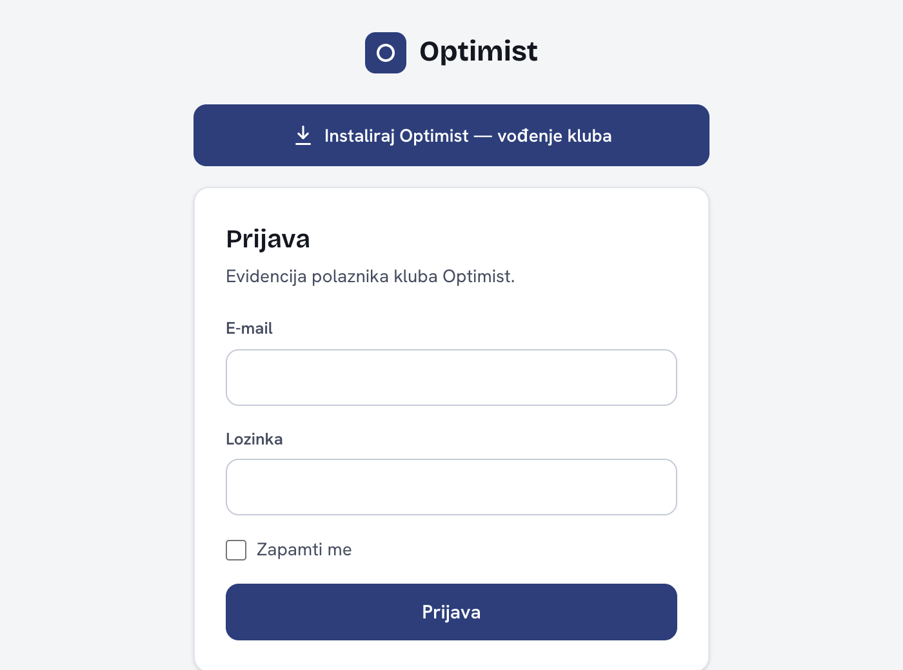

Ako vidiš „Podaci za prijavu nisu točni.", provjeri e-mail i lozinku. Nakon 5 neuspjelih pokušaja zaredom aplikacija te na kratko blokira („Previše pokušaja prijave."). U poruci piše koliko sekundi treba pričekati (najviše oko minute).

Kad se prijaviš, otvara se popis polaznika.

### 1.2 Instalacija na mobitel (neobavezno)

Na Android mobitelu s Chromeom iznad prijave se može pojaviti gumb „Instaliraj Optimist — vođenje kluba". Ako ga klikneš, aplikacija se dodaje na početni zaslon kao obična aplikacija. Ako gumba nema, ništa nije krivo: na iPhoneu ili u drugim preglednicima se ne prikazuje.

### 1.3 Izbornik

Na računalu je izbornik s lijeve strane:

- „Polaznici" — popis i kartice djece
- „Natjecanja" — natjecanja i rezultati
- „Popisi za natjecanje" — tko ide na koje natjecanje
- „Kata timovi" — timovi za kata

Na mobitelu i uskom prozoru izbornik se otvara gumbom s tri crte u gornjem kutu. Na dnu izbornika je „Odjava".

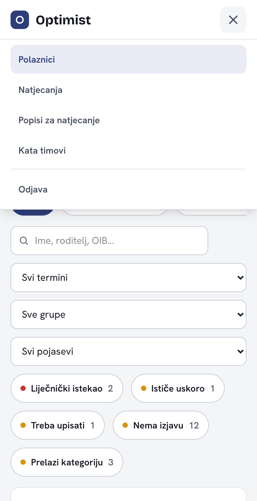

Stavke „Članarine", „Partneri" i „Postavke" vide samo administratori i samo kad su članarine uključene (vidi poglavlje 5).

### 1.4 Popis polaznika

Popis polaznika je glavni ekran. Svaki red je jedno dijete, sortirano po prezimenu i imenu.

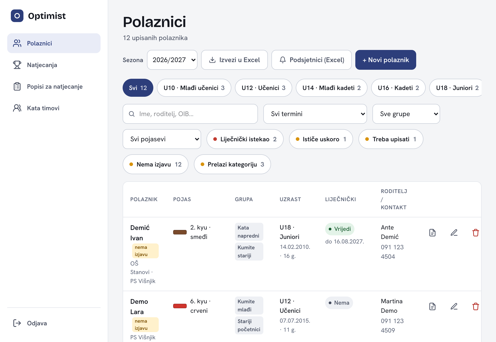

Što vidiš u redu:

- **Polaznik** — prezime i ime (klikni na njega za uređivanje), uz njega male oznake: tim za kata, „nema izjavu" ili zelena kvačica ako je izjava učitana. Ispod imena su mjesta gdje dijete trenira.
- **Pojas** s bojom, i ispod njega „Treba upisati" ili „Upisan" ako je dijete na redu za viši pojas.
- **Grupa** — grupe u kojima je dijete (može ih biti više).
- **Uzrast** — uzrasna kategorija, datum rođenja i godine.
- **Liječnički** — status liječničkog pregleda u boji.
- **Roditelj / kontakt** — ime i broj mobitela.
- Tri ikone: izvješće (PDF), uredi (olovka) i obriši (kanta).

Na mobitelu je svaki red kartica s imenom, pojasom, uzrastom i liječničkim statusom. Grupe i kontakt vidiš kad otvoriš dijete.

### 1.5 Pronađi dijete

U polje za pretragu („Ime, roditelj, OIB…") upiši dio imena, prezimena ili roditelja. Ne moraš paziti na velika slova ni na č, ć, š, ž, đ: upisano Coric pronalazi i prezime koje počinje slovom Č.

### 1.6 Dodaj prvog polaznika

1. Klikni „+ Novi polaznik". S desne strane otvara se obrazac.
2. Upiši „Prezime *" i „Ime *". Zvjezdica znači da je polje obavezno.
3. Po želji dodaj datum rođenja, pojas, grupe i podatke o roditelju.
4. Klikni „Dodaj polaznika". Na dnu ekrana kratko se pojavi poruka koja počinje s „Spremljeno:".

Ako nešto nije ispravno, ispod polja se pojavi crvena poruka (npr. „Obavezno polje") i na dnu obrasca „Provjeri označena polja". Ispravi označeno polje i ponovno spremi.

---

## 2. Kako da…

### 2.1 Pronaći djecu (filteri)

Filteri se mogu kombinirati. Što god odabereš, popis se odmah prilagodi, a pod naslovom piše koliko je djece prikazano od ukupnog broja.

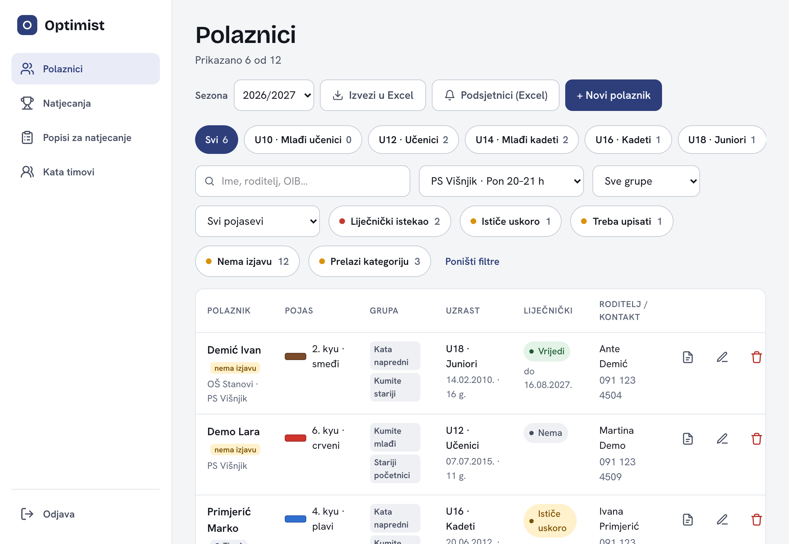

- **Uzrasni čipovi** pri vrhu („U10 · Mlađi učenici", „U12 · Učenici"…) prikazuju samo tu kategoriju. Klikni ponovno da ga isključiš. „Svi" prikazuje sve.
- „Svi termini" — odaberi termin (npr. PS Višnjik · Pon 20–21 h) i vidiš tko dolazi na taj trening.
- „Sve grupe" — djeca u odabranoj grupi.
- „Svi pojasevi" — djeca s odabranim pojasom.
- Čipovi s crvenom ili žutom točkom pokazuju što treba pažnju: „Liječnički istekao", „Ističe uskoro", „Treba upisati", „Nema izjavu", „Prelazi kategoriju". Broj pokraj čipa je broj djece u cijelom klubu.
- „Poništi filtre" briše sve filtere odjednom. Pojavi se čim je neki filter uključen.

Ako nema nikoga za odabrane filtere, vidiš „Nema polaznika za zadane filtre". Makni neki filter ili klikni „Poništi filtre".

### 2.2 Dodati ili urediti polaznika i dodijeliti grupe

Za novog polaznika klikni „+ Novi polaznik". Za postojećeg klikni na ime ili na olovku. Obrazac ima nekoliko dijelova:

- „Osobni podaci": „Prezime *", „Ime *", „Datum rođenja", „OIB". Uzrastna kategorija se izračuna sama iz datuma rođenja, ne unosi se ručno.
- „Karate": „Pojas", „Grupe", „Upis sljedećeg stupnja", „Kata timovi".
- „Liječnički pregled": „Vrijedi do" i „Nema liječnički pregled".
- „Roditelj / kontakt": „Roditelj / skrbnik", „Mobitel", „E-mail".
- „Ostalo": „Napomena" i oznaka **t** (vidi poglavlje 3).

Dijelovi „Natjecanja i rezultati", „Izjava roditelja" i (kad su članarine uključene) „Članarina" pojavljuju se tek kad polaznik već postoji: prvo ga spremi, pa ga ponovno otvori.

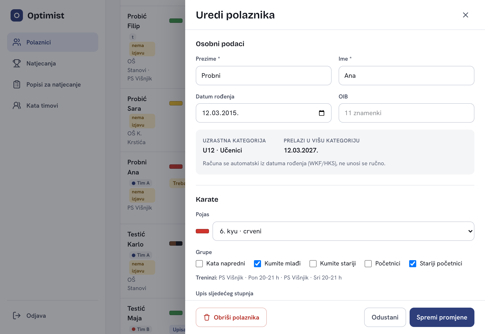

**Grupe.** Dijete može biti u više grupa: označi koliko treba. Čim označiš grupu, ispod piše „Treninzi:" i popis termina na kojima će dijete trenirati. Termini se ne unose posebno, izvode se iz grupa (poglavlje 4). Ako ne označiš nijednu grupu, dijete nema termin.

Klikni „Spremi promjene" za spremanje ili „Odustani" za zatvaranje bez spremanja.

### 2.3 Provjeriti liječničke preglede i izvesti podsjetnike (Excel)

U obrascu polaznika, u dijelu „Liječnički pregled", upiši datum u „Vrijedi do". Aplikacija sama izračuna status (Vrijedi, Ističe uskoro, Istekao, Nepoznato ili Nema):

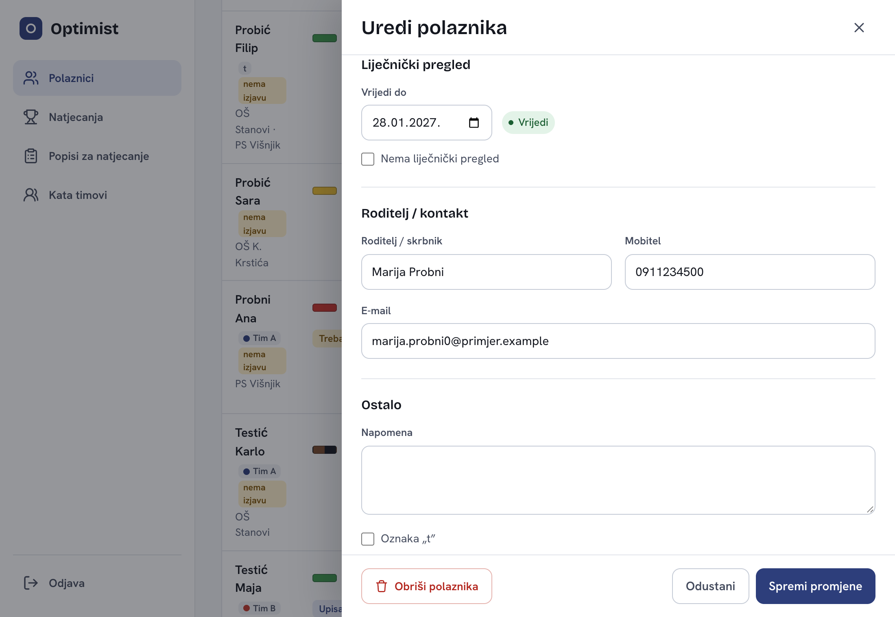

Boje i značenja statusa su u poglavlju 3, u dijelu Liječnički status.

Za popis djece kojoj treba novi pregled: po želji postavi filtere, pa klikni **„Podsjetnici (Excel)"**. Dobiješ Excel s djecom čiji je pregled istekao, ističe uskoro ili nije upisan, poredanom po hitnosti, s imenom roditelja i brojem telefona. Excel poštuje trenutne filtere, pa možeš npr. izvesti samo jedan termin.

Za brzi pregled bez Excela klikni čip „Liječnički istekao" ili „Ističe uskoro".

### 2.4 Učitati izjavu roditelja

1. Klikni na dijete da otvoriš obrazac, pa pomakni se do dijela „Izjava roditelja". (Za novog polaznika prvo ga spremi, pa ga ponovno otvori.)
2. Ispod natpisa „Učitaj izjavu" (u zagradi piše PDF ili slika, najviše 10 MB) klikni gumb za odabir datoteke (preglednik ga piše na svom jeziku, npr. Choose File) i odaberi datoteku. Dopušteni su PDF, JPG i PNG. Ako izjava već postoji, natpis glasi „Zamijeni izjavu".
3. Datoteka se sprema sama čim je odabereš; pričekaj da nestane „Spremam…".

Učitanu izjavu otvaraš gumbom „Pregledaj". Ako učitaš novu, stara se zamjenjuje. Kanta pokraj izjave je uklanja **bez dodatnog pitanja**.

U popisu zelena kvačica znači da je izjava učitana, a žuta oznaka „nema izjavu" da nije. Čip „Nema izjavu" izdvaja djecu bez izjave.

### 2.5 Označiti tko treba upisati viši pojas

U obrascu polaznika, u dijelu „Karate", u „Upis sljedećeg stupnja" odaberi jedno:

- „Nije potrebno" — nema promjene,
- „Treba upisati" — dijete je spremno za viši pojas,
- „Već upisan" — dijete je upisano; odaberi „Upisan na" koji stupanj.

Čip „Treba upisati" na popisu tada pokazuje sve koje treba upisati, a u njihovom redu vidiš žutu oznaku „Treba upisati".

### 2.6 Unijeti natjecanje i rezultate, izraditi PDF izvješće

**Natjecanje** se unosi jednom, na stranici „Natjecanja": klikni „+ Novo natjecanje", upiši „Naziv *", „Datum *" i po želji „Grad / mjesto", pa „Dodaj natjecanje".

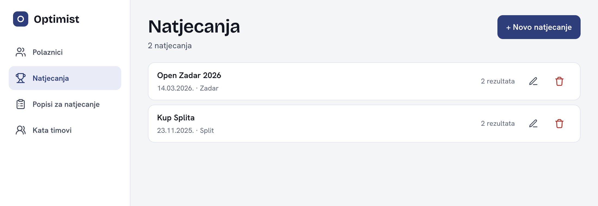

**Rezultat** se upisuje djetetu: otvori dijete, pomakni se do dijela „Natjecanja i rezultati" (natjecanje prvo mora postojati na stranici „Natjecanja"), ispuni „Natjecanje *", „Disciplina *" (Kate, Kumite ili Kata team), „Kategorija", „Plasman (mjesto)", „Pobjede", „Porazi" i „Broj borbi", pa klikni „Dodaj rezultat". Medalja se određuje sama iz plasmana: 1. mjesto je zlato, 2. srebro, 3. bronca.

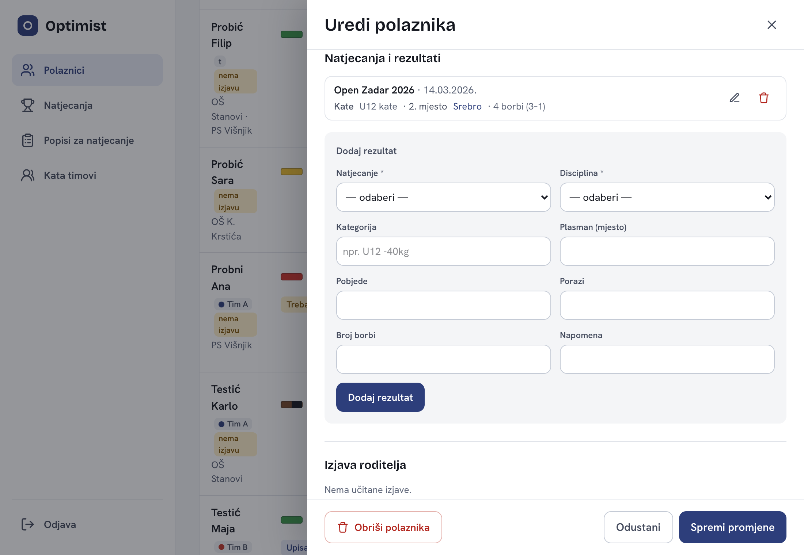

**Izvješće za roditelje.** Na kraju sezone svakom djetetu možeš izraditi PDF izvješće o natjecanjima. Na popisu polaznika odaberi sezonu u „Sezona" (sezona traje od 1. rujna do 1. srpnja), pa u redu djeteta klikni ikonu „Izvješće (PDF)". U izvješću su zbroj natjecanja i medalja te tablica rezultata po disciplinama.

### 2.7 Napraviti popis za natjecanje i izvesti ga u Excel

Popis za natjecanje je tvoj radni popis: tko ide na koje natjecanje i u kojoj disciplini. Ne ovisi o stranici „Natjecanja" i rezultatima.

1. Otvori „Popisi za natjecanje" i klikni „+ Novi popis". Upiši „Naziv *" (bilo koje ime, npr. Državno prvenstvo 2026) i po želji „Datum natjecanja". Klikni „Dodaj popis".
2. Klikni na popis da ga otvoriš.

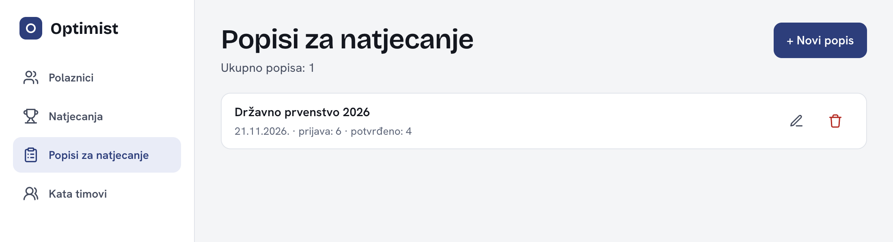

Djecu dodaješ na dva načina:

- **„Dodaj dijete"** — upiši ime i klikni „Dodaj" uz dijete.
- **„Brzo dodavanje po grupi ili uzrastu"** — odaberi grupu ili uzrast i klikni „Dodaj sve". Dodaju se samo djeca koja još nisu na popisu.

Za svako dijete u redu možeš odabrati „Disciplina", upisati „Kategorija" i „Napomena" te označiti „Potvrđeno". Promjene se spremaju odmah. Ako dijete ide u dvije discipline, klikni „+ disciplina": dobije novi redak s drugom disciplinom.

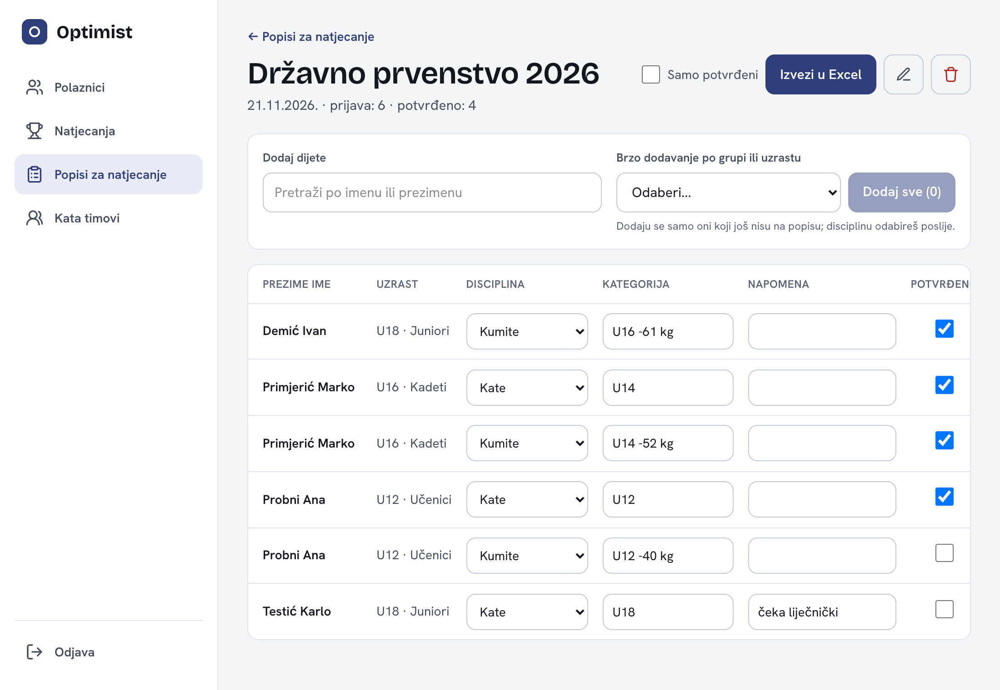

**Excel.** Klikni „Izvezi u Excel". Napomena i kategorija idu u Excel doslovno, pa u njih ne upisuj zdravstvene ni druge osobne podatke. Dobiješ jedan redak po djetetu; ako je dijete u dvije discipline, piše „Kate/Kumite". Ako uključiš „Samo potvrđeni", u Excelu su samo djeca koja imaju kvačicu „Potvrđeno". Uzrasna kategorija u Excelu računa se na dan natjecanja, ako si ga upisao.

Popis brišeš ikonom kante na popisu. Pitat će te „Obrisati popis?" i to se **ne može poništiti**. Polaznici ostaju u aplikaciji.

### 2.8 Kata timovi

Kata timovi su oznake djece koja zajedno nastupaju u kata. Dijete može biti u više timova i u isto vrijeme u svojoj grupi.

1. Otvori „Kata timovi" i klikni „+ Novi tim". Upiši „Naziv tima *", odaberi „Boja oznake" i klikni „Dodaj tim".
2. Djecu u tim dodaješ u obrascu polaznika, u dijelu „Karate", kvačicom ispod „Kata timovi".

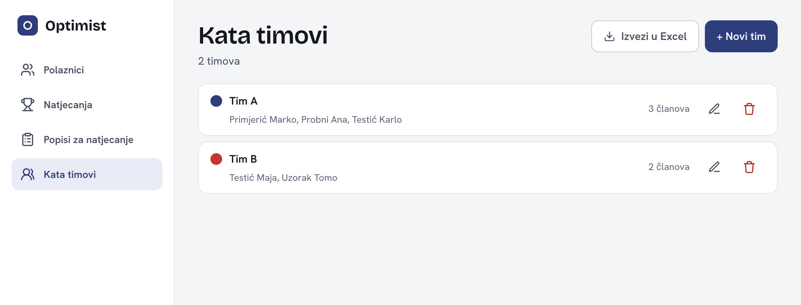

Na popisu polaznika uz ime djeteta stoji obojena oznaka tima, pa odmah vidiš tko je u istom timu. Gumb „Izvezi u Excel" izvozi samo timove s najmanje 3 člana, svaki tim u svom bloku u boji tima.

### 2.9 Izvesti popis polaznika (po terminu)

Klikni „Izvezi u Excel" na popisu polaznika. Izvozi se ono što je trenutno prikazano, pa:

- za **sve** djecu: makni sve filtere („Poništi filtre") i izvezi,
- za **jedan termin**: odaberi termin u „Svi termini" i izvezi. Naslov i ime datoteke tada nose naziv termina.

Excel ima stupce Prezime, Ime, Datum rođenja, Uzrasna kategorija i Pojas. Namjerno nema OIB-a ni zdravstvenih podataka pa ga možeš slati organizatorima.

### 2.10 Obrisati polaznika (i poništiti)

Klikni kantu u redu djeteta ili „Obriši polaznika" u obrascu. Pojavit će se „Obrisati polaznika?". Klikni „Da, obriši".

Odmah nakon brisanja, na dnu ekrana, 7 sekundi stoji poruka s gumbom **„Poništi"**. Ako si pogriješio, klikni ga i dijete se vraća. Kad poruka nestane, tražiš administratora da vrati dijete.

> **Što se ne može poništiti.** Pazi na ove radnje jer nemaju povratak:
>
> - brisanje natjecanja (briše i sve rezultate uz njega), brisanje popisa za natjecanje i brisanje kata tima (pitaju te za potvrdu, ali se ne mogu poništiti),
> - brisanje rezultata natjecanja (nema dodatnog pitanja),
> - uklanjanje izjave roditelja (nema pitanja),
> - uklanjanje djeteta s popisa za natjecanje (nema pitanja, ali ga možeš ponovno dodati),
> - kad se članarine uključe: uklanjanje članarine djetetu i storniranje uplate (nema pitanja).

---

## 3. Pregled oznaka

### Oznake u popisu polaznika

| Oznaka | Značenje |
|---|---|
| **t** (siva) | Dijete plaća gotovinom na treningu i za njega se ne izdaje račun. |
| obojeni krug i naziv tima | Kata tim u kojem je dijete. |
| zelena kvačica | Izjava roditelja je učitana. |
| „nema izjavu" (žuto) | Izjava nije učitana. |
| ↑ i tekst o broju mjeseci i dana (žuto) | Dijete u idućih 6 mjeseci prelazi u višu uzrasnu kategoriju. |
| „(bez grupe)" (sivo, kurziv) | Dijete nema grupu, a ima staru lokaciju. Dodaj mu grupu da dobije termin. |
| čip „Nedostaje način plaćanja" | Samo kad su članarine uključene: izdvaja djecu s tarifom bez načina plaćanja (poglavlje 5). |

### Liječnički status

| Status | Boja | Značenje |
|---|---|---|
| Vrijedi | zelena | vrijedi još više od 30 dana |
| Ističe uskoro | žuta | ističe unutar 30 dana |
| Istekao | crvena | datum je prošao |
| Nepoznato | siva | datum nije upisan |
| Nema | siva | označeno „Nema liječnički pregled" |

### Uzrasne kategorije

Ispod U8 · U08 Cicibani · U10 Mlađi učenici · U12 Učenici · U14 Mlađi kadeti · U16 Kadeti · U18 Juniori · U21 · Seniori. Računaju se iz datuma rođenja.

### Pojasevi

9. kyu bijeložuti · 8. kyu žuti · 7. kyu narančasti · 6. kyu crveni · 5. kyu zeleni · 4. kyu plavi · 3. kyu ljubičasti · 2. kyu smeđi · 1. kyu smeđe crni · Bez pojasa. „Nije uneseno" znači da pojas nije upisan.

### Što je u kojem Excelu

| Gdje | Stupci |
|---|---|
| Popis polaznika („Izvezi u Excel") | Prezime, Ime, Datum rođenja, Uzrasna kategorija, Pojas |
| „Podsjetnici (Excel)" | Prezime, Ime, Lokacija, Vrijedi do, Status, Rok, Roditelj, Telefon |
| Popis za natjecanje | Prezime, Ime, Datum rođenja, Uzrasna kategorija, Pojas, Disciplina, Kategorija, Napomena, Potvrđeno |
| Kata timovi | Prezime, Ime, Datum rođenja, Uzrasna kategorija (po timu, samo timovi s 3+ člana) |

### Grupe i termini

| Termin | Grupe koje treniraju |
|---|---|
| OŠ K. Krstića · Uto/Čet 17–18 h | Početnici |
| OŠ Stanovi · Uto/Čet 20–21 h | Kata napredni, Kumite stariji |
| PS Višnjik · Pon 20–21 h | Stariji početnici, Kumite stariji |
| PS Višnjik · Sri 20–21 h | Stariji početnici, Kumite mlađi |

---

## 4. Zašto je tako

**Zašto dijete nema lokaciju, nego grupe?** Prije je svako dijete imalo jednu grupu i jednu lokaciju, a u stvarnosti dijete često trenira u dvije ili tri grupe i na više mjesta. Zato sada samo označiš grupe u kojima je dijete. Aplikacija iz toga sama izračuna gdje i kada dijete trenira, jer je svaki termin vezan uz grupe koje u njemu treniraju. Primjer: dijete u „Početnici" i „Kumite stariji" trenira u OŠ K. Krstića, OŠ Stanovi i PS Višnjik (ponedjeljkom), bez ikakvog dodatnog unosa. Zato je filter „Svi termini" točan i bez posebnog unosa termina.

**Zašto se uzrast i liječnički status ne unose ručno?** Aplikacija ih računa svaki put iz datuma rođenja i datuma liječničkog pregleda. Tako nikad ne zastare i ne moraš ih ažurirati. Isto vrijedi za medalju, koja se izvodi iz plasmana.

**Što je sezona?** Za izvješća o natjecanjima sezona traje od 1. rujna do 1. srpnja iduće godine, jer ljeti nema treninga ni natjecanja. Natjecanje u srpnju ili kolovozu ne pripada nijednoj sezoni.

**Zašto je Excel s popisa polaznika bez OIB-a?** Ne sadrži OIB ni zdravstvene podatke, da ga smiješ poslati organizatoru. Excel popisa za natjecanje ima i tvoju „Napomena" i „Kategorija", pa u njih ne upisuj osjetljive podatke.

---

## 5. Članarine

> **Još nije u funkciji.** Ovaj dio opisuje što će članarine moći kad se uključe. Neki dijelovi već postoje u aplikaciji, ali **izdavanje i slanje računa putem eRačuna još ne radi**. Kad se članarine uključe, uputa će se ažurirati.

Članarine služe za praćenje tko je platio treninge: tarife, dodjela tarife djetetu, mjesečna zaduženja i uplate. Kad se članarine uključe, aplikacija će 1. u mjesecu sama stvarati zaduženje za svako dijete s mjesečnom tarifom, i to u mjesecima naplate koje odredi administrator. Aplikacija vodi tko je platio, a račune izdaje eRačuni (planirano).

### Tko što smije

| Radnja | Administrator | Blagajnik | Trener |
|---|---|---|---|
| Tarife, „Partneri", „Postavke" | da | ne | ne |
| Dodijeliti tarifu djetetu, dodati zaduženje | da | ne | da |
| Evidentirati uplatu, otpisati, stornirati | da | da | ne |

Trenutno su svi korisnici treneri. Uloge administrator i blagajnik dodjeljuje Odin Perica kad se članarine uključe.

### Tarife i dodjela djetetu

Administrator na stranici „Članarine" (naslov „Tarife članarine") klikne „+ Nova tarifa" i unese „Naziv *", „Iznos (EUR) *", „Vrsta *" (Mjesečno, Godišnje ili Jednokratno) i „Aktivna".

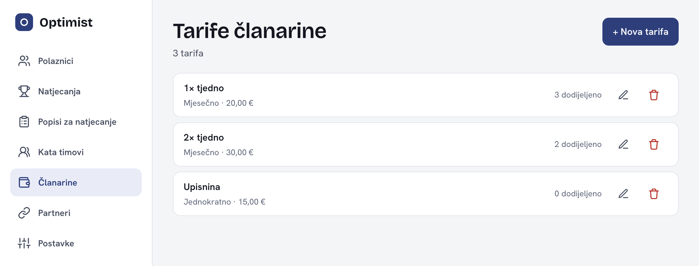

Tarifu djetetu dodijeliš u obrascu polaznika, u dijelu „Članarina": odaberi „Tarifa *", po želji „Popust", **„Način plaćanja"**, „E-mail platitelja", „Platitelj (ime)", „Vrijedi od *" i „Vrijedi do", pa klikni „Dodaj". Dijete može imati najviše jednu mjesečnu tarifu u istom razdoblju.

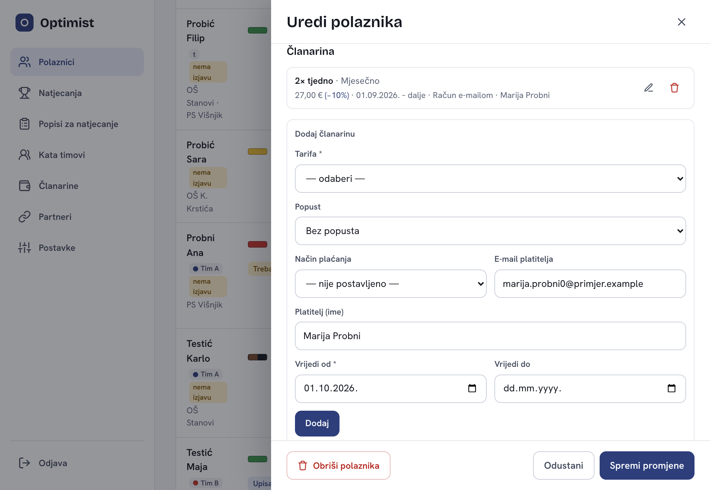

**Način plaćanja** je važan jer određuje što se događa s računom:

- „Račun e-mailom" — račun će se slati na „E-mail platitelja" (obavezan za taj način).
- „Gotovina" — dijete plaća na treningu i račun se ne izdaje. Znači isto što i oznaka **t**, ali aplikacija ih ne povezuje sama: kad postaviš „Gotovina", označi i oznaku **t** u dijelu „Ostalo" obrasca polaznika (i obrnuto). Uplatu ručno evidentira administrator ili blagajnik („Plaćeno gotovinom").

Ako dijete ima tarifu bez načina plaćanja, uz tarifu stoji žuta oznaka „Nedostaje način plaćanja", a isto se vidi i u čipu „Nedostaje način plaćanja" na popisu polaznika. Postavi način plaćanja da ne zaboraviš nikoga.

### Zaduženja i uplate

U obrascu polaznika, ispod tarife, u dijelu „Zaduženja" vidiš zaduženja po mjesecima i status svakog:

| Status | Značenje |
|---|---|
| Neplaćeno | još ništa nije uplaćeno |
| Djelomično | uplaćen je dio iznosa |
| Kasni | rok je prošao, a nešto je još neplaćeno |
| Plaćeno | uplaćeno u cijelosti |
| Otpisano | otpisano s razlogom |

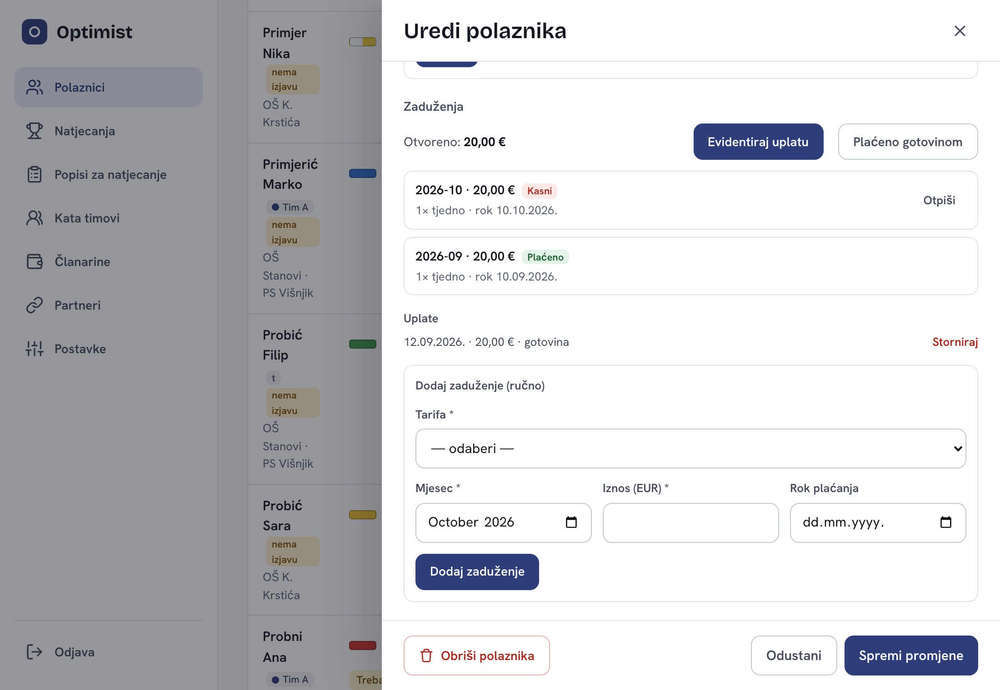

Uplate, otpis i storno rade administrator i blagajnik; trener ove gumbe ne vidi, a slike u ovom poglavlju prikazuju ekran administratora. Uplata se evidentira gumbom **„Evidentiraj uplatu"** (obrazac „Nova uplata"): upiše se iznos, odabere „Način *" („Transakcijski račun", „Gotovina" ili „Ostalo"), „Datum *" i, za gotovinu, „Primio gotovinu *". Pod „Rasporedi na (najstarije prvo):" može se odabrati na koja zaduženja ide uplata. Na kraju se klikne „Spremi uplatu". Za gotovinu je brži gumb **„Plaćeno gotovinom"**: otvara isti obrazac s već odabranom gotovinom, cijelim otvorenim iznosom i imenom prijavljene osobe u „Primio gotovinu *", pa i tu treba kliknuti „Spremi uplatu".

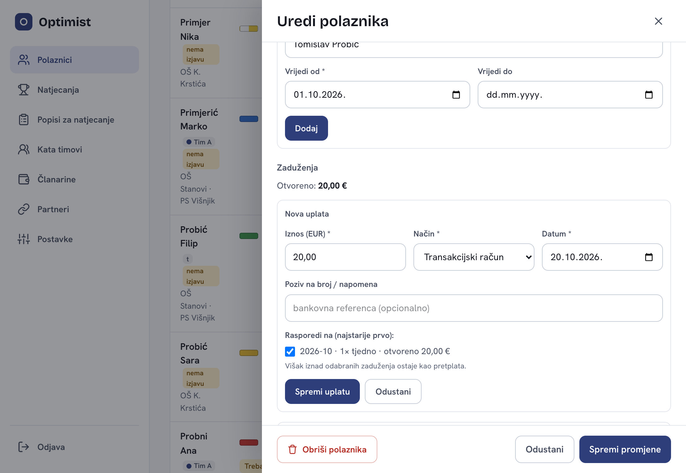

Zaduženje koje se neće naplatiti zatvara se klikom na „Otpiši", uz obavezan razlog. „Storniraj" poništava pogrešno evidentiranu uplatu: u povijesti ostaje trag, ali **bez dodatnog pitanja**.

### Što još ne radi

- **Izdavanje i slanje računa** putem eRačuna: planirano, još nije uključeno.
- **Podsjetnici** za neplaćene članarine: planirano.
- Iznosi tarifa i postavke naplate tek se unose.

---

## 6. Problemi i pitanja

**Ne mogu se prijaviti, a lozinku sam zaboravio.** U aplikaciji nema opcije za zaboravljenu lozinku. Javi se Odinu Perici, administratoru, koji ti postavlja novu.

**Pretraga ne nalazi dijete.** Provjeri jesu li uključeni neki filteri (klikni „Poništi filtre"). Pretraga traži po imenu, prezimenu, roditelju, e-mailu, telefonu i OIB-u, i ne moraš paziti na velika slova ni na č, ć, š, ž, đ.

**Excel se ne preuzima.** Provjeri dopušta li preglednik preuzimanja. Ako je popis prazan, poruka će reći „Nema prijava za izvoz." (popis za natjecanje) ili „Nema timova s 3+ člana za izvoz." (kata timovi).

**Slučajno sam obrisao dijete.** Odmah klikni „Poništi" u poruci na dnu ekrana (ima 7 sekundi). Poslije toga se javi administratoru.

**Ne vidim „Članarine" u izborniku.** Članarine još nisu uključene, a vide ih samo administratori.

**Dijete nema termin, a ima lokaciju sivom kurzivom.** To je stara lokacija iz vremena kad se nisu unosile grupe. Dodaj djetetu grupu u obrascu polaznika i termin će se pojaviti sam.
